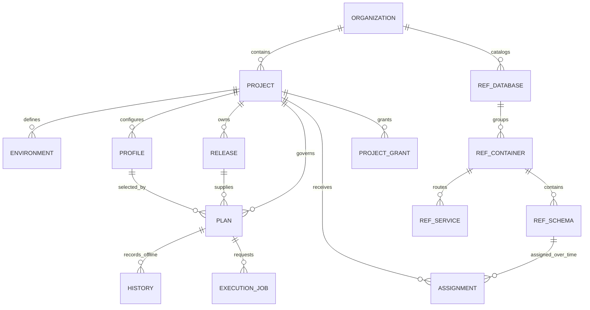
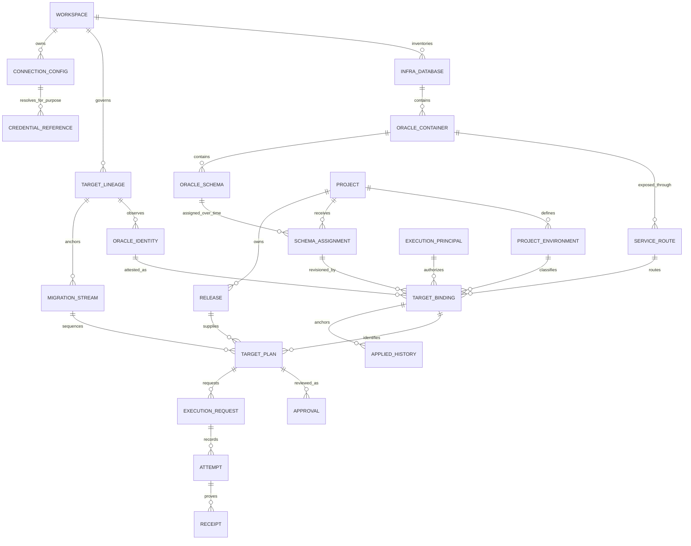
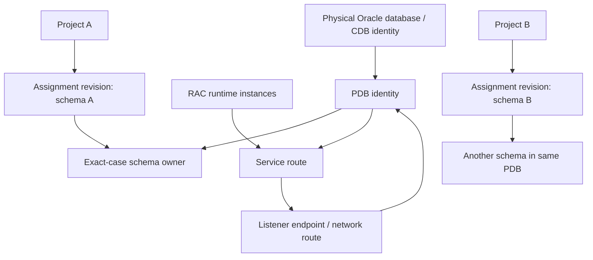

# Kelryvo Architecture Decisions

**Status:** Final planning baseline, 2026-10-12. **Scope:** Oracle-first Kelryvo / SchemaForge architecture, current product implementation, immutable research inputs, and the retained FR/AS requirement summaries. Planning only: no application code, schema, API, Oracle target, deployment, or data was changed. The original standalone `FUNCTIONAL_SPECIFICATION.md` and Google Stitch source mockups are not present in this checkout; the product requirements document records this traceability limit and preserves the existing FR/AS identifiers.

## Decision summary

Kelryvo should keep project workflow ownership and Oracle estate ownership separate. Projects own migration source, review, release, and workflow history. The organization owns the physical database inventory, connection routes, and credential references. Projects receive explicit, revisioned assignments to Oracle schemas. A PDB or database may therefore host schemas assigned to multiple projects; a schema has one active owning project in the initial model.

This matches the strongest existing implementation: a fixed local organization, project-scoped releases and approval workflow, and an operator-managed organization-level reference catalog whose schema assignments are single-owner and auditable. It avoids treating a project-specific profile or an operator-entered reference as proof of a live Oracle target.

## Reconciled decisions

| Topic | Decision for initial Kelryvo | Alternatives considered | Rationale and tradeoffs |
|---|---|---|---|
| Organization and workspace | Retain one server-owned organization/workspace. Workspace is the owner of infrastructure inventory and local operator authority. | Multi-tenant organizations now; a workspace per project. | The running model, identity, operator recovery, and catalog are single-organization. Multi-tenancy would multiply every ownership and authorization boundary before the Oracle target contract is proven. This limits deployment scale for now. |
| Instance ownership | Oracle infrastructure is workspace-owned. Do not introduce project-owned instances in the first target-binding model. | Project-owned instances; dual workspace/project scope. | A shared physical estate commonly hosts separate application schemas. Dual scope creates unclear lifecycle, credential, and uniqueness rules. Workspace ownership offers one inventory and permits project views derived from assignments. |
| Database, container, service, and schema | Model distinct physical database/CDB, PDB or non-CDB container, service/endpoint route, and exact-case schema owner. A service is a connection route to a container, not the owner of a migration stream. Runtime RAC instances are observations of the database service/target, not independent migration targets. | One generic “instance” record; service as target identity; each RAC node as a target. | The existing reference catalog already separates database, container, service, and schema. The extra distinctions prevent routing changes and RAC node changes from silently changing logical target identity. The current manually declared IDs remain provisional. |
| Project membership | Assign a schema to exactly one project at a time. A physical database/PDB may contain schemas from many projects. Reject overlapping active assignment to the same schema. | Database-level project assignment; shared schema membership; project-level whole-PDB ownership. | Schema ownership maps to least privilege and migration history. Existing catalog enforces one active assignment per schema and records transfer/release. Shared schema ownership would need joint approval, shared serialization, and conflict policy; defer it. |
| Project views of the estate | Show a project only its currently assigned schemas and derive database/container/service context from those assignments. Keep global inventory stewardship on the trusted local operator CLI; a global browser view is deferred until the same authority can be authenticated safely. | Copy physical instance records into every project; infer a database membership from profiles; expose workspace inventory to all project users. | Derived views avoid duplicated mutable infrastructure facts. A connection profile alone is not evidence of assignment. |
| Connection profiles and credentials | Treat connection configuration as workspace infrastructure configuration, with purpose-specific references for catalog/read, query, and deployment identities when those capabilities are approved. Keep secrets in an external/local secret provider; store opaque references only. | Keep current project/environment profiles as authoritative target; one credential for all purposes. | Current `sf_profiles` are project/environment-scoped endpoint and username snapshots, with an opaque `credential_ref`; there is no resolver or Oracle connection. Preserve them as legacy workflow snapshots during migration. All project members currently receive the opaque reference in project detail, so narrow that field to the roles that need it before adding secret resolution. |
| Environment model | Keep project environments for release workflow. Store environment on a separately revisioned target binding, not on the schema assignment interval. Every current binding has exactly one project environment and a name snapshot; historical binding revisions retain prior values. Container environment remains a legacy/operator classification hint, never inherited authority. | Environment only on database/PDB; environment on ownership assignment; environment inferred from profile name; one global ordered environment list. | Ownership may remain stable while a route, identity observation, or environment mapping changes. Separate revisions preserve each reason and make a plan bind the exact environment/target interpretation it reviewed. Current UI grouping by declared container environment must be labeled as legacy until explicit mapping; never silently reinterpret it. No global rank or automatic promotion rule is introduced. |
| Migration identity and history | Key an applied migration stream by a Kelryvo target-lineage ID + exact Oracle schema identity + immutable stream namespace/version. Project and assignment IDs are provenance, not stream identity. Persist target identity/observation and binding revisions in each plan/job. Assignment transfer closes the owner interval; it never rewrites stream history. | Key by project; key by connection profile; key only by service; reset stream on reassignment. | Projects, profiles, routes, RAC instances, and potentially CDB placement can change while the same logical schema stream continues. Current random reference UUIDs are manual catalog keys, not Oracle identity. Existing offline history stays `NOT_EXECUTED` / `NOT_OBSERVED`. |
| Plan target binding | Before any executable admission, bind the approved immutable plan to assignment ID/revision, binding ID/revision, stable `stream_id`, target-lineage ID, full observed identity digest/status, exact owner, service route, config/policy revision, release digest, and execution principal. Approval must cover that complete envelope. Any assignment/binding change invalidates admission and requires a new plan. | Bind only to a project profile; resolve target after approval; derive stream from project. | Current plans select a profile and create an offline intent, but do not select a `sf_reference_assignments` row. Execution admission later checks a host-observed assignment against the profile. This is a material approval-to-execution gap. |
| Discovery and synchronization | Treat inventory registration as provisional until an authorized Oracle adapter observes and verifies physical identity. Separate manual declaration, observed identity, drift, and attestation state. No silent overwrite of immutable facts. | Trust operator-entered values as live identity; periodically replace catalog facts from discovery. | No Oracle connection or authorized target is available. The existing catalog correctly labels manual provenance and preserves registration history. Live discovery is externally blocked until there is an approved Oracle lab and credential boundary. |
| Concurrency | Retain durable job state and proofs. Serialize initial Oracle DDL at one lock per verified physical PDB (or non-CDB), regardless of project/schema; do not execute at CDB root. Hold a session-scoped Oracle mutex on the exact writer session across all DDL commits and ledger/receipt work. Keep a central Kelryvo lock as a second gate. | Lock by project, profile, service string, only a metadata lease, or schema alone; allow external DDL to race without detection. | Container locking is conservative and sacrifices throughput. Current code has global/schema metadata advisory locks, target-session `DBMS_LOCK` with `release_on_commit=FALSE`, a private nonce/continuity check, and HOLD-only lease expiry. These contracts are not Oracle/RAC acceptance. External DBA writes bypass the Kelryvo mutex and need separate controls. |
| Lifecycle and retention | Retire configuration by replacement and permanent retirement. Release/transfer schema assignments with reason and operator identity. Archive projects to stop new work while retaining review and audit history. Do not delete physical database records through normal product flows. | Editable profiles/target identities; cascading project deletion; automatic cleanup on transfer. | This preserves immutable approvals and historical facts. Existing profile retirement blocks while an admitted job exists; assignment operations are revisioned. Add target lifecycle states only with explicit in-flight-work rules. |
| Recovery and ambiguity | Preserve the existing rule: uncertain execution evidence means `HOLD`, no automatic SQL replay, and no API authority to clear the hold. Recovery needs independently verified target/history evidence and a separately authorized operator path. | Auto retry after timeout; mark applied from a client response alone. | DDL can commit before a connection fails. Existing execution code is designed around durable attempts and receipts, but no real Oracle result has been validated. |
| Authorization | Keep local fixed developer/approver identities and trusted OS operator provisioning for the current private deployment. Require current project grant on every project resource read/write; keep deploy grant separate from review role. Hide opaque credential references from users who do not need them. | Add app-admin role, invitations, or external identity now. | This is consistent with the selected private local product boundary and explicit grants. The API prehandler currently checks grant for `/api/projects/:id` and audit reads as well as writes. No machine identity or general workspace administrator exists. |
| Query editor and webhooks | Keep out of the initial completion milestone. Add only after target identity, scoped read credentials, masking policy, and audit contract are approved. | Add a general SQL console or callback framework alongside target binding. | These features add data access and external trust boundaries and are not prerequisites for safe migration governance. |

## Specification contradictions and resolutions

1. **One project per database vs. multiple schemas per shared PDB.** The proposed entity model says a database belongs to one project, while Oracle requirements and AS-02/AS-07 allow separate schemas in a shared PDB. Resolve this by removing project ownership from physical database/PDB and assigning schema owners to projects. A shared schema remains exclusive until a separate co-ownership policy is designed.
2. **Project-scoped instances vs. shared infrastructure.** FR-004 and FR-008 suggest project-scoped instance setup and lifecycle. That conflicts with shared estate reuse, workspace catalog ownership, and schema-level assignment. Preserve project-specific environment profiles as legacy snapshots; make infrastructure workspace-owned and project views assignment-derived.
3. **Environment on multiple entity levels.** FR-011 describes ordered environments and schema/database classifications, while the current reference catalog stores a single environment label on each container and project environments live separately. A separately revisioned target binding selects the project environment; the container label remains a legacy hint. No rank or deployment ordering is inferred.
4. **Profile-selected plan vs. target-selected execution.** FR-015 and the current plan API bind a plan to a profile, while FR-031..035 require physical database/container/schema identity. The plan must bind an assignment and target identity before approval can authorize execution. Existing plans remain offline candidates and are not retroactively assigned a target.
5. **Discovery, drift, and Oracle facts vs. manual reference metadata.** The local catalog creates provisional records and random registration IDs without connecting to Oracle. It cannot satisfy live discovery, identity, sync, or drift claims. Keep the distinction visible in UI/API and acceptance evidence.
6. **Execution framework vs. Oracle acceptance.** The repository has a restricted coordinator and worker path, but the deployed workers are zero and no Oracle target/runtime validation exists. Treat simulated/unit behavior as metadata/kernel evidence only; Oracle acceptance remains blocked externally.
7. **Approval/work-request terminology.** Current immutable plans and independent review provide part of a change request workflow, but the spec’s separate issue object, reason/recovery fields, and configurable policy are not all present. Do not silently equate the two contracts.
8. **Workspace management and invitations.** The retained requirements imply configurable workspace identity, users, and roles. The initial product keeps one fixed workspace and OS-provisioned local actors/grants; multi-workspace, invitations, and configurable roles are deferred.

### Final reconciled requirement outcomes

These outcomes are the planning baseline for the product requirements and UI/UX specifications. They retain the original FR/AS identifiers and resolve ownership or safety conflicts conservatively. They do not claim Oracle acceptance or authorize execution.

- **FR-001–003:** Keep one private workspace and the existing fixed developer/approver identities with explicit project grants and separate deploy permission. Defer multi-workspace, invitations, configurable roles, and machine identities.
- **FR-004 / FR-008:** Workspace owns physical inventory and route configuration; projects own release and review workflows. Project archive never deletes infrastructure. Existing project/environment profiles remain compatibility snapshots until explicitly replaced.
- **FR-007 / AS-02 / AS-03 / AS-07:** Assign exact schemas, not databases, to projects. A PDB may host schemas for multiple projects; one exact schema has at most one active project owner. Reject overlap. Shared-schema co-ownership is deferred.
- **FR-011 / AS-05:** A target-binding revision selects exactly one project environment. Container environment labels remain descriptive legacy hints. No inferred mapping, global ordering, or implicit promotion rule is introduced.
- **FR-015 / FR-031 / FR-032:** Every new plan binds to a schema assignment and revision, target-binding and revision, exact case-sensitive schema owner, stable migration stream, identity state/digest, route/config revision, environment, scope-policy revision, and execution-principal purpose. Approval covers the complete immutable envelope. A profile alone is not a target.
- **FR-020–025 / FR-033 / AS-14–21:** A request is distinct from execution. Preserve immutable plan/decision/evidence, independent approval, durable attempts and receipts, `HOLD` on uncertainty, no automatic replay, and dual-authorized reconciliation as a future gate. Real execution stays disabled.
- **FR-006 / FR-009 / FR-027 / FR-031 / FR-035:** Manual registration is provisional, separate from Oracle-observed identity and drift evidence. The future target matrix is single-instance CDB/PDB and non-CDB, each requiring separate lab acceptance. RAC, Data Guard, cloning, restore automation, and PDB relocation execution are deferred until separately specified and verified.
- **FR-005 / FR-028 / AS-06 / AS-23:** Keep secrets outside product metadata; use purpose-separated opaque references. Ordinary project views show safe aliases and route labels. Defer SQL query/data access and masking until a separate security contract exists.
- **FR-014 / FR-016 / FR-034:** Use the pinned parser and exact retained source bytes. Reject cross-schema and database/CDB/PDB-level DDL by default. Unsupported or ambiguous syntax is visibly unverified and blocks executable admission; no regex splitting or automatic rewrite is allowed.
- **FR-029 / FR-030:** Keep current `/api` contracts stable and add compatible resources/payload versions only when needed. Defer external webhooks and broad third-party API clients; do not add backend capabilities solely to satisfy a visual proposal.

The retained requirements conflict with the shared-PDB ownership model where they describe one project per database. The product requirement is resolved in favor of schema-level assignment. The original standalone functional specification is not present in this checkout, so its exact legacy wording cannot be compared; see [Product Requirements](../product/KELYRVO_PRODUCT_REQUIREMENTS.md) for the traceability boundary.

## Compatibility and migration invariants

- Do not rename, rewrite, or infer historical plans, decisions, audit entries, comments, source releases, `sf_history`, execution jobs, attempts, or receipts.
- Existing project/environment profiles remain immutable historical configuration snapshots; new workspace routes do not silently retarget them.
- Existing manual database/container/service/schema rows remain labeled `MANUAL_REFERENCE` and provisional. A future observation creates linked evidence and a new identity state; it does not turn a random UUID into an observed Oracle ID.
- Existing schema assignment intervals remain authoritative for their recorded dates. New environment, target identity, or credential-purpose fields require additive migration and explicit backfill status.
- No migration step may mark a plan executed or history observed without independently verified target evidence.
- Preserve the single-active-project-per-schema invariant. Transfers close the prior assignment and create a new interval with optimistic revision checks and audit.
- Keep execution admission disabled until approved target binding, credential resolution, worker installation, physical identity, history, and lock contracts pass their separate acceptance gates.

## Current and target domain maps

### Current persistence and ownership

`sf_profiles` are project/environment connection snapshots. The separate reference catalog is organization-owned and manual. `sf_plans` currently bind release and profile, not a schema assignment. Assignment-to-plan edges are therefore absent. Project detail and most project workflow are API/UI-backed; catalog writes use the trusted local operator CLI. `sf_history` explicitly records offline `NOT_EXECUTED` state.

### Recommended target model

Each schema assignment has at most one active project owner and exactly one current target-binding revision. Target bindings are immutable revisions that capture one project environment, route/config revision, exact owner, physical identity state/digest, SQL-scope policy revision, and purpose-specific execution-principal reference. A PDB can have multiple schema assignments to different projects. `TARGET_PLAN` represents new plans only; existing plans remain legacy offline plans without a target edge.

### Oracle topology identity and routing

DBID/CDB/PDB values are observed identity facts, not user-entered labels. A service and endpoint route a session and can change independently of the logical migration target. RAC instances are runtime topology evidence; failover must preserve the same canonical target and lock contract. Exact schema owner plus physical container identity anchors the migration stream. If a service can route to multiple containers, connection-time identity validation must select and verify the actual destination before admission.

## Oracle identity contract and topology handling

The architecture uses five distinct identities. They must never be represented by one ambiguous “instance ID.”

| Identity | Meaning | Stable across | Must not be confused with |
|---|---|---|---|
| Kelryvo resource ID | Workspace UUIDs for database, container, service route, schema reference, assignment interval, binding revision, and target lineage. These identify Kelryvo records. | Display-name, endpoint, and project changes unless an explicit new resource is recorded. | Oracle DBID, PDB GUID, or proof a connection reached the record. |
| Observed Oracle identity | Versioned, privileged observation of database/container identity plus role/incarnation and exact schema user. Includes observation time, adapter/version, and evidence digest. | Only when the observation contract establishes continuity. A mismatch creates a new or conflicted observation; never mutate the old one. | A host, service alias, `CON_NAME`, `CON_ID`, `SESSION_USER`, or caller-provided digest alone. |
| Service/endpoint route | Workspace-owned connect path and transport/TLS facts that can resolve to a database/PDB and runtime member. | DNS/listener/service updates when the resolved target is independently re-attested. | Target lineage or an Oracle service guaranteed to route to exactly one database. |
| Runtime member | RAC instance or Data Guard member that serves a connection at observation time. | RAC instance failover only if observed identity and primary/role policy remain valid. | Migration target or stream identity. |
| Migration stream | Immutable namespace for ordered application migrations on a target lineage and exact schema. | Project handover and a verified in-place route/CDB move that preserves the same logical PDB/schema lineage. | Project ID, release ID, environment label, connection profile, or assignment interval. |

### Identity key and evidence

The Kelryvo target-lineage ID is an operator-controlled surrogate with immutable history. It links one or more Oracle identity observations only through a separately authorized continuity event. Three values must remain separate: `targetLineageId` is the stable logical continuity record; `targetKey` is a canonical, versioned physical-container lock key derived by the trusted installation; `targetIdentityDigest` binds one full, time/version-scoped observation. They are not raw Kelryvo UUIDs or service strings. A route, RAC member, parent CDB, role, or restore incarnation can change the observation without silently changing the lineage.

A route revision names exactly one intended Kelryvo target lineage and an explicit set of allowed Oracle destinations for the accepted single-instance topology. A route that can resolve to unrelated target lineages is not executable. Connection-time service and actual destination observations are required; endpoint equality is never identity proof. RAC and Data Guard member sets are rejected in the initial scope.

For a **non-CDB**, the observation should include `DBID`, `DB_NAME`, `DB_UNIQUE_NAME`, database incarnation/resetlogs facts, database role/open mode, exact schema owner, service, and server version. For a **CDB/PDB**, include the CDB identity, PDB GUID and PDB DBID where available, parent CDB identity, container name for diagnostics, role/open mode, exact owner, service, and server version. `CON_ID` is a runtime/container-local observation, not a durable PDB key. The current session query in `packages/execution/oracle-driver.mjs` checks session user/current schema, `DB_UNIQUE_NAME`, `CON_NAME`, `CON_ID`, service, session ID, and proxy user; it does not itself read DBID or PDB GUID. `apps/worker/oracle-host.ts` delegates the physical identity/GUID/TLS/grant proof to the privileged installation's `attest` capability. No such installation is accepted or Oracle-validated here.

Oracle documentation distinguishes DBID and Data Guard `DB_UNIQUE_NAME`; Data Guard members can share DBID while using distinct unique names. RAC instances share one database identity while services route sessions among instances. PDBs have GUIDs; documented PDB clone operations assign a new GUID. These distinctions support the model but do not establish Kelryvo's adapter correctness. See [Oracle DB_UNIQUE_NAME](https://docs.oracle.com/en/database/oracle/oracle-database/26/refrn/DB_UNIQUE_NAME.html), [Data Guard database identity](https://docs.oracle.com/en/database/oracle/oracle-database/19/bradv/reporting-rman-operations.html), [RAC services](https://docs.oracle.com/en/database/oracle/oracle-database/21/rilin/database-services-for-an-oracle-rac-database.html), and [PDB clone identity](https://docs.oracle.com/en/database/oracle/oracle-database/21/multi/multitenant-administrators-guide.pdf).

### Topology decision matrix

| Topology/event | Identity and stream treatment | Mismatch / execution behavior | Decision status |
|---|---|---|---|
| Non-CDB, stable database | One target lineage maps to observed database identity + exact owner. Incarnation is observed and included in validity/history evidence. | Any changed DBID, DB_UNIQUE_NAME, incarnation/resetlogs, role, owner, route destination, or grants makes observation stale/conflicted and blocks admission pending explicit continuity review. | Identity model READY; actual Oracle collection/runtime validation BLOCKED_EXTERNAL. |
| CDB/PDB | Logical migration target is PDB identity + exact local schema owner. Record parent CDB identity and runtime container facts in each observation. `CON_ID`/name is diagnostic, not sole identity. | Wrong PDB/GUID or parent not linked by approved move event => HOLD before dispatch. CDB root/common-user and cross-PDB work are outside schema scope. | Model READY; exact views/privileges and version behavior BLOCKED_EXTERNAL. |
| RAC | RAC nodes are members, not separate streams. RAC is not in the initial supported topology. | Reject RAC routes and any unrecognized runtime member; HOLD on a detected multi-instance destination. Reconsider only under a separate topology and lock-acceptance specification. | **DEFERRED**; no RAC support claim or acceptance in the initial product. |
| Data Guard switchover/failover | Treat each database member as a distinct target until a separately accepted role-group lineage and fencing contract exists. | Reject Data Guard routes and role transitions. Same DBID or service name cannot establish continuity; the current DBMS_LOCK cannot fence a former primary across independent sites. | **DEFERRED**; no Data Guard write/failover support claim in the initial product. |
| Clone / duplicate / refreshable clone | A clone is a new target lineage by default, even if it contains copied schemas and ledger rows. Keep any future source link as provenance; never inherit applied authority from a copied ledger. | Reject clone/refresh targets for execution. No automatic production stream on a clone; any later clone workflow needs a separate fork/baseline contract. | **DEFERRED**; no clone or refresh execution in the initial product. |
| Restore / point-in-time recovery / RESETLOGS | Restore automation is outside scope. A detected external restore, target rewind, changed incarnation, missing ledger tail, or central/Oracle divergence invalidates the observation and holds the target pending independent reconciliation. | Never roll central history backward, reuse an expired lease, or infer that the prior stream remains valid. No automatic dispatch after restore. | **DEFERRED** for restore automation; observed divergence remains HOLD. Any future automation requires separate lab acceptance. |
| PDB relocation / unplug-plug / move to another CDB | Relocation continuity is not assumed. A future handover would need before/after observations and old-route retirement; matching name or GUID alone is not enough. | Reject relocation execution and hold on a detected unexpected parent/identity change. Do not dispatch on the moved target under the old binding. | **DEFERRED**; no relocation continuity or execution claim in the initial product. |

Cloning, restore, switchover, and relocation require event records that identify the source/target resource IDs, before/after observation digests, operator/change authority, time/window, and reconciliation outcome. Until a corresponding event is accepted, any identity vector change is a hard mismatch. Oracle sources: [RMAN duplicate semantics](https://docs.oracle.com/en/database/oracle/oracle-database/26/rcmrf/DUPLICATE.html), [PDB identity and relocation](https://docs.oracle.com/en/database/oracle/oracle-database/18/multi/multitenant-administrators-guide.pdf), [PDB relocation procedure](https://docs.oracle.com/en/database/oracle/oracle-database/18/multi/relocating-a-pdb.html), and [Data Guard role transitions](https://docs.oracle.com/en/database/oracle/oracle-database/21/dgbkr/using-data-guard-broker-to-manage-switchovers-failovers.html).

## Schema assignment, environment binding, SQL scope, and principals

**Decision:** keep the ownership assignment and executable target binding as separate immutable records. Assignment says *which project owns the schema workflow during this interval*. Binding says *which target observation, route, project environment, SQL scope policy, and execution principal revision a new plan targets*. The assignment has one current binding pointer; each binding revision is immutable and exactly one environment is selected. A binding change never rewrites prior plan facts.

### Cardinality and lifecycle invariants

- A physical non-CDB/PDB may host many schemas. Each schema has zero or one active project assignment. No assignment means no project plan can select that schema.
- An active assignment belongs to exactly one project, one Kelryvo schema resource, and a bounded interval. Transfer closes it; it does not edit its project ID.
- Each route/config revision targets one logical lineage for a single-instance non-CDB or CDB/PDB and binds to an allowed destination. RAC and Data Guard member sets are rejected in the initial scope; future support requires a separate topology/fencing specification and lab acceptance.
- An active assignment has exactly one current target binding. A binding has one project environment, one target-lineage/identity observation state, one route/config revision, one allowed SQL scope policy revision, and one purpose-specific execution principal reference.
- A schema cannot be active in two project environments simultaneously. Environment reclassification creates a new binding revision, not a second live assignment. There is one canonical environment per target binding; aliases and rollout waves are deferred.
- Binding change, target mismatch, credential/principal change, policy change, or assignment revision change invalidates pending approvals/requests for execution. Previously approved immutable facts remain readable and are marked stale; no automatic reapproval.
- Only workspace operator authority registers physical resources/routes and creates/transfers assignments. Project membership permits project workflow and visibility; it grants no Oracle privileges. Keep this authority on the trusted local OS operator path; a web operator role is deferred until its authentication boundary is separately defined.

**Why environment belongs on binding:** environment is an interpretation of a project-to-target relationship and can change without changing physical schema ownership; target identity/route can change without changing project environment. Putting it on the assignment conflates these lifecycles; putting it only on a container cannot represent two projects' distinct release stages within a shared PDB. A separate binding revision records each target/environment/route combination reviewed by a plan. The existing container-level label continues only as legacy estate classification until mapped explicitly.

### Ownership is not SQL authority

An assignment does not grant DDL privileges. It scopes project governance and selected schema identity. Execution authority is independently granted to an installed worker permit and Oracle execution principal, with least privilege and verified effective grants. The principal/user must be bound in the plan's approved digest and observed session (`SESSION_USER`, `CURRENT_SCHEMA`, `PROXY_USER` plus install-attested grants). `CURRENT_SCHEMA` alone does not prove object privileges.

Initial execution scope is **one assigned schema only**. Allow only parser-produced operations whose resolved object owners are the assigned exact-case schema; reject unresolved or dynamic owner resolution. Reject cross-schema object changes, `ANY`-scope DDL, public/common objects, database/CDB/PDB administration, users/roles/grants, database links, directories, tablespaces, jobs, `ALTER SYSTEM`, and all CDB-root/common-user operations. No cross-schema or database-level exception is part of this product baseline. A full-DBA or shared-schema executor is prohibited.

No Oracle grants/roles, proxy authentication, parser completeness, or privilege inventory is validated in this review. The initial SQL policy is fail-closed: parser or owner-resolution uncertainty is unverified and blocks admission; only exact-schema scope is eligible for future acceptance. Oracle principal privilege checks and install-specific writer/ledger separation remain `BLOCKED_EXTERNAL` until runtime proof.

## Migration stream continuity and baseline

### Stream identity and uniqueness

Use a workspace-issued immutable `stream_id` bound to one attested target lineage, exact Oracle schema owner, and migration namespace. Its identity is independent of project, assignment interval, profile, route, placement, and environment. A target plan snapshots `stream_id`, target-binding revision, assignment revision, exact schema owner, approved migration source, version/checksum list, and current history digest.

- Version ordering is canonical and arbitrary precision. Unique key: `(stream_id, canonical_version)`.
- Re-observing an already applied version with the exact approved checksum/statement manifest and receipts is a no-op only after independent history validation. Same version with a different source or statement checksum is a hard conflict and HOLD.
- Reuse of one content checksum under another version is rejected by default for versioned migrations; repeatable migrations, if required, need a distinct declared migration type and separate policy. A filename/path change does not create a new version identity.
- Project reassignment retains the same `stream_id` and full applied history. Transfer does not reset to version 1 or copy a second ledger. New project plans must select the next valid version and include full prior prefix evidence.
- Ledger partition identity is the stable `stream_id`; store target observation digests and lineage-continuity events as facts inside the stream. Do not partition the ledger solely by mutable service, RAC member, CDB placement, assignment, or full observation digest. The current `oracleTargetLedgerId({targetKey,targetIdentityDigest})` hashes physical lock key plus observation digest; a future install must prove that its inputs preserve the stream across allowed relocation/role changes or replace the partition contract with `stream_id`.
- A clone receives a different target lineage and cannot inherit production applied authority. A PDB relocation may preserve a stream only after an explicit, proven identity handover. Restore/RESETLOGS retains lineage provisionally but creates a new validity epoch and blocks work until reconciliation.

### Handover and baseline acceptance

**Project handover:** freeze new plan requests; require no active worker/attempt and no unresolved HOLD for the stream; export and hash the complete central and target ledger; require old-project independent approver release and new-project independent approver acceptance, plus trusted operator transfer. Preserve old plan, approvals, history, and assignment interval. If the old project is archived or cannot approve, block the transfer. There is no bypass in the initial product; a future recovery authority requires a separate two-person policy and evidence contract.

**Initial empty adoption:** `UNINITIALIZED` or an absent target ledger never means empty. A trusted host must verify the exact target identity and schema object inventory, effective grants, and no in-flight external work; a reviewed adoption record captures object snapshot digest, DB/PDB/schema identity, route, actor, time, tool version, and approver. A non-empty schema cannot use empty adoption.

**Non-empty baseline:** require an explicitly approved baseline manifest mapping current schema state to a chosen stream/version and checksums, full object/privilege snapshot, target identity, source repository/release provenance where available, unsupported/unmanaged objects, reviewers, and a reconciliation report. Baseline creates a `BASELINED_AT_VERSION` event, not fake per-migration receipts. Never translate legacy `sf_history` (`NOT_EXECUTED`) or infer applied migrations from filenames. Rebaseline/reset is forbidden as a user retry; it is a separately audited recovery event.

Baseline read APIs/metadata and operator views may be implemented offline, but baseline *acceptance* is `BLOCKED_EXTERNAL` until Oracle catalog inventory and effective grants are verified on an authorized target.

## Execution, locking, fencing, and ambiguous outcomes

### Lock model and worker lifecycle

1. **Metadata serialization:** retain PostgreSQL advisory/row locks around assignment, binding, grant, approval, request, and attempt transitions. Lock order must be documented and consistent: inventory/catalog serialization, physical assignment scope, global governance, then project/job rows.
2. **Physical serialization:** initial DDL lock is one exclusive lock per attested PDB/non-CDB. This serializes different project schemas sharing the same container. Database/CDB administration and cross-schema operations are rejected. PDB/non-CDB-wide serialization remains the default; lock narrowing is outside the initial scope.
3. **Oracle mutex:** private definer-rights `DBMS_LOCK` cover on the dedicated writer connection; acquire once with a private nonce and `release_on_commit=FALSE`; continuously prove current ownership using the existing handle (`CONVERT`), never reacquire after loss. Keep the same physical session through target identity checks, DDL, and receipt/cleanup. The protected ledger writer remains a different principal/connection.
4. **Permit and fencing:** the installed short-lived write permit binds worker/job/plan/approval/intent/profile/statement digests and expires. The metadata claim uses immutable attempt generation and lease token. These fence central state writes but Oracle does not consume a generic Kelryvo fencing number. The actual non-overlap guard is the held Oracle session mutex plus one-use dispatch permit and private host-side continuity check. A lost mutex/session permanently poisons that operation; token renewal/reacquisition is not allowed.
5. **Restart/lease recovery:** a worker restart never reclaims an admitted attempt. Expired metadata lease projects `HOLD` only and creates no new attempt or Oracle call. If session termination or lock release cannot be established, retain HOLD. A later migration cannot start on the same target stream while any prior attempt has unresolved central or target-ledger state.
6. **RAC/Data Guard:** same PDB-wide mutex must be proven across RAC instances. Data Guard members are separate databases; a DBMS_LOCK on one member does not fence another member. Data Guard write failover is unsupported until old-primary fencing and cross-member leadership/lock design are validated.

Current source supports portions of this contract: `packages/execution/oracle-target-mutex.mjs` uses one same-session lock, nonce, and no reacquisition; `apps/worker/oracle-host.ts` re-attests identity and mutex through dispatch; `packages/database/index.ts` records immutable attempts/receipts; `packages/execution/postgres-jobs.ts` moves expired claims to HOLD; `apps/worker/run-request.ts` recovers expiry without replay; and `packages/execution/oracle-target-ledger.mjs` preserves ordered target history. `apps/worker/oracle-host.ts` explicitly says the installation is runtime-unvalidated. The existing target observation identity is installed/privileged and cannot be inferred from ordinary API metadata.

### DDL, ledger, connection loss, and external change

Oracle commits implicitly around DDL; a successful DDL cannot be undone by rolling back the following ledger write. Therefore target ledger `STARTED` must commit before each DDL call. A lost execute/commit acknowledgment, target-ledger append error after DDL, central receipt loss, postcondition mismatch, or lock continuity failure yields HOLD. No retry, connection replacement, `IF NOT EXISTS` guess, or client-reported success is sufficient. The ledger/central receipt chain is evidence and ordering, not proof by checksum that an effect occurred.

After a statement becomes ambiguous, require an independently authorized reconciliation operator to compare: target identity and session facts; complete target ledger including unresolved tail; immutable central attempt/receipt stream; actual object state/definition digest and relevant dependencies; grants/owner; and any database audit/change records. The reconciler appends a witnessed resolution (confirmed applied, confirmed not applied with proof, or manual repair/rebaseline) and cannot mutate original events. It requires two distinct authorized actors (one target operator and one independent governance approver) and a reason/change ticket. No automated service may clear HOLD based only on timeout/lease expiry or receipt absence.

Kelryvo locks coordinate only Kelryvo executions. External DBA/user changes bypass the application mutex. The initial execution policy requires an enforced maintenance/change-control window that prohibits out-of-band DDL for the target during admission and execution. If the environment cannot enforce that window, the target remains ineligible; an audit/control mechanism is not assumed as a substitute. Recheck a versioned schema/object/privilege snapshot before dispatch and after completion; any intervening unapproved change blocks or holds. Snapshot hashing is not a substitute for a complete and authorized discovery source. This policy still requires lab acceptance.

Oracle documents that DDL issues implicit commits before and after execution and that `DBMS_LOCK` user locks can be named and released at session end. These facts motivate, but do not verify, the Kelryvo protocol: [DDL implicit commit](https://docs.oracle.com/en/database/oracle/oracle-database/19/tdddg/data-definition-language-ddl-statements.html), [DBMS_LOCK](https://docs.oracle.com/en/database/oracle/oracle-database/19/arpls/DBMS_LOCK.html). The current adapter's fake-driver and synthetic suites are not runtime proof.

## Entity contracts and lifecycle

| Entity | Current representation and API/UI | Ownership/cardinality and authorization | Lifecycle and dependency |
|---|---|---|---|
| Workspace / identity | `sf_organizations`, `sf_local_actors`, `sf_local_credentials`; `/api/session`, `/api/account/*`; account panel. | One fixed organization; trusted local OS operator provisions actor credentials and project grants. Project routes require live credential and grant. | Credentials rotate/revoke; no workspace delete, invite, tenant administration, or machine identity. Projects and all organization catalog records depend on this fixed scope. |
| Project | `sf_projects`, `sf_project_grants`, `sf_project_operator_audit`; `/api/projects`, `/api/projects/:id`, archive; Projects workspace. | Organization owns project; explicit actor grants; separate deploy grant. | Archive blocks new mutation while preserving reads/history. No delete/restore workflow. Source, releases, plans, assignments, jobs, audit refer to project ID. |
| Environment | `sf_environments` scoped to project; POST `/api/projects/:id/environments`; project workflow selector. | Project-owned; current behavior does not define global rank or target inheritance. | Retained with project. Existing profile points to environment; reference container has a separate hint. Plans need new explicit mapping before execution. |
| Profile / credential reference | `sf_profiles` stores endpoint, username, credential_ref, environment; POST profiles and retire route; Database instances screen. | Project/environment scoped; visible in granted project detail today. Trusted mutation authority; no credential resolver. | Immutable snapshot and permanent retirement; retirement blocks while admitted job exists. Plan currently depends on profile ID. Treat as legacy until purpose-specific workspace route model exists. |
| Database/container/service/schema reference | `sf_reference_databases`, `sf_reference_containers`, `sf_reference_services`, `sf_reference_schemas`; project schema-reference GET and operator CLI writes; Instances/Schema references screens. | Workspace organization-owned; one DB groups containers, container hosts services and schemas. Manual provenance only. | Immutable declaration conflicts are rejected. IDs are local registration references, not Oracle identity. Service/container facts are not observed health or discovery. |
| Schema assignment | `sf_reference_assignments`, `sf_reference_operator_audit`; project schema-reference GET, local `assign/transfer/release`; schema-reference UI. | One active project assignment per schema, protected by expected revision; writes trusted operator-only. | Assignment is interval history. Transfer closes prior row, creates next row, increments schema revision, and appends audit. No plan currently binds assignment revision. |
| Repository/release | Repository allowlist/config and `sf_releases`; `/api/repositories`, project source update, release import/compare/preview; Release intake UI. | Repository is locally allowlisted; release belongs to one project and is immutable. Current reads/mutations require auth and project grant. | Retained commit/folder/manifest/file facts. Plans reference release; source changes require new release/plan. No automatic external webhook. |
| Plan/review | `sf_plans`, `sf_plan_comments`, revocations, `sf_history`; plan/review routes, review inbox, project plan views. | Project-owned; developer creates, independent approver reviews; deploy permission is separate. Membership checked on project reads and writes. | Immutable intent and decision; revocation appends fact. `sf_history` remains `NOT_EXECUTED`; plan references release/profile but not assignment. |
| Execution request/attempt/receipt | `sf_execution_jobs`, admission proofs, events, attempts, receipts; request/cancel/history routes and records UI. | Project-scoped request; deploy grant plus trusted worker admission. API creates waiting request, not Oracle authority. | Durable revisions/events; ambiguous evidence HOLDs. Worker runtime and Oracle target acceptance absent; job links to plan, future binding must be captured separately. |
| Audit | `sf_audit`, account/project/operator/execution journals; project audit paging and records UI/API. | Organization/project/operator scopes; project membership required for project reads. | Inserted history is retained; no general export/retention product contract. Do not infer Oracle events from project audit. |

## Product UX boundary

Keep the initial browser navigation project-scoped: **Projects**, **Database instances**, **Schema references**, **Releases**, **Plans & review**, **Review inbox**, **Audit & history**, and **Account & access**. The detailed page hierarchy, states, component rules, and responsive behavior are in [UI/UX Design Specification](../product/KELYRVO_UI_UX_DESIGN_SPECIFICATION.md).

| Surface | Scope / user | Product boundary |
|---|---|---|
| Projects and settings | Granted project members. | Project, environment, source, and compatibility-profile workflow. Archived projects remain readable and cannot accept new work. |
| Database instances and schema references | Current selected project only. | Show its assigned schemas and sanitized route labels. Assignment, transfer, and release continue through trusted local operator procedures; foreign projects are never discoverable through the browser. |
| Releases and plans | One project; developer and independent approver. | Retained source, target-bound plan facts, review, decision, revocation, and request status. Approval covers the immutable target envelope. |
| Review inbox | Cross-project list of current granted projects only. | Show pending requests and eligibility, then reopen a project-scoped plan after a fresh authorization check. |
| Audit and history | One granted project. | Show retained audit and offline/applied history distinctly; general workspace export is deferred. |
| Account and access | Current actor. | Show own grants and browser sessions; explain trusted OS operator provisioning. There is no application administrator or invitation flow. |
| Workspace inventory | Trusted operator. | Global in-app inventory is deferred until the existing OS operator authority can be represented safely in web authentication. The local operator CLI remains the write surface. |
| Operations and recovery | Project-scoped request detail. | Keep requests/attempts in plan detail and restore hold in a global banner. A cross-project Oracle monitoring or HOLD-release console is deferred. |

Do not add a dashboard that implies live Oracle health or global deployment readiness. No Bytebase screen design or asset is copied.

## Final planning decisions and gates

The choices below are selected for this planning baseline under the user's delegation of routine product and technical decisions. They are not a claim of owner sign-off, Oracle acceptance, or permission to implement or deploy.

### Adopted defaults

- [x] One private workspace; workspace-owned inventory; project-owned workflow.
- [x] One active project owner per exact schema; separate schemas in a shared PDB may belong to separate projects.
- [x] Separate Kelryvo resource IDs, Oracle observations, service routes, runtime members, and stable stream IDs.
- [x] Assignment does not grant Oracle privilege. Keep approval, deployment, and operator authority separate.
- [x] Reject cross-schema and database/CDB/PDB-level DDL by default.
- [x] Use immutable target-binding revisions; every revision selects one project environment and route/config revision.
- [x] A target or assignment change makes an existing plan stale and requires a new plan; never retarget or reapprove silently.
- [x] Preserve container-wide serialization as the initial lock scope; HOLD on uncertainty; no automatic replay.
- [x] Keep database-level inventory mutation under the trusted local OS operator boundary in the first product slice.
- [x] Keep Oracle execution and any new production rollout disabled until separately authorized acceptance gates pass.

### Deferred capabilities

- Multi-workspace tenancy, app-admin, invitations, configurable roles, machine identities, external Git/webhooks, query/data access, emergency bypass, schema co-ownership, and configurable rollout policy are outside the initial private MVP. They are deferred with no open decision blocking the specifications.
- RAC, Data Guard, clone/refresh, restore automation, and PDB relocation execution are unsupported until their identity, continuity, and recovery behavior is separately verified. Their absence is an explicit fail-closed topology boundary.
- Environment names remain project-defined without a global order or promotion ladder. A binding selects one environment explicitly; no automatic ordering is inferred.
- If out-of-band DDL cannot be reliably excluded or detected, a target is not eligible for execution. Kelryvo locks coordinate only Kelryvo workers.

### External acceptance blockers

- Authorized isolated Oracle 19c/21c lab and purpose-specific least-privilege identities.
- Runtime identity attestation for non-CDB and CDB/PDB, exact schema owner, route/TLS, role/open mode, and effective grants.
- Actual DDL, mutex continuity, target-ledger, lost-response, external-change, and dual-control reconciliation evidence.
- Approved operating evidence for empty adoption and non-empty baseline; ledger absence is never proof of an empty schema.

## Decision acceptance evidence matrix

| Decision | Evidence required before considering the decision implemented | Current evidence boundary |
|---|---|---|
| Workspace inventory + project schema ownership | Database constraints prove one active assignment per schema; API authorization tests deny foreign assignment IDs; shared-PDB fixture shows two projects with different schemas; transfer audit and history snapshots remain intact. | Current catalog tests verify manual assignment semantics. No observed Oracle PDB or target-binding model yet. |
| Resource ID vs Oracle identity vs route/member | Versioned observation includes physical ID facts, exact schema owner, role/incarnation, route/TLS, and attestation provenance; mismatch tests cover same service to wrong container and changed member; clone/restore/relocation event tests prove explicit lineage transitions. | Current session reader covers selected session labels; installed GUID/TLS/grant attestation is unactivated and unverified. |
| Assignment vs binding/environment vs SQL authority | Persistence permits one binding revision pointer per active assignment and one environment per binding; changes stale plans; assignment grants no SQL privileges; test role/effective-grant inventory denies cross-schema and database-level DDL. | Assignment is implemented without target binding. No SQL scope policy/principal has Oracle acceptance. |
| Migration stream/version/checksum/handover | Unique `(stream_id, canonical_version)` behavior tested: same version/same digest only reconciles; different digest rejects; transfer preserves stream/ledger and blocks unresolved job; clone starts separate lineage; baseline event cannot fabricate receipts. | Existing target ledger records ordered file/statement checksums and source approvals but has no accepted stream-ID/transfer/baseline runtime semantics. |
| Mutex/fencing/restart/DDL ambiguity | Oracle lab proves same-session DBMS_LOCK continuity across commits, PDB/RAC serialization, call loss, server/session termination, target ledger failure, external DDL detection, and no takeover/replay. Central attempt expiry produces HOLD only and every unresolved stream vetoes new dispatch. | Source and fake transport express many fail-closed transitions; no DBMS_LOCK install, grants, RAC, DDL effects, or actual recovery are verified. |
| Old/new API/frontend/worker/database compatibility | Compatibility matrix tests old records and routes, new immutable envelope, stale plans, mixed-version worker rejection, schema expand/contract, restore compatibility, and no execution fallback. | Current APIs remain project/profile based; target-binding API/persistence does not exist. |
| Minimum offline product slice | Full local Git→release→target-bound plan→independent approval→request→zero Oracle calls, transfer invalidation, audit/history preservation, and synthetic failure-to-HOLD are all demonstrated with focused local suites. | Existing offline approvals/jobs and synthetic execution tests are substantial but do not yet prove the future target-bound end-to-end contract. |

## Architecture decision summary and open blockers

Kelryvo's domain direction is a conservative extension, not a greenfield replacement: retain project/release/approval and durable execution modules; finish resource identity and approval-to-target binding. Physical database and PDB are workspace resources, schema assignments are project-owned intervals, target bindings are revisioned environment/route/identity facts, and migration streams follow the verified target lineage plus exact owner. Assignment is not SQL privilege.

The remaining blockers are external evidence, not open product choices: topology continuity for deferred configurations, actual Oracle lock/DDL ambiguity acceptance, and authorized identity/privilege evidence. Existing code contains host/ledger/mutex contracts, including a single-session mutex and HOLD-only restart recovery, but no installed/validated Oracle host. No Oracle behavior is marked verified. M1/M2 are offline product work; M3/M4 remain gated by an authorized lab and separately approved execution authority.

## Evidence and confidence

Reviewed source includes `packages/database/index.ts`, `packages/catalog-reference/index.mjs`, `packages/database/project-membership.ts`, `packages/database/profile-lifecycle.ts`, `packages/execution/admission.ts`, `apps/api/index.ts`, `apps/web/src/Instances.jsx`, project workflow UI, `docs/architecture/boundaries.md`, `docs/development/local-product.md`, `docs/implementation/MVP.md`, current tracking/decisions, and focused schema-reference/profile-lifecycle tests.

The test files are gated by `SCHEMAFORGE_TEST_DATABASE_URL`; they document local database behavior, not Oracle. The MVP evidence records API/browser/fresh-install acceptance and a deployment with an application replica and zero workers. No tests were run for this planning task. Consequently, source-level presence and historical test/evidence artifacts are not represented as fresh verification or as Oracle proof. The repository's currently reported deployment is existing evidence; this specification authorizes no new production deployment.
