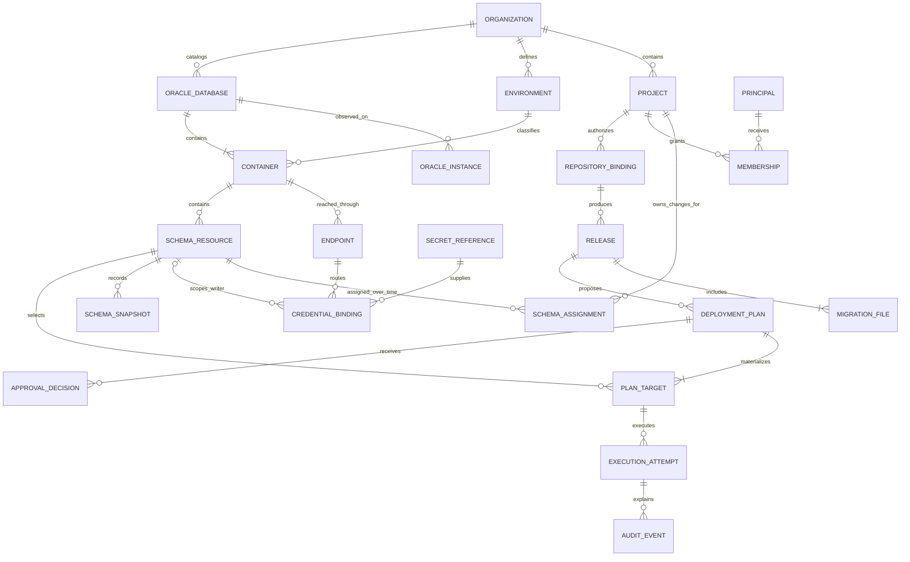

# Database resource model

Status: **DESIGN_PROPOSAL**, 8 October 2026. Capacity target: 50 services/endpoints, 500 application schemas, 20 active users, DEV/SIT/UAT/PROD. These are sizing inputs, never license limits. Source comparison: [Bytebase baseline](BYTEBASE-FEATURE-BASELINE.md); evidence keys resolve in [feature evidence](evidence/feature-evidence.md).

Use organization-owned physical resources and project assignments of independently identified schemas. A project owns change requests, releases, policies and assignment history; it does not own a duplicate physical Oracle connection. Discovery does not confer membership or execution permission.

## Oracle vocabulary and identity

| Resource | Meaning | Identity and relationship |
|---|---|---|
| Oracle database/CDB | Persistent database; a CDB contains containers | Observed DBID plus operator inventory identity. DBID alone is insufficient after cloning; retain incarnation/generation and provenance |
| Oracle instance | Memory/processes accessing a database; RAC has several instances | Optional observed instance name/number; never the application migration target |
| Container/PDB | Namespace containing local users and objects | PDB GUID when available, CON_ID as an observation, database identity and generation; non-CDB has one logical container |
| Service | Connection routing and workload service associated with a database/container | Service name and route revision; multiple services can route to the same PDB |
| Endpoint | Host/SCAN, port, service and transport configuration | Organization resource UUID; aliases resolve to a common container identity after verification |
| Schema | Objects owned by an Oracle user within a container | Container UUID plus exact catalog owner name plus lifecycle generation; quoted names preserve case |
| Execution target | A schema through an approved route and credential scope | Stable schema UUID, container identity, endpoint revision, principal/secret reference and generation; password bytes excluded |

Do not equate a service, PDB, instance and schema. SYS_CONTEXT exposes some connection context; broader identity information may require DBA-approved grants. If aliases cannot be reconciled reliably, block writes until a DBA attests the mapping. A clone with the same DBID cannot inherit approval or migration history merely because its name matches. Database reset/open/restore events require explicit reconciliation.

## Conceptual hierarchy

```text
Organization
├── Physical catalog: Oracle database → container ← service endpoints
│                                        └── schemas
├── Environments: DEV / SIT / UAT / PROD
└── Projects
    ├── schema assignments → physical catalog schemas
    ├── memberships and policies
    └── repositories → releases → approved deployment plans
```

One PDB may contain APP_CUSTOMER assigned to Customer and APP_FINANCE assigned to Finance. One service endpoint serves both; there are separate owner credentials and ledgers. Project views expose assigned schemas while concealing the other project's names, metadata, artifacts and secret references unless explicit cross-project read grants apply.

## ERD



Cardinality: an organization has many projects, environments and database resources. A database has at least one logical container. A container has zero or more registered routes and schemas; endpoints map to exactly one verified container at a revision. A schema has many historical assignments but **at most one active owning project**. Enforce an active-assignment unique constraint, including an organization boundary. Cross-project read access is a separate grant, not another owner. A plan includes one or more explicit targets; a target can accumulate many attempts. Each execution credential binding has one endpoint and one schema scope; discovery bindings have no schema writer scope. Secret versions can rotate without creating duplicate endpoint resources.

## Environment and permission rules

1. Container environment is authoritative for MVP. Endpoint environment is inherited from its container; schema and project views inherit it. Do not allow a PROD PDB to be relabeled DEV through a schema override. A project references environments used by its assignments rather than creating private copies of DEV/SIT/UAT/PROD.
2. Project membership grants scoped actions on assigned schemas. It does not grant physical endpoint administration or visibility into other projects. Resolve permissions on every API action, including SQL previews, history, exports and background jobs.
3. Fixed initial roles: organization inventory administrator, project developer, project approver, project deployer, auditor and recovery DBA. Recovery DBA can inspect and propose repairs; sensitive repair still needs a second actor. A user may hold several roles, but the request author and all authenticated substantive editors of the current intent cannot approve it.
4. Production execution requires a current approval, execution permission, current assignment and route binding, allowed window, predecessor evidence and no recovery hold. An administrator changing permissions cannot silently approve the same change.
5. A transfer closes the old assignment and opens a new one in a metadata transaction; reject when an execution is active. Increment assignment revision, invalidate pending plans, preserve schema UUID and local ledger. Historical records retain the original project and actors. The receiving project's access to historical SQL is an explicit audit policy, not an automatic disclosure.

Bytebase's inspected model has workspace- and project-scoped instances, a database project field, optional database environment and a computed effective environment [BB-INSTANCE-MODEL, BB-DATABASE-MODEL, BB-METADATA-MODEL]. Its Oracle driver represents owner names as Database entries [BB-ORACLE-SYNC, BB-ORACLE-USERS]. This proposal deliberately gives the physical container and schema separate identities; it does not reproduce Bytebase's persistence layout.

## Credentials and catalog visibility

| Purpose | Scope | Grants and restrictions |
|---|---|---|
| Discovery | One endpoint/container, dedicated inventory principal | Approved dictionary reads; no DDL/DML writer grants; no SYSDBA. Enumerating ALL_USERS is not proof of visibility into every object's definition |
| Execution | One schema, per environment | Prefer actual owner login; future proxy authentication must verify SESSION_USER, PROXY_USER and owner. Only privileges required by approved migrations; no generic ANY privileges |
| Verification | Owner session plus independent observer when required | USER_* under owner, or ALL_* with OWNER filter and visibility evidence. Permission errors or missing expected objects cannot be interpreted as VALID |
| Lock/ledger bootstrap | DBA-controlled installation for disposable or approved targets | Narrow cover package for DBMS_LOCK and platform tables; separate from normal migration execution |

Setting CURRENT_SCHEMA changes name resolution; it does not change login identity or grant ownership privileges. Discovery credentials must not become execution credentials through a UI dropdown. Store references to versioned Kubernetes Secrets or an optional OpenBao backend; never return a password in catalog APIs. TCPS trust and server identity are verified independently of a successful ping.

Node Thin uses homogeneous pools: keep pools separated by credential principal/version and transport settings, with bounded lazy allocation. Shared endpoint metadata does not imply pooling different schema owners into the same authenticated session. Drop connections after execution or perform verified session cleanup; discard sessions after cancellation or protocol uncertainty. See [driver comparison](TECHNOLOGY-DECISIONS.md).

## Synchronization and lifecycle

Schedule shallow discovery with jitter; deep metadata collection runs on demand and after deployment. Store the observed generation, successful timestamp, grant/visibility profile, errors and snapshot digest. Initial configurable limits: four discovery tasks globally and one per service, with timeouts; measure before tuning. Discovery filters Oracle-maintained accounts using available catalog metadata and a reviewed exclusion policy. Do not infer application schemas solely from a hard-coded name list.

New schemas start UNASSIGNED; explicit administrative assignment is required. Missing objects after an incomplete scan become UNKNOWN, not deleted. A complete scan may mark a resource MISSING; retirement requires operator confirmation and cannot erase history. Resource UUIDs survive project transfer and secret rotation; drop/recreate creates a new generation. A container/service mapping change quarantines dependent plans. Never execute CREATE/DROP USER, CREATE/DROP PDB or provisioning as an incidental discovery operation.

Audit ownership follows the project at the time of intent, with organization security events for registration, secret scope, transfers and topology changes. Target-local ledger entries carry stable project-at-execution and plan digests; central audit retains assignment snapshots. Retention and restore must include catalog identity, artifact bytes, approvals, receipts and project history together.
