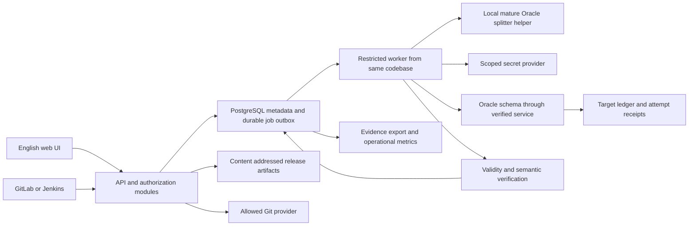
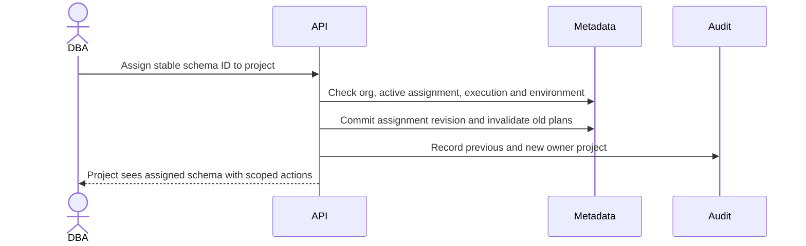
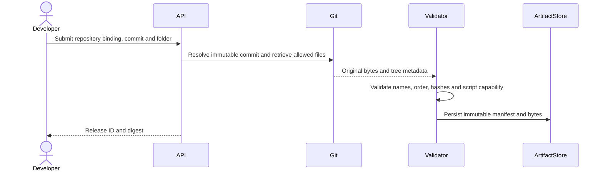
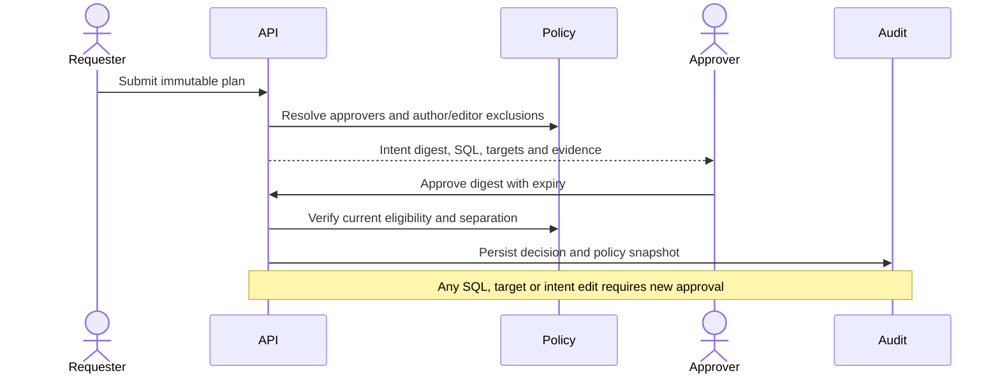
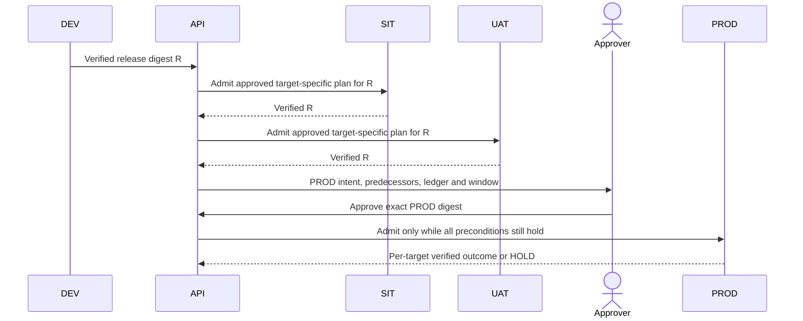

# Migration runtime architecture

Status: **DESIGN_PROPOSAL**. No application or Oracle connections were created in this research. This is an execution contract to implement and test, not a claim of achieved runtime behavior. References resolve in [feature evidence](evidence/feature-evidence.md); [resource model](DATABASE-RESOURCE-MODEL.md) defines target identity.

## Component boundaries



Start with a modular monolith, one API deployment and a worker deployment built from the same repository. The optional local JVM parser helper is a subprocess within the worker security boundary, not a network microservice or authority. Default driver candidate is OSS node-oracledb Thin. The ledger/execution coordinator is independently written after assessing mature engines; parser reuse is conditional on an Apache-only, driver-free adapter passing the first milestone. [Technology ADRs](TECHNOLOGY-DECISIONS.md) explain this trade-off.

## Release identities and folder ingestion

| Identity | Definition | Must not be substituted with |
|---|---|---|
| Git commit | Provider/repository identity plus resolved full object ID and hash algorithm | Branch/tag name, short SHA, mutable archive URL |
| Release | Immutable manifest UUID and SHA-256 over canonical manifest | Git commit alone: folders, streams and build settings can differ |
| Migration file | Stream UUID plus canonical version and original path, raw SHA-256, size | Filename alone or formatted SQL |
| Migration version | Numeric dotted tuple; 001 and 1 canonicalize to the same version | Lexical string sorting |
| Target schema | Container identity, exact owner, schema UUID/generation | Host/service name alone |
| Execution attempt | New attempt UUID with plan/target IDs and admission generation | Change ticket or release ID |

Accept `customer-service/db/migrations/V001__create_customer.sql` through a project repository binding and folder selection. Ingest exact commit once. Reject symlinks, submodules, archive path traversal, duplicate normalized paths, unsupported encodings, huge files and unapproved nested locations. MVP uses UTF-8 without BOM and bounded regular `.sql` files, numeric versioned names, no repeatables, no uncontrolled includes. Missing versions are allowed; duplicates, zero/negative versions and changed historical versions are not. Stream UUID is stable across path renames; renaming a deployed file cannot bypass identity checks.

Manifest fields: format version, project/stream IDs, repository identity, commit ID/algorithm, selected folder, original file paths, canonical versions, raw-byte hashes and lengths, file type, required engine capability profile, parser/version, execution settings, expected objects and postconditions. Include all verified SQL bytes in content-addressed storage; do not depend on Git remaining reachable after approval. Set an approved maximum release size, for example 20 MiB initially, as a configurable operational limit. No license quota is involved.

Hash raw bytes with SHA-256. Preserve them for evidence. Parser output is an ordered list of statement bytes and source ranges with its own digest; approval also covers that digest, parser version and any preprocessing. Disable placeholders and SQL*Plus substitutions for MVP. If later introduced, bind fully expanded bytes and nonsecret values before approval. Runtime expansion that changes SQL is prohibited.

## Planning and approval integrity

Planning reads each target's ledger through a scoped account, validates **all included historical checksums**, and compares target history with the central mirror. Record a sorted ledger snapshot digest and generation. Missing/unreachable/inconsistent history blocks the plan; central logs cannot substitute for that read. For a target with V001/V002 already applied, the sample release plans V003/V004/V005. A second schema with only V001 plans V002–V005. Missing applied files or unexpected higher versions require reconciliation, not automatic repair.

Freeze the target set, per-target pending files/order, ledger snapshot, route/container/schema generation, assignment revision, credentials' logical scope, execution options, risk findings, expected objects, postchecks, policy revision, predecessor evidence and deployment window. Compute `intent_digest = SHA256(canonical deployment intent)` with a specified canonical JSON encoding such as RFC 8785. SQL and target digests are data; display the full target names prominently to approvers.

Approval decisions contain authenticated actor, role/eligibility snapshot, intent digest, policy revision, decision, timestamp and expiry. MVP requires one independent human approver for every change, including DEV; advanced templates belong to V1. Request author and every authenticated SQL/target/postcheck editor contributing to the current intent cannot approve. Keep this contributor set across revisions retaining their substantive edits; a later metadata-only edit cannot erase exclusions. Git author strings alone are not authenticated platform identities. Deployer permission is separate; the worker identity does not inherit the requester’s privileges. A rejected or edited plan becomes a new immutable revision and requires fresh approval. Revocation or policy/assignment/topology change before dispatch blocks execution. Revocation during a call stops future statements where possible, records CANCEL_REQUESTED/HOLD, and cannot undo committed Oracle effects.

At dispatch, atomically admit one plan/target job, recheck authorization and current approval, verify artifact/statement hashes and route identity, acquire target mutex, then reread history under that mutex. **Any change from the approved history snapshot invalidates the plan**, even if it merely shrinks the pending set. Generate and approve a fresh plan. This conservative rule avoids approving one plan while silently executing another. Approved zero-pending intents complete as NOOP after integrity checks, with no migration SQL.

## Ledger decision

| Option | Strengths | Failure and operational cost | Verdict |
|---|---|---|---|
| A: target-local | Survives central outage; can pair simple DML with receipt in one transaction | DDL/receipt gap remains; no approval authority; owners/DBAs can alter it; restore may rewind | Necessary applied-state evidence, insufficient alone |
| B: central | Rich actor/approval history; no target bootstrap | Oracle can commit before central update; restoring metadata can cause replay without reconciliation | Reject as sole applied-state authority for this product |
| C: hybrid | Target receipt identifies successful applications; central preserves admission, approval, unknown attempts and retained bytes | Two systems must be reconciled; still no distributed atomicity for arbitrary Oracle DDL | **Recommend** |

Bytebase's versioned runner consults central revisions, executes a file, then creates a revision [BB-STATE]. Flyway stores target history after engine execution [FW-EXEC, FW-ORA]; Liquibase has target changeset history/locking [LB4-STATE, LB4-EXEC]; Sqitch records target deploy and verification events [SQ-STATE, SQ-EVENTS]. None of these ordering facts proves exactly-once arbitrary Oracle DDL.

**Authority split:** central PostgreSQL is authoritative for approval, artifacts, admission, permissions and recovery holds; the Oracle ledger is authoritative for recorded applied versions and digests in that target generation. A successful deployment requires agreement plus verification. A central STARTED/UNKNOWN attempt without local success remains blocked even if the migration appears pending. Local absence is not proof of no effects.

Proposed target tables (logical schema, not implementation SQL):

| Table | Required content and constraints |
|---|---|
| `PLATFORM_SCHEMA_IDENTITY` | Organization registration, container/schema UUID and generation; one identity per managed schema |
| `PLATFORM_MIGRATION_HISTORY` | Stream/version primary key within schema; immutable raw and execution hashes, release/plan/attempt digests, installed actor/time, state APPLIED or BASELINED, engine version; no overwrite of existing version |
| `PLATFORM_MIGRATION_ATTEMPT` | Attempt UUID, version, plan digest, admission generation, start/end, last acknowledged statement, execution/commit/validity states, error and recovery linkage; append terminal/recovery events |

One version namespace per project migration stream, with a schema-level lock across **all** streams. MVP permits one managed stream per schema to avoid conflicting ordering; transfer preserves it. A baseline is explicitly approved evidence of preexisting state, records manifest versions/checksums and schema snapshot, and never claims their SQL ran. Do not automatically baseline a nonempty database.

Commit a local STARTED receipt before running a file. For DDL or PL/SQL, the receipt is a breadcrumb, not an atomic commit witness. After execution and object checks, commit the APPLIED entry, then mirror success centrally. For strict ordinary DML-only files with no internal commits, DDL, autonomous transactions or unreviewed routine side effects, target data and APPLIED entry can share one Oracle transaction. General PL/SQL stays in the non-atomic class. If file verification fails before that DML commit, roll back the transaction and record the attempt separately. A target success receipt can reconstruct a missing central completion; it cannot manufacture missing approval.

## Concurrency and worker lifecycle

Use durable PostgreSQL jobs/outbox, unique active target admission, `FOR UPDATE SKIP LOCKED` claims and an increasing admission generation. Queue delivery may repeat. Lease expiry changes a running job to UNKNOWN/HOLD; it does not re-run SQL. Before each statement check job authorization and generation, but acknowledge that a call already in Oracle cannot be fenced by a PostgreSQL token.

Hold an Oracle **session-scoped** mutex on the actual execution connection for the whole target run. Preferred implementation: DBA-installed narrow cover package using DBMS_LOCK in exclusive mode with `release_on_commit => FALSE`; allocate its stable canonical schema name before migration work, using the autonomous allocation routine where appropriate. Both aliases and RAC routes must resolve to that same schema lock. A transaction row lock is insufficient because DDL commits release it. Lock contention yields WAITING_LOCK with a bounded deadline, never concurrent SQL. No DBMS_LOCK grant means managed writes are disabled until an equivalent DDL-safe mutex is demonstrated.

Only the session holding that lock executes SQL; no second pooled connection may do the work. If the worker disappears but Oracle still has its session, a replacement cannot acquire the mutex. Operators must observe or terminate the old session through an audited DBA procedure; central heartbeat expiry alone cannot release it. On lost connection, suspend further work until target state and session termination are established. DBAs and applications outside the managed path can bypass advisory locks; least privilege and independent drift observation address that residual risk.

## Oracle script and validation contract

Use a mature dialect-aware splitter, never `split(';')`. Packages, specification/body, functions, procedures, triggers, types, views with local PL/SQL, anonymous blocks, q-quoted strings, quoted identifiers, comments and standalone slash delimiters require exact source-range preservation. Slash is a client delimiter, not SQL sent to the database. Ordinary SQL loses only its terminal client delimiter; PL/SQL retains its internal and required terminal semicolon. Parser failures block before any target effects.

MVP supports SQL/PLSQL with SQL*Plus-style slash terminators. It **rejects** executable SQL*Plus commands such as SET, DEFINE, @/@@, HOST, SPOOL, CONNECT, WHENEVER and EXIT with a file/line error. It does not emulate their semantics or execute them through a shell. Comments resembling these commands remain comments. Mature parser capability is not a complete static security proof: dynamic SQL, routines, database links and autonomous transactions can hide effects. Restrict grants and require risk review of opaque PL/SQL. Native SQL*Plus may be an optional adapter later, with explicit client license review, include closure hashes and reliable error handling.

Define expected objects in the approved manifest by owner, name and **object type**. A package specification and body are separate entries. Before execution capture invalid objects and relevant dependencies; after each file validate directly created/changed objects, and after the release check new invalid objects among the approved affected dependency set. ALL_DEPENDENCIES is advisory and does not fully capture dynamic SQL. Do not automatically recompile every invalid object in the PDB. Explicit recompilation is an approved migration or correction.

Collect USER_ERRORS/ALL_ERRORS diagnostics by name/type and sequence with line/position. USER_* requires the actual schema owner login; ALL_* requires OWNER filters and known dictionary visibility. Check required objects exist and are VALID. Warnings may follow policy; compiler ERROR always fails. A driver can return success while a created PL/SQL object is INVALID. Preserve separate fields for statement execution, commit knowledge, ledger state and verification. Read-only semantic postconditions are versioned approved artifacts; unsafe checks need their own authorized change. Run final committed-state checks from an independent observer where a commit is part of the claim.

A target is **VERIFIED_SUCCESS** only when every planned file has matching target history, required objects are valid, approved postconditions pass, no unresolved partial/unknown attempt remains, and the evidence has been stored centrally. UI task completion, an exit code, an APPLIED row or a schema dump alone cannot satisfy this definition. A previously invalid unrelated object can be an approved exception; a new relevant invalid object cannot silently pass.

Oracle DDL commits before syntactically valid DDL and after successful DDL; even a failed DDL may commit preceding work. A timeout can hide an already committed operation. See [Oracle COMMIT](https://docs.oracle.com/en/database/oracle/oracle-database/19/sqlrf/COMMIT.html). The mutex design follows [Oracle DBMS_LOCK](https://docs.oracle.com/en/database/oracle/oracle-database/19/arpls/DBMS_LOCK.html). Do not advertise release-wide transactional rollback.

## Failure and recovery matrix

| Observation | Result | Permitted next action |
|---|---|---|
| Failure before admission or before target calls | REJECTED or retryable ingestion error | Retry read-only work with idempotency key; no SQL replay risk |
| Applied versions/checksums match, no holds, zero pending | NOOP | Store a no-op evidence bundle; zero migration statements |
| V003 succeeds; V004 fails after CREATE TABLE | PARTIAL/HOLD | Stop target and downstream promotion; inspect committed effects, approve correction; no automatic replay of V004 |
| Entirely ordinary DML fails and observer confirms rollback | FAILED_KNOWN_NO_EFFECT | New reviewed attempt may run under fresh admission; immutable original artifact still required |
| Lost connection / deadline during a call | UNKNOWN/HOLD | Observe session, ledger, objects and data; never infer rollback |
| Oracle APPLIED receipt exists, central completion missing | RECONCILING | Validate receipt against retained approval and hashes, then re-run safe observer checks and rebuild central result; never rerun SQL |
| Effects exist, APPLIED receipt missing | UNKNOWN/HOLD | DBA proves postconditions and adopts effects through a separately approved recovery record, or authors a corrective version |
| Target history restored to older state | RESTORE_HOLD | Compare central receipts, generation, artifacts and target evidence; reconcile before any write |
| Central metadata restored to older state | RESTORE_HOLD | Reconcile target receipts with restored approval/artifact set; missing authorization is not reconstructed from target data alone |

Recovery can record ADOPTED_AFTER_VERIFICATION with the original digest plus explicit exception approval and evidence. It must not insert a fabricated ordinary APPLIED row or edit a deployed checksum. Failed-file effects may require restore or corrective migration; a new higher version cannot run while a lower unknown attempt remains unresolved. Rerunning the original file is allowed only after a DBA demonstrates safe no-effect/idempotent preconditions and an independent recovery approval. Ordinary migrations have no transparent execution retries. Fix-forward is the normal DDL recovery path; coordinated application rollback and database restore remain separate operating procedures.

## Promotion, API and evidence

Promote the same release digest to DEV → SIT → UAT → PROD. Each environment receives its own target/ledger-specific plan and approval; lower-stage **verified** evidence for the same artifact is a server precondition. Each stage may select several schemas, initially serial per endpoint with bounded global parallelism. A partial target result stops new targets by default; completed targets remain completed. Do not roll back successful schemas automatically.

Proposed REST resources: `/v1/endpoints`, `/schemas`, `/projects`, `/repository-bindings`, `/releases`, `/plans`, `/plans/{id}/approvals`, `/deployments`, `/attempts`, `/recovery-cases`, `/audit-events`. All are new platform contracts. Idempotency keys bind caller, action and request digest; same key/different body yields conflict. GET/streamed events report execution and verification separately. CI may ingest and poll; it cannot mint a human approval or send arbitrary SQL/DSNs to a privileged runner.

Evidence bundle: source commit/repository, original artifacts, release/plan/statement digests, inventory/assignment snapshot, policy version, requester/editor/approver/deployer identities, each attempt and session context, timestamps, file/statement ranges, redacted errors/logs, target receipts, compiler diagnostics, observer checks, recovery decisions and preceding-stage IDs. Hash the bundle and retain it independently of job logs. Audit includes denied admission, altered content, expired/revoked decisions, transfers, secrets access, lock waits, cancel requests and reconciliations. External logs must exclude passwords, DSN credentials and result data; approved SQL itself may contain sensitive literals and needs scoped retention.

## Required runtime sequence diagrams

### 1. Instance onboarding and schema discovery

```mermaid
sequenceDiagram
    actor DBA
    participant API
    participant Catalog
    participant Worker
    participant Oracle
    DBA->>API: Register service, transport and discovery secret reference
    API->>Catalog: Save provisional endpoint revision
    API->>Worker: Read-only connection test and discovery
    Worker->>Oracle: Verify identity, enumerate visible owners
    Oracle-->>Worker: Container identity, schemas, visibility and errors
    Worker->>Catalog: Upsert observed resources; new owners UNASSIGNED
    API-->>DBA: Discovery report; writes remain disabled until bootstrap
```

### 2. Project/schema assignment



### 3. Git release ingestion



### 4. Migration planning

```mermaid
sequenceDiagram
    actor Developer
    participant Planner
    participant Catalog
    participant Oracle
    participant Metadata
    Developer->>Planner: Select release and schema IDs
    Planner->>Catalog: Resolve current assignment, route and generation
    Planner->>Oracle: Read target history and recovery receipts
    Oracle-->>Planner: Applied versions and checksums
    Planner->>Planner: Validate history; derive per-target pending lists
    Planner->>Metadata: Freeze plan, history digest and execution intent
    Planner-->>Developer: Exact SQL, targets, risk and pending files
```

### 5. Approval workflow



### 6. Migration execution

```mermaid
sequenceDiagram
    actor Deployer
    participant API
    participant Metadata
    participant Worker
    participant Oracle
    participant Observer
    Deployer->>API: Execute approved plan with idempotency key
    API->>Metadata: Recheck admission; create unique job and outbox
    Metadata-->>Worker: Claim job and admission generation
    Worker->>Oracle: Verify route; acquire session mutex; reread history
    Worker->>Metadata: Confirm snapshot, approval and generation still current
    loop Each approved pending file
        Worker->>Oracle: Commit STARTED receipt
        Worker->>Oracle: Execute parsed statements on locked session
        Worker->>Oracle: Validate expected objects and compiler diagnostics
        Worker->>Oracle: Commit APPLIED receipt when file passes
        Worker->>Metadata: Mirror file outcome
    end
    Worker->>Observer: Check committed state and final postconditions
    Observer-->>Metadata: Verification evidence
    Worker->>Oracle: Release mutex and close session
    Metadata-->>API: VERIFIED_SUCCESS only with complete evidence
```

### 7. Successful re-run with zero pending migrations

```mermaid
sequenceDiagram
    actor User
    participant Planner
    participant Approver
    participant Worker
    participant Oracle
    User->>Planner: Plan same immutable release again
    Planner->>Oracle: Read matching applied history
    Planner-->>Approver: New zero-pending intent
    Approver-->>Worker: Approved no-op intent
    Worker->>Oracle: Acquire mutex; verify unchanged history and no hold
    Note over Worker,Oracle: Zero migration SQL statements
    Worker-->>User: NOOP with checked target history and audit evidence
```

### 8. Partial failure and retry

```mermaid
sequenceDiagram
    participant Worker
    participant Oracle
    participant Metadata
    actor DBA
    actor Reviewer
    Worker->>Oracle: Apply V003 and commit receipt
    Worker->>Oracle: V004 creates object; later statement fails
    Worker->>Metadata: PARTIAL and recovery HOLD; stop promotion
    DBA->>Oracle: Observe effects and compiler errors
    DBA->>Metadata: Propose recovery decision and correction artifact
    Reviewer->>Metadata: Approve recovery intent
    Metadata-->>Worker: Admit explicitly authorized recovery attempt
    Note over Worker,Oracle: V003 stays applied; no blind replay of V004
```

### 9. Crash after Oracle commit but before central success

```mermaid
sequenceDiagram
    participant Worker
    participant Oracle
    participant Metadata
    participant Reconciler
    actor DBA
    Worker->>Metadata: Durable STARTED admission
    Worker->>Oracle: Execute DDL; Oracle commits
    Note over Worker: Worker crashes before central completion
    Metadata->>Metadata: Lease expires to UNKNOWN/HOLD
    Reconciler->>Oracle: Inspect session, local receipt and actual effects
    alt Matching APPLIED receipt exists
        Reconciler->>Metadata: Restore result after approval/hash and observer checks
    else Receipt absent or inconsistent
        Reconciler-->>DBA: Remain HOLD; request evidence-based recovery
    end
    Note over Reconciler,Oracle: Never infer pending means safe to replay
```

### 10. DEV to SIT to UAT to PROD promotion



## Required lab evidence before accepting this design

Retain the historical 45-case Oracle criteria and workload fixtures as inputs; do not overwrite their outcomes. Add first-statement/partial-DDL failures, commit/receipt/central-update crash barriers, alias/RAC contention, worker pause beyond lease, orphan sessions, metadata/target restore divergence, approval revocation/edit races, invisible compiler diagnostics, invalid package body with valid specification, q-quotes/slashes, zero-pending replay and checksums changed after planning. Execute only in a separately authorized disposable lab. Validate 19c and 21c independently; neither the driver documentation nor historical Bytebase/ODC runs proves this new executor.
