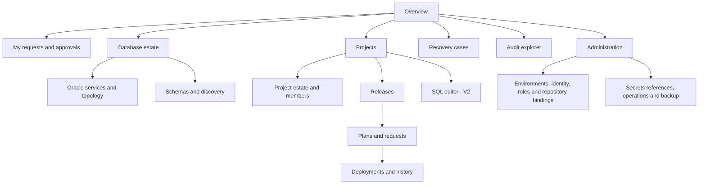
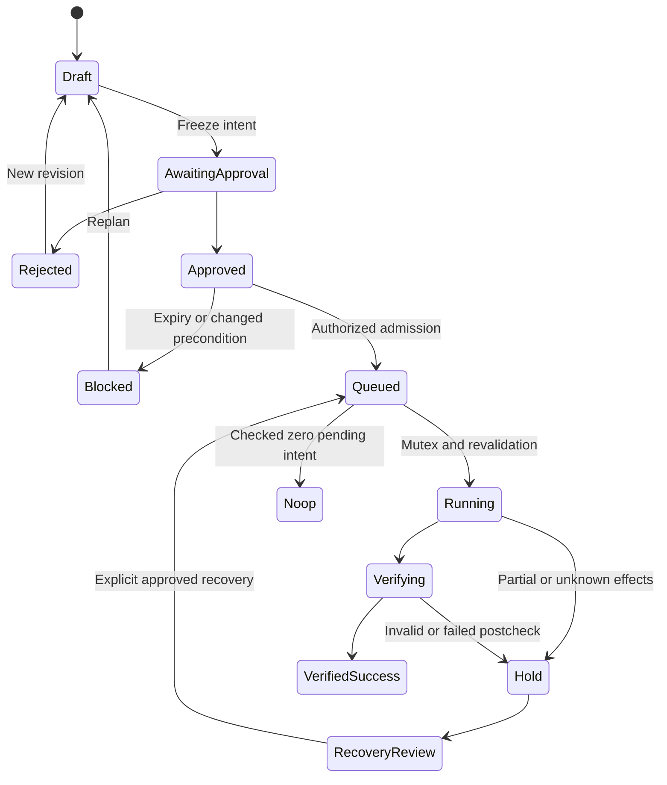

# UI/UX feature map

8 October 2026. All proposed screens and API names are **DESIGN_PROPOSAL**. Source route/component evidence supports product discovery; there was no new browser session or usability measurement. Existing [UI evidence](../UI-EVIDENCE.md) and historical screenshots remain unchanged. References: BB-ROUTES, BB-ROUTES-PROJECT, BB-SQL-ROUTES; P-ODC-NAV/QUEUE/RESULT-UI; DBGATE-README; CB-SCOPE in [feature evidence](evidence/feature-evidence.md).

Design independent English pages and original assets. Use a shared resource selector that shows **environment → container/service → exact schema owner → project**, with stable ID in details. Keep secrets as references. Externalize strings from the first screen; support locale-specific dates/numbers, an explicit displayed timezone, accessible keyboard use, table headers, status text/icons and color-independent severity. Identifiers, SQL and checksums are never translated.

## Navigation

MVP has focused inventory/project/release/approval/deployment/recovery/audit pages. Overview and advanced analytics grow in V1; the editor is V2. Hiding a navigation item is not authorization. Scoped roles may see read-only details or an explicit denied state; users never infer permission from a disabled button alone.

## Screen records

### UX-01 — Main overview / personal work

**Goal:** Developer/approver/operator sees work requiring action and estate reliability. **Actions:** Open assigned request, resume a draft, inspect a hold; V1 adds filters/summary charts. **Data:** Own requests, eligible approvals, per-project deployment states, oldest holds and sync freshness. **APIs:** Proposed GET `/v1/requests?mine=true`, `/plans`, `/deployments`, `/recovery-cases`; V1 aggregates counts on the server. **Permissions:** Only granted projects; operational cross-project counts require separate permission. **Empty:** Explain no assigned work and link to authorized first release/onboarding action. **Errors:** Show unavailable sources independently; never replace UNKNOWN with zero. **Tables/forms:** Request/project/environment/risk/waiting-on/time; hold age and assigned DBA. **Pattern:** Bytebase personal issues/navigation [BB-ROUTES]. **Improvement:** Put unresolved outcomes and compiler failures ahead of cosmetic success totals. Features PRJ-014, OPS-015/025, GOV-021.

### UX-02 — Oracle service inventory and onboarding

**Goal:** DBA registers one shared route without duplicating it per schema. **Actions:** Register, test discovery visibility/TCPS/identity, view routes/aliases, edit secret reference, archive or place in maintenance. **Data:** Host/SCAN, port/service, container identity/generation, environment, discovery principal scope, transport profile, last complete scan and error. **APIs:** `/v1/endpoints`, `/endpoints/{id}/connection-tests`, `/discovery-runs`; administrative topology changes are versioned. **Permissions:** Inventory administrator; project members get sanitized contextual endpoint data only. **Empty:** Guided first service form. **Errors:** Distinguish DNS/network, certificate, authentication, wrong PDB and insufficient catalog visibility; no password echo. **Tables/forms:** Explicit service versus SID fields; target environment; opaque secret selector; test results with identity and grants. **Pattern:** Bytebase instance and ODC datasource screens [BB-INSTANCE, P-ODC-ORACLE-UI]. **Improvement:** Discovery credential never implicitly becomes writer; ping and identity checks have distinct results. DBM-001/003/014/016/019/020.

### UX-03 — Schema and database explorer

**Goal:** DBA discovers/assigns schemas; developer reads authorized metadata. **Actions:** Refresh, inspect snapshot/objects, request or perform assignment, filter Oracle-maintained accounts, view history. **Data:** Exact owner/container/schema UUID/generation, assignment/project/environment, visibility/freshness and expected objects; deeper metadata in V1. **APIs:** `/v1/schemas`, `/schemas/{id}/snapshots`, `/assignments`; browsing never submits arbitrary Oracle catalog SQL. **Permissions:** Inventory admin for assignment, project-scoped reads for definitions/history. **Empty:** Separate no visible schemas, discovery not run and no grants; offer next permitted action. **Errors:** Incomplete/missing/stale dictionary results retain previous successful snapshot. **Tables/forms:** Owner/project/environment/service/visibility/last sync; object type/name/status/definition with protected viewing. **Pattern:** ODC database/project association and DbGate explorer [P-ODC-DATABASE, DBGATE-README]. **Improvement:** Surface assignment isolation and uncertain visibility; do not label an inaccessible object VALID. DBM-004–007/020, PRJ-002, SQL-004.

### UX-04 — Project management

**Goal:** Project owner manages assigned schemas, members, repositories and scoped settings. **Actions:** Create, invite/add/remove membership, connect repository or archive an inactive project; V1 policy/transfer settings. **Data:** Stable project ID, active assignments, environment coverage, members/roles and binding revisions. **APIs:** `/v1/projects`, `/projects/{id}/memberships`, `/repository-bindings`, `/assignments`; V1 `/policies`. **Permissions:** Project administration; separate inventory permission to move schemas. **Empty:** Project exists with no assignments and a clear assignment request path. **Errors:** Transfer blocked by active execution; membership/setting conflict returns current revision. **Tables/forms:** Membership role versus approval eligibility; project/environment estate matrix; repository allowlist/folder. **Pattern:** Bytebase project tabs and ODC project database/member pages [BB-PROJECT, P-ODC-PROJECT-UI]. **Improvement:** No duplicate endpoint credentials on each project form; ownership and read grants are distinct. PRJ-001–012.

### UX-05 — Migration release list and detail

**Goal:** Developer ingests an immutable Git folder as one reviewable release. **Actions:** Select bound repository, resolve commit, choose allowed folder, ingest, inspect files/digests and create target plan. **Data:** Repository ID, full commit, manifest hash, ordered canonical versions, original paths/hashes/sizes, script profile and retained bytes. **APIs:** `/v1/releases`, `/release-ingestions`, `/releases/{id}/files`; GET original file content is scoped. **Permissions:** Project developer; no execution authority conferred by ingestion. **Empty:** Explain expected V-file layout with one safe sample. **Errors:** Duplicate canonical version, malformed name, unsupported command, traversal, encoding or size reported by file/line. **Tables/forms:** Version/path/raw SHA/validation/size; immutable provenance card. **Pattern:** Bytebase releases and Flyway applied/pending list [BB-RELEASE, BB-FOLDER-ACTION, FW-ORA]. **Improvement:** One folder submission; branch name is displayed as source selection while resolved commit remains authority. MIG-004–009, GIT-003–007.

### UX-06 — Change request and pending-plan builder

**Goal:** Developer submits exactly the pending SQL for explicit schemas. **Actions:** Select target schema IDs, inspect per-target history, enter purpose/expected effect/recovery notes, review risks and submit frozen intent. **Data:** Release/statement digests, route/generation/assignment revision, pending/applied/checksum-conflict lists, history snapshot, expected objects and postconditions. **APIs:** POST `/v1/plans`, GET `/plans/{id}`, POST `/requests`; plans are immutable revisions. **Permissions:** Project developer can propose permitted schemas; cannot grant themselves access or execute. **Empty:** Zero-pending is a valid no-op state with a checked-history explanation. **Errors:** Unreachable history, checksum mismatch, UNKNOWN attempt, target reassignment or unsupported script blocks submission. **Tables/forms:** Schema × file matrix and readable SQL/range preview; target detail visible next to SQL. **Pattern:** Bytebase plan/issue separation and ODC explicit target queue [BB-PLAN-DISCOVERY, P-ODC-QUEUE]. **Improvement:** Different pending sets per schema are shown before approval; target changes always create new intent. MIG-010–013/028/031, GOV-001/012/013, EXT-008.

### UX-07 — Approval inbox and decision detail

**Goal:** Independent approver understands what will run and where. **Actions:** Approve exact intent, reject with reason, request new revision; inspect author/editor eligibility and expiry. **Data:** Full SQL/target sets, risks, release and statement hashes, lower-stage evidence, required objects, policy/assignment snapshots, prior decisions and current eligibility. **APIs:** `/v1/approval-inbox`, `/plans/{id}/approvals`; decisions cannot accept arbitrary alternate SQL or targets. **Permissions:** Current eligible approver, excluding requester and all substantive contributors to the current intent. **Empty:** No eligible decisions; distinguish another stage waiting from denied eligibility. **Errors:** Stale intent/policy/permission/expiry conflict reloads details and requires a fresh deliberate action. **Tables/forms:** Side-by-side SQL and target intent, required quorum/stage, decision reason. **Pattern:** Bytebase ordered templates and AccessFlow releasable gate [BB-APPROVAL-MODEL, AF-DEPLOY-DOC]. **Improvement:** Approval is bound to an immutable digest; engine completion and job admission are different states. GOV-002–013/023.

### UX-08 — Deployment admission and progress

**Goal:** Deployer follows authorized per-target execution and verified stage progress. **Actions:** Dispatch approved plan; inspect file/statement ranges, lock wait, verification and holds; V1 schedule/cancel under explicit semantics. **Data:** Admission generation, job/attempt IDs, approval validity, target identity, session context, file sequence, execution/commit/ledger/validity results, timestamps and predecessor evidence. **APIs:** `/v1/deployments`, `/attempts`, streamed `/events`; cancellation request separate from session-stopped acknowledgement. **Permissions:** Deployer plus project read; raw session operations reserved to recovery DBA. **Empty:** Approved but not admitted shows actual blocking reason. **Errors:** Stale history or revoked approval blocks before SQL; lost call shows UNKNOWN/HOLD. **Tables/forms:** Target queue and file list; four outcome fields (execution, commit knowledge, history, validity). **Pattern:** ODC queue/results and Bytebase task progress [P-ODC-QUEUE, P-ODC-RESULT-UI, BB-ROLLOUT]. **Improvement:** VERIFIED_SUCCESS is visually distinct from SQL executed; future stages cannot be clicked around server gates. MIG-018–022/026, OPS-001–006, EXT-010.

### UX-09 — Per-schema migration history

**Goal:** Developer/DBA/auditor understands recorded applied state and every attempt. **Actions:** Inspect version/digests/attempts, compare local/central history, open compiler evidence/recovery case, export with permission. **Data:** Target generation, stream/version, raw/execution hashes, baseline/application state, release/plan linkage, actor/time and verification results. **APIs:** `/v1/schemas/{id}/migration-history`, `/attempts/{id}/evidence`; local read freshness recorded. **Permissions:** Project history reader or scoped auditor; artifact SQL read separately controlled when needed. **Empty:** Never managed versus explicitly baselined versus inaccessible history are separate states. **Errors:** Target/central disagreement or restore hold remains prominent. **Tables/forms:** Version/applied state/hash/time/verified outcome; attempts expand independently. **Pattern:** Flyway history and Liquibase changeset identity [FW-ORA, LB4-STATE]. **Improvement:** Query history and tickets cannot masquerade as applied migrations. MIG-011/025/026/029/034.

### UX-10 — Recovery case detail

**Goal:** DBA resolves uncertain/partial effects with an independent decision. **Actions:** Assign recovery owner, attach observer evidence, propose correction/adoption/no-effect retry, request approval; V1 controlled session-stop tools. **Data:** Durable admission, original SQL hashes, last acknowledged statement, open session/lock facts, target history, actual object/data checks and linked corrections. **APIs:** `/v1/recovery-cases`, `/recovery-decisions`, `/recovery-plans`; no generic reset-to-pending endpoint. **Permissions:** Recovery DBA proposes; another eligible actor approves. **Empty:** No unresolved cases; successful historical resolutions remain searchable. **Errors:** Missing evidence/grants or live session blocks resolution. **Tables/forms:** Facts versus unknowns, evidence uploads with scoped retention, explicit recovery rationale and approved actions. **Pattern:** Mature engine failure messages plus own safety design [FW-FAIL, ORACLE-LOCK]. **Improvement:** Recovery is a core operating workflow with owner/hold status, rather than a retry button. MIG-017/020/034, OPS-025.

### UX-11 — SQL editor (V2)

**Goal:** Authorized developer queries safely without receiving shared passwords. **Actions:** Browse, autocomplete, run bounded read queries, explain, save and export with permission; write/admin operations require an explicit product decision and core admission. **Data:** Scoped schema snapshot, credential access mode, grants/expiry, query/result/error/time metadata. **APIs:** Proposed `/v1/queries`, `/query-history`, `/saved-queries`, `/query-exports`; separate from migration history. **Permissions:** Query/export/admin roles independently checked with actual read-only target credentials. **Empty:** Show only authorized targets; no grant prompts a scoped access request. **Errors:** Permission expiry, row/time cap, object invisibility and masking failure are visible with no raw unmasked fallback. **Tables/forms:** Independent tabbed query/result panels and deliberate export confirmation. **Pattern:** Bytebase SQL editor, DbGate workbench, CloudBeaver tree [BB-SQL-API, DBGATE-README, CB-SCOPE]. **Improvement:** No migration bypass and no invented read-only safety from a UI label. SQL-001–014/022–024, SEC-025/026.

### UX-12 — Audit explorer and evidence export

**Goal:** Auditor reconstructs decisions and deployment facts. **Actions:** Filter principal/action/project/schema/release/attempt/time, open original evidence and export an authorized bundle. **Data:** Denials as well as successful actions, policy/intent hashes, provenance, target receipts, diagnostics, recovery lineage and retention gaps. **APIs:** `/v1/audit-events`, `/evidence-bundles`; exports are jobs with separate permission/retention. **Permissions:** Scoped auditor, no writer/secret access. **Empty:** Explicit time/filter explanation; no “no events” message when data source failed. **Errors:** Retention gap/corrupt hash/permission limit is exposed rather than hidden by aggregate counts. **Tables/forms:** Actor/action/resource/result/time/hash; timeline joins changes without deleting source facts. **Pattern:** Bytebase audit page and AccessFlow SIEM approach [BB-AUDIT-GATE, AF-SIEM]. **Improvement:** Approval, SQL execution and Oracle validity evidence stay independently inspectable. SEC-011–013/020/028.

### UX-13 — Administration / identity / policies

**Goal:** Administrator manages global minimum controls without silently approving changes. **Actions:** Invite/revoke identity, manage fixed roles/environments/repositories/secret references; V1 OIDC/LDAP/templates/groups/MFA. **Data:** Membership/grant revisions, principal type, environment/container mapping, policy versions and secret-provider health. **APIs:** `/v1/principals`, `/roles`, `/environments`, `/policies`, `/repository-bindings`, `/secret-references`; never return secret bytes. **Permissions:** Separate identity, inventory and security administration privileges. **Empty:** Setup requires the first independent approver before migration admission. **Errors:** Removing the only viable approver warns/blocks pending work according to policy; concurrency uses revision conflicts. **Tables/forms:** Role matrix, provider test with sanitized details, policy version/effect preview. **Pattern:** Bytebase identity/policy navigation and ODC security area [BB-ROUTES, P-ODC-SECURE-UI]. **Improvement:** All core security controls are free; optional features are phased, not paywalled. SEC-001–010/021–027, GOV-008/025.

### UX-14 — Operations / backup / capacity

**Goal:** Operator keeps the platform recoverable offline. **Actions:** Inspect workers/queue/storage/backup health, drain maintenance, export diagnostics and enter restore reconciliation mode. **Data:** Worker versions/leases, queue age, holds, artifact storage, secret/backend readiness, bounded metrics and backup checkpoints. **APIs:** `/v1/operations`, `/health/live`, `/health/ready`; privileged maintenance/reconciliation actions audited. **Permissions:** Operations roles; aggregate observation cannot reveal SQL or credentials. **Empty:** A single-worker install shows topology honestly; missing metrics do not imply healthy targets. **Errors:** Metadata outage, stale worker, orphan target session and backup failure have distinct operating consequences. **Tables/forms:** Worker claim/session state, unresolved cases, backup/reconciliation status and configured session budget. **Pattern:** Existing operational patterns, not a verified Bytebase full monitoring console [BB-METRICS]. **Improvement:** Restore is a write-blocking workflow, and rescheduling cannot imply safe replay. OPS-001–027.

## Page flows

```mermaid
flowchart LR
    REG[Register service] --> DISC[Discover and attest container]
    DISC --> ASSIGN[Assign schema to project]
    ASSIGN --> BIND[Bind repository and folder]
    BIND --> ING[Ingest commit and validate release]
    ING --> PLAN[Select schemas and freeze pending plan]
    PLAN --> REVIEW[Independent approval]
    REVIEW --> ADMIT[Deployer admission checks]
    ADMIT --> RUN[Execute under target mutex]
    RUN --> CHECK[Object and postcondition verification]
    CHECK --> SUCCESS[Verified history and evidence]
    SUCCESS --> PROMOTE[New environment-specific plan]
    RUN --> HOLD[Partial or unknown recovery case]
    CHECK --> HOLD
    HOLD --> CORRECT[Observed facts and reviewed correction]
    CORRECT --> REVIEW
```

Tables use stable pagination/filter/sort APIs and persisted project/environment context. Search results must enforce permissions before counts or suggestions. Preview SQL is escaped text, never executable HTML. Empty/error states offer one relevant authorized next action rather than exposing internal framework/provider configuration. Add UI tests for stale approval, wrong target, partial/invalid outcomes, expired grants and unauthorized cross-project URLs after implementation; no prototype is accepted as runtime completion.
