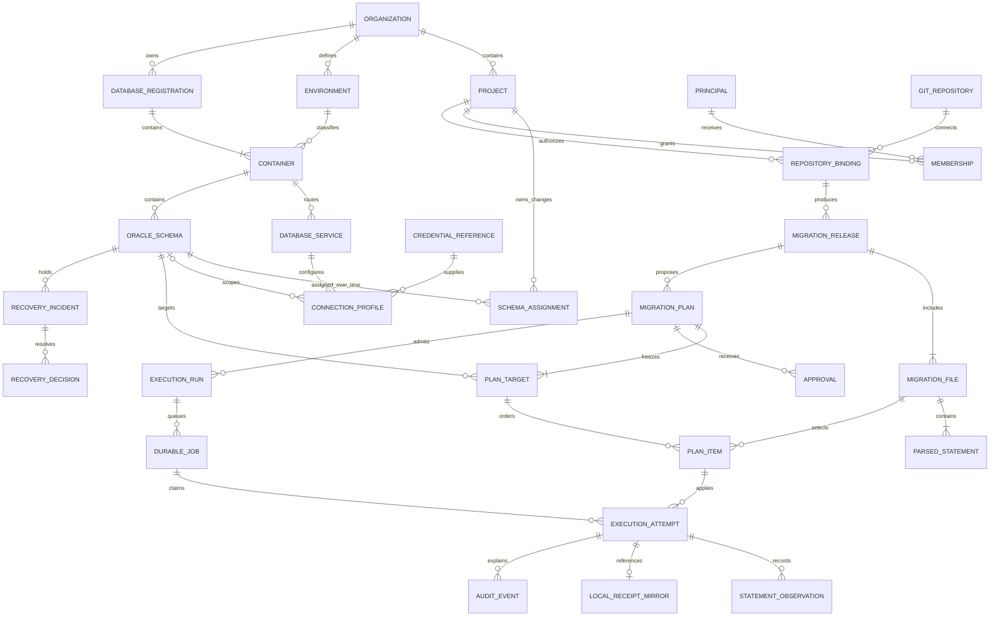
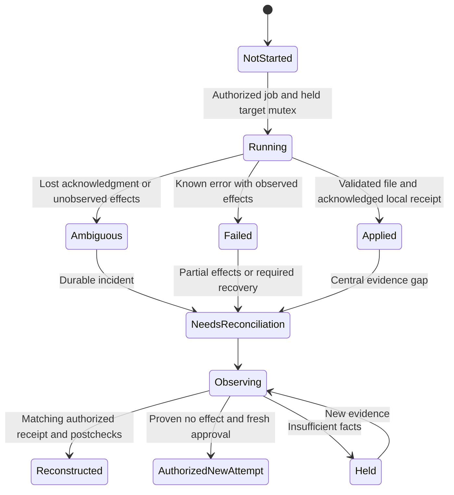
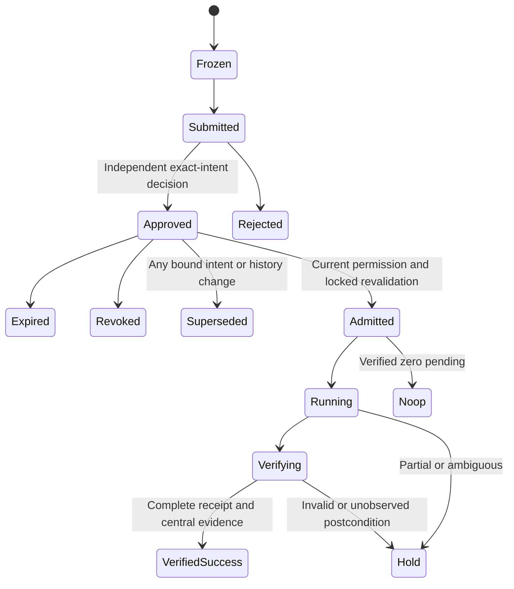

# Minimal data contracts

Contract proposal v1, 8 October 2026. No SQL migrations, platform models or endpoints are implemented. Original [resource model](../DATABASE-RESOURCE-MODEL.md) and [runtime](../MIGRATION-RUNTIME-ARCHITECTURE.md) are retained. This document resolves RR-05–09 as proposed implementation contracts.

## Shared rules and identity

Central entity primary keys are server-generated UUIDs. All organization-owned rows include `organization_id`; same-organization composite foreign keys prevent cross-tenant references. `created_at` and audit timestamps are server UTC instants, not caller claims. Mutable projections have monotonic `revision` and compare-and-swap writes. Referenced resources are archived, not cascade-deleted; immutable records remain readable only through explicit audit/artifact permission. Credentials are references, never password/token bytes.

**Oracle target:** connection address `service/PDB/schema` is the selected route. Execution identity is `organization + physical database registration/generation + container registration/generation + exact dictionary owner + schema lifecycle generation`. A stable schema UUID identifies that namespace across approved route aliases. Bind route/profile/credential-reference revisions separately in every plan. DBID, CON_ID, host or service spelling alone is not canonical identity. Copied local identity tables do not prove a clone is the same target. When catalog evidence is inadequate, DBA attestation is required and writes remain disabled until confirmed.

**Migration identity:** `project + repository/folder binding + stream UUID + canonical numeric version`; release occurrences additionally retain original path, commit identity, raw checksum and parsed execution digest. Path/checksum are immutable assertions for that occurrence, not an identity escape hatch: changing a checksum or renaming an applied file cannot create a new version. One active stream per schema in WS/Core; multiple-stream conflict policy remains V1. Binding rename preserves stream UUID. Project transfer cannot create a new empty history namespace without explicit approved reconciliation.

**Version:** positive dotted decimal tuple stored as strings of arbitrary-precision nonnegative components; first component must be positive. Strip component-leading zeroes, so V001 and V1 collide. V1 and V1.0 are distinct tuples; compare numeric components then shorter tuple first when common components match. Gaps are permitted. Duplicate normalized versions and an undeclared earlier version relative to existing history fail closed. Parser/engine adapters must not silently substitute their native normalization rules. Version semantics are frozen in golden vectors before implementation.

**Git identity:** repository UUID/provider immutable ID, declared object algorithm and full resolved commit object ID. SHA-1/SHA-256 IDs are validated for their algorithm; unsupported formats are rejected. A commit is source provenance, not a database transaction or release attempt. An attempt UUID is a new authorized invocation, not a migration version.

## Canonical intent and parser boundary

Use a pinned maintained OSS implementation of [RFC 8785 JCS](https://www.rfc-editor.org/rfc/rfc8785.html), accessed 8 October 2026. JCS fixes serialization/property ordering, preserves string data without Unicode normalization, rejects duplicate properties and recommends strings for large integers. This contract restricts numeric identities/version components/ranges to decimal strings, fixed ASCII field names and explicit schemas to avoid cross-language number ambiguity. Invalid Unicode, duplicate/unknown keys and missing required fields fail validation. No hand-written JSON serializer or Oracle grammar is required.

`manifest_digest = SHA256(JCS(manifest_v1))`. `intent_digest = SHA256(JCS(plan_intent_v1))`. Array order is meaningful. The manifest binds repository/commit/stream/folder, files in canonical order, raw hashes/sizes, parser helper and capability/build profile, ordered executable statement digests/ranges, expected objects and postchecks. The plan binds release/manifest digest, target set/order, route/container/schema/assignment/profile/credential revisions, exact pending items, full per-target history snapshot, policy/expiry/contributor provenance, execution options/checks and Core predecessor requirements. Mutable display comments are outside the execution envelope and cannot change it.

Parser helper input contains bounded original UTF-8 bytes, raw digest and pinned capability profile. Output contains statement ordinal, original UTF-8 byte interval `[start,end)`, exact executable bytes and their SHA-256, classification and diagnostics. Removed client delimiters are explicit transformations covered by parser/profile/output digest. PL/SQL's required terminal semicolon remains; standalone slash is not transmitted. Source character line/column is diagnostic metadata, not a byte offset. Approvers preview exactly the execution stream; changing helper/profile/output requires a new manifest and intent. No placeholders, includes, SQL*Plus commands or runtime substitutions in WS/Core.

**Authorization checkpoint:** while holding the target mutex, the worker commits a durable dispatch permit for each exact statement, binding job/claim generation, intent, target/profile revisions, statement ordinal/digest and current authority. This transaction must serialize with relevant membership/policy/revocation changes; a stale revision check followed by an unrelated write is insufficient. Its commit is the authorization checkpoint: earlier revocation denies the call, while later revocation treats that permitted call as in flight and stops subsequent permits. PostgreSQL and an Oracle driver call cannot share an atomic transaction. A pause or crash after the checkpoint can therefore leave effects unknown; cancellation cannot promise that the permitted call never executes. Persist permit/acknowledgment observations and hold uncertainty without automatically replaying a permit. This is an authorization boundary, not an exactly-once claim.

**Planning history reads:** the API requests an authenticated, target-scoped read job from the restricted worker using an OBSERVER profile with explicit read-only ledger/catalog grants. It receives a sanitized, generation-bound history snapshot without resolving owner/bootstrap credentials. Discovery credentials need not see migration receipts, and catalog visibility does not grant execution authority. Missing observer grants block planning. Actual execution revalidates that snapshot under the target mutex before any dispatch permit.

## Entity contracts

Each record below specifies its key, fields/constraints, state, ownership, immutability and audit. Lists are proposed logical contracts, not database DDL. `FK` refers only to a relation within the same metadata database unless explicitly labeled as a recorded UUID reference.

### Organization

- **PK/fields:** `id`, unique organization code, display name, status, revision, active metadata-generation UUID.
- **Constraints/FKs:** code unique; every scoped entity references this ID; referenced organizations cannot be deleted.
- **State/owner:** ACTIVE → SUSPENDED/ARCHIVED; organization administrator, with no automatic migration authority.
- **Immutability/audit:** ID/code immutable after resource use; lifecycle/configuration changes append actor/reason/revision events and block new jobs when suspended.

### Project

- **PK/fields:** `id`, organization FK, code, name, status, revision.
- **Constraints/FKs:** unique `(organization_id,code)`; assignments/releases/plans retain project references; archive forbidden while active runs/incidents require work.
- **State/owner:** ACTIVE → ARCHIVED; project administrator within organization authority.
- **Immutability/audit:** ID and historical ownership persist; create/archive/member/repository changes audited; archived projects cannot admit new runs.

### Environment

- **PK/fields:** `id`, organization FK, stable code, ordinal, protection/capability profile, revision.
- **Constraints/FKs:** unique `(organization_id,code)`; containers reference one environment; WS accepts DEV only.
- **State/owner:** ACTIVE/RETIRED; inventory/security administrator; Core DEV/SIT/UAT/PROD ordering is server-owned.
- **Immutability/audit:** protected environment changes invalidate dependent plans; retain prior policy/ordinal snapshots. Schema labels cannot override classification.

### Physical database registration and container

- **PK/fields:** independent database and container UUIDs; database organization/DBID/incarnation/provenance/generation; container database FK, observed GUID/CON_ID/name, environment FK, generation, visibility/attestation/state.
- **Constraints/FKs:** container environment and physical registration belong to same organization; non-CDB has one explicit logical container. Observed GUID uniqueness applies within an attested physical registration/generation; names and DBID are observations, not globally unique keys.
- **State/owner:** PROVISIONAL → VERIFIED → QUARANTINED/MISSING/RETIRED; inventory administrator and attesting DBA.
- **Immutability/audit:** lifecycle generation is never reassigned to a clone; every identity/environment attestation or remap preserves observation and invalidates old intents.

### Database service

- **PK/fields:** `id`, organization/container FKs, route name, host/SCAN/port, service/SID mode, transport/trust-profile reference, revision, state, last observed identity/time.
- **Constraints/FKs:** only one active normalized route configuration per organization/profile; several routes can map to one canonical container. DNS/route proof is versioned. SID/non-CDB support requires an accepted capability profile.
- **State/owner:** PROVISIONAL → VERIFIED/QUARANTINED → RETIRED; inventory administrator.
- **Immutability/audit:** ID stable; route mutation creates revision and invalidates plans; audit stores sanitized route/identity changes, never secret bytes.

### Oracle schema

- **PK/fields:** `id`, organization/container FKs, exact owner, lifecycle generation, observed user identity, maintained-account flag, state, visibility/snapshot references.
- **Constraints/FKs:** unique active `(container_id,exact_owner,generation)` using exact/case-sensitive semantics; one active project assignment and one active stream per schema. System/maintained owners are non-executable.
- **State/owner:** DISCOVERED_UNASSIGNED → ASSIGNED_READY → QUARANTINED/MISSING/RETIRED; physical catalog is organization-owned, changes project-owned through assignment.
- **Immutability/audit:** owner/drop-recreate changes create generation; discovery cannot delete history or auto-provision/authorize owners. Audit all assignment/generation/visibility changes.

### Schema assignment

- **PK/fields:** `id`, organization/schema/project FKs, assignment revision, active-from/closed-at, actor/reason.
- **Constraints/FKs:** unique active schema assignment; same-org relation; change is rejected during active writes. Historical plans record the exact assignment ID/revision.
- **State/owner:** ACTIVE → CLOSED; inventory administrator; WS initial assignments, later administrative transfer policy separately scoped.
- **Immutability/audit:** append new assignment instead of replacing history; closing invalidates pending plans. Original project-at-execution and artifact access policy survive transfer.

### Connection profile

- **PK/fields:** `id`, service FK, schema FK when owner-scoped, purpose DISCOVERY/EXECUTION/OBSERVER/BOOTSTRAP, principal/transport/capability, credential-reference FK/revision, revision, state.
- **Constraints/FKs:** execution/observer scope must match verified container and owner; discovery is not writable; API cannot resolve writer/bootstrap references. Pools are profile/principal/credential-revision specific.
- **State/owner:** CONFIGURED → VERIFIED/REVOKED; inventory/secret administrator, DBA for bootstrap.
- **Immutability/audit:** changes invalidate intent and discard old pooled sessions. Secret-resolution access events retain reference/purpose only.

### Credential reference

- **PK/fields:** `id`, organization, provider kind, opaque locator, version/revision, allowed consumer/purpose/scope, status.
- **Constraints/FKs:** unique scoped provider locator/revision; consumer policy authorizes admitted schema/profile only; no plaintext column or digest of low-entropy secret material.
- **State/owner:** ACTIVE → ROTATED/REVOKED; secrets operator. WS private worker-only references; Core cluster/OpenBao adapter as selected.
- **Immutability/audit:** locator/version metadata is sensitive and scoped; rotation records a new revision; audit access and denial without passwords/DSN credentials.

### Principal and project membership

- **PK/fields:** principal UUID/organization/authentication subject/status/credential verifier; membership UUID/project/principal/role/revision/active interval.
- **Constraints/FKs:** unique authentication subject per provider/org; active role grants scoped by project; authenticated subject resolved server-side, never from body `actor_id`.
- **State/owner:** ACTIVE → DISABLED; grants ACTIVE → REVOKED; identity/project administrators.
- **Immutability/audit:** actor IDs remain in historical events; no shared human approver identities. Named WS CLI credentials are seeded, hashed, revocable and expiring; complete browser session management is Core.

### Git repository and binding

- **PK/fields:** repository UUID/organization/provider identity/object algorithm/trusted locator; binding UUID/project/repository/folder/stream UUID/read-only credential reference/revision/state.
- **Constraints/FKs:** same-org project/repository; unique active stream binding; trusted provider/path/size rules; initial local read-only bare mirror, Core GitLab provider. A repository rename does not mint a new migration stream.
- **State/owner:** CONFIGURED → VERIFIED/REVOKED; project/inventory authority separate from ordinary requester.
- **Immutability/audit:** protected binding revision joins intent; retain full resolved commit, object format and source reads. No mutable branch pointer as authority.

### Migration release

- **PK/fields:** UUID, project/binding/stream references, full commit/algorithm, folder, manifest schema/version/digest, parser/build profile, creator, validation findings.
- **Constraints/FKs:** unique manifest digest within project/format; exact original and parsed artifacts must exist and match digests before FROZEN; every file validated before any plan writes.
- **State/owner:** INGESTING → REJECTED/FROZEN; authorized project developer.
- **Immutability/audit:** FROZEN manifest/bytes never mutate; changed input creates new release. Retain original source/provenance and sanitized validation failure.

### Migration file and parsed statement

- **PK/fields:** file UUID/release FK/stream/version/raw path/hash/length/blob/type; statement UUID/file FK/ordinal/byte start/end/execution digest/blob/classification.
- **Constraints/FKs:** unique `(release_id,canonical_version)` and `(file_id,ordinal)`; path normalized for traversal validation but raw spelling retained. Release occurrence ID differs from stream/version identity. No huge numeric component converted to floating point.
- **State/owner:** immutable after validated release freeze; project release owner.
- **Immutability/audit:** raw or execution change creates a new occurrence; applied stream/version digest is checked against target history. Diagnostics refer to original file/statement range.

### Migration plan and plan target

- **PK/fields:** plan UUID/project/release FK/revision/intent schema/digest/policy/contributors/purpose/checks; target UUID/plan/schema/assignment/service/profile/generation/history digest/predecessor/window snapshot.
- **Constraints/FKs:** unique immutable revision and exact target membership; same-org/project assignment; positive permission/visibility/history integrity required. One plan can have A/B with different pending lists.
- **State/owner:** FROZEN → SUBMITTED → APPROVED/REJECTED/REVOKED/EXPIRED/SUPERSEDED; developer proposes, independent approver decides.
- **Immutability/audit:** envelope cannot change; projected lifecycle state derives from append-only events. Contributors are authenticated provenance retained across revisions using their substantive content. Every edit to execution-affecting data creates new intent and approval.

### Migration plan item

- **PK/fields:** UUID, plan-target FK, migration-file FK, stream/version, ordinal, raw/execution hashes, expected objects/check references, transaction profile.
- **Constraints/FKs:** unique target/ordinal and target/stream/version; exact declared pending list, no worker-discovered extra files; profile matches parser/driver capability.
- **State/owner:** frozen with plan; project-owned execution intent.
- **Immutability/audit:** no item insertion/order/SQL substitution after approval; file/statement execution evidence links back to item ID.

### Approval

- **PK/fields:** UUID, plan FK, intent/policy digest, authenticated principal, eligibility/contributor exclusion snapshot, decision/reason/time/expiry.
- **Constraints/FKs:** decision allowed only by eligible independent current actor; request author and all substantive contributors excluded. At most one effective decision per actor/plan/stage; revoke is a linked event.
- **State/owner:** immutable APPROVE/REJECT/REQUEST_CHANGES decisions plus revocation/expiry projection; approver owns decision, not deployment credential.
- **Immutability/audit:** no edits to approving digest or actor; recheck current policy/membership at admission and each statement; decisions and denied attempts audited.

### Execution run and durable job

- **PK/fields:** run UUID/plan/requester-deployer/idempotency scope+key/body digest/created time; job UUID/run/target/claim generation/lease owner/deadline/status/outbox event.
- **Constraints/FKs:** unique `(organization,principal,action,idempotency_key)` with conflict on different digest; one active admission per canonical schema across streams; admission/job/outbox/audit in one PostgreSQL transaction. Target lock remains separate.
- **State/owner:** run REQUESTED/QUEUED/WAITING_LOCK/RUNNING/VERIFYING → VERIFIED_SUCCESS/NOOP/FAILED_KNOWN_NO_EFFECT/HOLD; CANCEL_REQUESTED is not rollback. Worker claims only admitted durable jobs.
- **Immutability/audit:** run identity/digest immutable; state projections revision-checked. Lease expiry creates unresolved state and incident, never automatically restarts SQL. Keep claim/generation/dispatch/revocation evidence.

### Execution attempt and statement observation

Here an execution attempt is one file invocation within an admitted target job; the run groups targets and the job holds the target-level mutex lifecycle. Sequential files have separate attempt UUIDs. A target retry creates fresh admission/file attempts and never changes migration identity.

- **PK/fields:** attempt UUID/run/job/plan-target/item IDs, generation, driver/session context, start/end, ordered last acknowledged statement, outcome axes, incident/reference digests; observation UUID/attempt/ordinal/time/call phase/result plus dispatch-permit UUID/authority revisions/authorized-at/statement digest.
- **Constraints/FKs:** at most one running attempt for canonical target admission; next attempt needs current authorization/recovery eligibility. Captured session identifiers are observations, not authorization tokens.
- **State/owner:** NOT_STARTED → RUNNING → APPLIED/FAILED/AMBIGUOUS/NEEDS_RECONCILIATION. APPLIED means an acknowledged local file receipt; it does not imply release verification. Recovery creates linked new events/attempts, not erasing the failed one.
- **Immutability/audit:** immutable admission identity and ordered observations; terminal decisions/events append. Distinguish “sent”, “acknowledged”, “observed committed” and “unknown”; a source line log is not a commit witness.

### Migration ledger: local receipt and central mirror

- **Local key/fields:** `(target_generation,stream_uuid,canonical_version)` unique; original/execution digests, release/plan/intent/attempt references, project/assignment-at-execution, installed principal/time, disposition APPLIED/BASELINED/Core ADOPTED_AFTER_VERIFICATION, engine/contract version and recovery link.
- **Central key/FKs:** mirrored receipt UUID with unique target-generation/stream/version and real run/attempt/artifact/decision references. Target UUIDs in Oracle are recorded identifiers, not distributed SQL FKs.
- **State/owner:** local applied-history evidence plus central approval/admission authority; target owner/DBA can still bypass advisory protections. STARTED attempts live in an append-only local attempt/event structure, not fake applied rows.
- **Immutability/audit:** no ordinary checksum repair/receipt overwrite. Baseline never claims SQL ran; adoption never fabricates APPLIED. Local receipt plus central evidence must agree before run success. Target data/receipt atomicity is limited to explicitly proven ordinary DML; DDL/opaque PL/SQL has independent commits.

### Audit event

- **PK/fields:** UUID, organization/project-at-action, authenticated principal/service, action/result/resource/intent/run/attempt/incident references, UTC timestamp, sanitized facts and payload digest.
- **Constraints/FKs:** same-org scoped references; denials can record attempted opaque IDs without revealing another project; retained actor/resource references cannot cascade-delete.
- **State/owner:** append-only; scoped auditor/operations retention authority.
- **Immutability/audit:** corrections are new events; SQL artifacts have separate read permission and retention. A digest detects payload change but alone does not protect against an administrator rewriting both payload and hash; external tamper resistance remains later scope.

### Recovery incident and decision

- **PK/fields:** incident UUID/schema/generation/run/attempt/reason/assigned recovery owner/opened time/hold revision; decision UUID/incident/evidence digests/proposer/independent approval/action/new attempt or adoption references.
- **Constraints/FKs:** one unresolved schema hold blocks every managed stream/alias; recovery proposer cannot approve; observations identify actual effects/session lifetime before resolution.
- **State/owner:** OPEN → OBSERVING → PROPOSED → AUTHORIZED → RESOLVED or back to OPEN when evidence fails; recovery DBA proposes, another eligible actor authorizes.
- **Immutability/audit:** incident reason/observations/decisions append; no reset-to-pending or terminal-result rewrite. No-effect retry, receipt-based reconstruction, Core adoption/correction/restore are different actions.

### Metadata generation and external restore witness

- **PK/fields:** central deployment-generation UUID/organization/version/checkpoint and independent operator-held witness ID/checkpoint outside the restored metadata backup; target generation references remain separate.
- **Constraints/FKs:** admissions reference current attested metadata/target generation; startup after a declared restore enters HOLD before claiming jobs. External witness and actual target observation must agree.
- **State/owner:** ACTIVE → RESTORE_HOLD → RECONCILED; operations and DBA with independent decision.
- **Immutability/audit:** preserve old checkpoints/generations in retained evidence. This contract needs an operating procedure and actual Core restore proof; it cannot detect every undeclared hostile/coordinated rewind by itself.

## ERD

Local receipts are in Oracle and their central mirror is in PostgreSQL; ERD lines express logical links, not cross-database foreign keys or atomicity. A zero-pending plan target has zero items. Empty executable migration files are rejected, so accepted files have one or more parsed statements.

## State machines and outcome axes

| Axis | Values / meaning |
|---|---|
| Execution | NOT_STARTED, RUNNING, RETURNED, FAILED; RETURNED is driver acknowledgment only |
| Commit knowledge | NONE, KNOWN_NO_EFFECT, KNOWN_PARTIAL, KNOWN_COMMITTED, UNKNOWN; transaction classification accompanies the claim |
| History | NONE, STARTED, APPLIED, BASELINED, ADOPTED_AFTER_VERIFICATION, CONFLICT |
| Verification | NOT_CHECKED, VALID, INVALID, UNKNOWN; retain object/compiler/semantic facts separately |
| Reconciliation | CLEAR, NEEDS_RECONCILIATION, RECONCILING, RESOLVED; an unresolved incident prevents dispatch and success |

Original UNKNOWN maps to AMBIGUOUS display terminology; original PARTIAL remains a truthful partial-commit observation, not a discarded state. Do not rewrite historical records to the new labels. A run is VERIFIED_SUCCESS only after all expected target receipts/digests, current authorization, required validity/committed postchecks and durable central evidence agree and no unresolved incident exists.

## Reconciliation algorithm

1. Read central admission/approval/artifact/incident and attested generations before treating any file as pending. Missing/unknown history or a declared restore creates HOLD.
2. Observe/acquire the same-session target mutex and verify route/owner/generation. A surviving session or inability to prove it terminated prevents replacement writes. Lease time is not target-lock expiration.
3. Read sorted local history/attempt facts and compare stream/version/disposition/raw/execution/intent/attempt references to retained central records and bytes. Check visibility and immutable authorization rather than trusting a copied receipt.
4. Matching authorized receipt with missing central completion permits read-only observer checks then central reconstruction; migration SQL is never rerun. A receipt without retained original authority remains held.
5. Missing receipt plus a prior STARTED/RUNNING/AMBIGUOUS attempt is not pending/no-effect proof. Inspect actual objects/data/session and record facts. Known pre-call failure or positively proven ordinary-DML rollback may permit a fresh approved attempt; other cases remain held.
6. Core adoption/correction/baseline needs independent recovery approval and separate disposition. Re-plan only after the lower unresolved incident is genuinely resolved. No checksum rewrite or fabricated ordinary application receipt.
7. Any changed approved history snapshot invalidates the old plan, even if another attempt merely reduced pending files. A new exact plan/approval is required. Approved NOOP records zero migration calls after locked integrity checks.
8. On restore, reconcile external metadata witness, target generation and retained approval/artifact/receipt evidence before readiness enables admissions. Logical-rewind simulations validate decision logic; actual restore conformance belongs to Core.
