# Executable implementation backlog

8 October 2026. **64 planned tasks across WP0–WP9, including 12 WP0 tasks.** No task is implemented. Every task is bounded by output/tests/dependencies; no task authorizes production connections, deployment, push or merge. Future implementation destination outside the harness is an explicit input, not an invented repository. Read [readiness decision](IMPLEMENTATION-READINESS.md) and [next-session prompt](NEXT-CODEX-PROMPT.md) before starting.

## Namespace and old/new package crosswalk

These implementation task IDs are authoritative only with this document path. The original roadmap remains historical scope/effort input; its WP1–WP9 package numbers do not designate these new tasks.

| Original research package | New implementation responsibility |
|---|---|
| WP0 feasibility | WP0-T01–T12, same bounded experiment purpose |
| WP1 project/identity/audit | WP1 metadata/audit and WP4 identity/authorization |
| WP2 inventory/assignment | WP2 |
| WP3 Git artifacts | WP3-T01–T04 and Core WP8-T01 |
| WP4 history/planning/baseline | WP5-T01 bootstrap/reader, WP3-T05 planner, Core WP6-T04 baseline |
| WP5 approval/admission | WP4-T03/T04 |
| WP6 execution/ledger/mutex | WP5 plus WP6 reconciliation |
| WP7 validity/recovery/promotion | WP5-T05, WP6 and Core WP8-T02 |
| WP8 focused UI | WS WP7 CLI/API; optional Extended WP7-T04 |
| WP9 packaging/restore/capacity | Core WP6-T05/WP8/WP9 |

## Required sequence and safe parallel work

1. WP0-T01 preflight precedes any connection or fixture mutation. T02 license/parser feasibility precedes candidate build selection; T03 parser and T04 approved connectivity may then proceed independently.
2. T05 discovery follows connectivity; T06 bootstrap/locks follows identity/grant proof. T07 immutable approval harness model depends on parser and target identity.
3. T08 executes the actual corpus; T09 proves divergent histories/replay; T10 injects concurrency/faults; T11 closes security/offline evidence; T12 reviews all gates and stops.
4. After accepted WP0 and explicit platform implementation instruction, WP1 foundation and WP4 early identities precede inventory/profile and protected repository branches.
5. **WP5-T01 target bootstrap/reader precedes WP3-T05 planning.** Complete plans precede WP4-T03 approval; WP4-T04 admission precedes WP5-T03/T04 actual execution. Never schedule whole numbered packages sequentially in a way that violates this dependency.
6. Worker validity and WP6 reconciliation/recovery precede WP7-T03 real integrated WS acceptance. WP9-T06 then closes WS security/evidence; Core begins only after both gates; provider/deployment and supported correction/promotion work can proceed in independent branches, preserving the shared contracts.
7. Actual restore/security/retention/capacity and Core API conformance precede WP9-T05 production-readiness review. Extended views/export follow Core. Explicit production deployment approval is still separate.

Independent engineering branches may work in parallel once their named task dependencies and contract versions are accepted. Identity and inventory share permissions; planner/approval/execution share intent/ledger contracts and need integration review. This describes scheduling opportunities, not a request to spawn agents or change providers/credits. No parallel writer tests against a shared schema except the controlled lock/fault cases.

```mermaid
flowchart LR
    P0[WP0 accepted evidence] --> D[WP1 domain and metadata]
    D --> AUTH[WP4 identity and roles]
    AUTH --> INV[WP2 inventory and assignments]
    AUTH --> GIT[WP3 Git artifacts]
    INV --> LEDGER[WP5-T01 target ledger reader]
    LEDGER --> PLAN[WP3-T05 pending planning]
    GIT --> PLAN
    PLAN --> APPROVE[WP4 approval and admission]
    APPROVE --> EXEC[WP5 locks and execution]
    EXEC --> VERIFY[WP5 validity]
    VERIFY --> REC[WP6 reconciliation and HOLD]
    REC --> WS[WP7 integrated WS gate]
    WS --> SEC[WP9-T06 WS security and evidence gate]
    SEC --> CORE[Core provider, deployment and governance]
    CORE --> RESTORE[Core actual restore and security]
    RESTORE --> CAP[WP9 capacity and operating review]
    CAP --> EXT[Optional Extended views and export]
```

## Effort and milestone accounting

All package numbers are engineer-weeks for shared implementation/tests/review/integration. S/M/L feature estimates and task-relative slices are nonadditive; task duration is not claimed equal to total proof/debugging/review effort. The estimates assume experienced engineers, timely DBA/security participation, available approved labs/TCPS, passing mature parser feasibility and maintained mirrored dependencies.

| Package | Owner | WP0/WS | Additional Core | Additional Extended |
|---|---|---:|---:|---:|
| WP0 Oracle feasibility harness | Oracle runtime engineer + DBA + license reviewer | 6–10 | 0 | 0 |
| WP1 Core domain and metadata | Domain/metadata engineer | 3–4 | 2–3 | 0 |
| WP2 Oracle service/schema management | Inventory engineer + DBA | 2–3 | 3–5 | 1–2 |
| WP3 Git releases and pending planning | Artifact/planner engineer | 3–4 | 2–3 | 0 |
| WP4 Approval and authorization | Identity/governance engineer | 3–5 | 5–7 | 1–2 |
| WP5 Restricted worker and target ledger | Runtime engineer + DBA | 6–9 | 3–5 | 0 |
| WP6 Recovery and reconciliation | Recovery engineer + DBA | 4–6 | 6–9 | 0 |
| WP7 Minimal API/CLI and optional views | API/CLI engineer | 2–3 | 3–4 | 5–8 |
| WP8 Provider integration and deployment | Integration/release engineer | 0.5–1 | 6–9 | 2–3 |
| WP9 Security and operating readiness | Security/operations engineer + DBA | 0.5–1 | 10–15 | 3–5 |

Totals: **WS including WP0 30–46; Core additional 40–60 (70–106 cumulative); Extended additional 12–20 (82–126 cumulative)**. Original MVP 110–170 remains unchanged. The revised range removes the broad portal from the mandatory early path and stages operations; it does not discount unknown Oracle correctness work. A later optional full portal is a separately estimated choice, not silently included in the lower estimate.

WP0's 12 task estimates total 30–50 engineer-days = 6–10 engineer-weeks. Two full-time engineers imply 3–5 elapsed weeks; with a 25% coordination/support allowance, approximately 4–7. WS including WP0 with three engineers at 75% implementation availability implies about 13–21 elapsed weeks. Core cumulative with 4–5 engineers at 75% implies about 19–36 weeks; full refined MVP about 22–42 weeks (roughly 5–10 months). Dependency gates and DBA availability can dominate elapsed time; parallel work is not unlimited.

If parser/driver/grants/lock/recovery gates fail, stop that candidate and revise ADRs/effort. Do not preserve a delivery date by inventing supported capability or replacing reviewed components with an unsafe fallback. Core production-readiness scope includes actual supported restore and representative target-capacity proof; synthetic-only tests cannot shrink these obligations.

## Work packages and individual tasks

All package Definitions of Done include reviewed original code, accepted contracts, named feature/negative tests, observed evidence, reproducible offline inputs/notices and no unrelated modifications. A failed/blocked required gate prevents that milestone's completion. Unit/simulated results are labeled separately from real Oracle and actual platform tests.

## WP0 — Oracle feasibility harness

**Goal:** Accept or reject the Oracle execution candidate using reproducible disposable-target evidence. **Owner:** Oracle runtime engineer + DBA + license reviewer.

**Scope:** Isolated parser/approval/ledger fixture models; Actual 19c/21c execution, locks, validity and fault observations; Reviewed OSS/offline closure and cleanup; stop before platform implementation.

**Feature traceability:** [DBM-001](../FEATURE-CATALOG.md#dbm-001), [DBM-003](../FEATURE-CATALOG.md#dbm-003), [DBM-004](../FEATURE-CATALOG.md#dbm-004), [DBM-007](../FEATURE-CATALOG.md#dbm-007), [DBM-014](../FEATURE-CATALOG.md#dbm-014), [DBM-016](../FEATURE-CATALOG.md#dbm-016), [DBM-019](../FEATURE-CATALOG.md#dbm-019), [DBM-020](../FEATURE-CATALOG.md#dbm-020), [DBM-021](../FEATURE-CATALOG.md#dbm-021), [DBM-023](../FEATURE-CATALOG.md#dbm-023), [GIT-018](../FEATURE-CATALOG.md#git-018), [GOV-007](../FEATURE-CATALOG.md#gov-007), [GOV-012](../FEATURE-CATALOG.md#gov-012), [GOV-013](../FEATURE-CATALOG.md#gov-013), [MIG-004](../FEATURE-CATALOG.md#mig-004), [MIG-005](../FEATURE-CATALOG.md#mig-005), [MIG-008](../FEATURE-CATALOG.md#mig-008), [MIG-009](../FEATURE-CATALOG.md#mig-009), [MIG-010](../FEATURE-CATALOG.md#mig-010), [MIG-013](../FEATURE-CATALOG.md#mig-013), [MIG-017](../FEATURE-CATALOG.md#mig-017), [MIG-019](../FEATURE-CATALOG.md#mig-019), [MIG-020](../FEATURE-CATALOG.md#mig-020), [MIG-025](../FEATURE-CATALOG.md#mig-025), [MIG-026](../FEATURE-CATALOG.md#mig-026), [MIG-027](../FEATURE-CATALOG.md#mig-027), [MIG-028](../FEATURE-CATALOG.md#mig-028), [MIG-029](../FEATURE-CATALOG.md#mig-029), [MIG-031](../FEATURE-CATALOG.md#mig-031), [MIG-034](../FEATURE-CATALOG.md#mig-034), [OPS-001](../FEATURE-CATALOG.md#ops-001), [OPS-005](../FEATURE-CATALOG.md#ops-005), [OPS-019](../FEATURE-CATALOG.md#ops-019), [OPS-023](../FEATURE-CATALOG.md#ops-023), [OPS-025](../FEATURE-CATALOG.md#ops-025), [SEC-005](../FEATURE-CATALOG.md#sec-005), [SEC-008](../FEATURE-CATALOG.md#sec-008), [SEC-009](../FEATURE-CATALOG.md#sec-009), [SEC-010](../FEATURE-CATALOG.md#sec-010), [SEC-011](../FEATURE-CATALOG.md#sec-011), [SEC-013](../FEATURE-CATALOG.md#sec-013), [SEC-014](../FEATURE-CATALOG.md#sec-014), [SEC-017](../FEATURE-CATALOG.md#sec-017), [SQL-016](../FEATURE-CATALOG.md#sql-016), [SQL-017](../FEATURE-CATALOG.md#sql-017), [SQL-018](../FEATURE-CATALOG.md#sql-018), [SQL-019](../FEATURE-CATALOG.md#sql-019), [SQL-020](../FEATURE-CATALOG.md#sql-020). WP0 references are proof targets, not implemented feature claims.

**Incoming dependencies by stage:** Approved task/lab/artifact inputs recorded by WP0-T01; no database call before scope proof.. These are individual task edges, not package-wide entry gates; use each task record below.

**Deliverables/acceptance/test cases:** the task records below are required outputs and evidence oracles. **Risks:** Unproved parser/driver/locks/commit windows, lab grants and dependency rights (R-01–05/09/13).

**Effort:** use this package's WS/Core/Extended allocation above; no sum of individual feature estimates. **Definition of Done:** applicable task outputs/tests/gates reviewed; required runtime evidence captured; unresolved prerequisites remain explicit.

### WP0-T01

**Preflight isolated harness workspace and lab input manifest — WP0; 1-2 days. Status PLANNED_NOT_IMPLEMENTED.**

**Dependencies:** Existing research/instructions and explicit subsequent WP0 implementation request.

**Feature IDs:** [DBM-019](../FEATURE-CATALOG.md#dbm-019), [SQL-017](../FEATURE-CATALOG.md#sql-017), [MIG-019](../FEATURE-CATALOG.md#mig-019), [SEC-009](../FEATURE-CATALOG.md#sec-009), [OPS-023](../FEATURE-CATALOG.md#ops-023)

**Implementation steps:**

1. Inspect branch/instructions/current changes.
2. reserve experiments/db-devops-wp0 and append-only evidence/db-devops-wp0/run-id.
3. validate supplied secret-free lab profile for both versions, two fixture schemas, aliases, DBA/bootstrap/fault permissions and offline input availability without database calls.

**Deliverables and acceptance:** A reproducible preflight report names every required input and exact missing prerequisite; existing POCs remain protected.

**Tests:** [WP0-10-01](WP0-TEST-PLAN.md#wp0-10-01). AC-* maps to the per-feature acceptance contract; WS-* maps to the sixteen-outcome checklist.

**Definition of Done:** Implementation and relevant positive/negative tests reviewed; evidence/status retained; no unrelated changes; unresolved gate is reported, never marked PASS.

### WP0-T02

**Audit and pin the candidate driver/parser dependency closure — WP0; 2-3 days. Status PLANNED_NOT_IMPLEMENTED.**

**Dependencies:** [WP0-T01](#wp0-t01)

**Feature IDs:** [SQL-017](../FEATURE-CATALOG.md#sql-017), [DBM-016](../FEATURE-CATALOG.md#dbm-016), [OPS-023](../FEATURE-CATALOG.md#ops-023)

**Implementation steps:**

1. Inspect original pinned source/licenses and actual selected artifacts.
2. test driver-free Apache parser packaging and chosen OSS JRE.
3. record all dependency hashes/notices/maintenance ownership and reject required proprietary client/FSL/Bytebase code.

**Deliverables and acceptance:** An auditable candidate lock/notice register and parser isolation feasibility decision exist; unknown required rights block build selection.

**Tests:** [WP0-10-01](WP0-TEST-PLAN.md#wp0-10-01). AC-* maps to the per-feature acceptance contract; WS-* maps to the sixteen-outcome checklist.

**Definition of Done:** Implementation and relevant positive/negative tests reviewed; evidence/status retained; no unrelated changes; unresolved gate is reported, never marked PASS.

### WP0-T03

**Build mature parser helper and byte-range corpus — WP0; 5-8 days. Status PLANNED_NOT_IMPLEMENTED.**

**Dependencies:** [WP0-T02](#wp0-t02)

**Feature IDs:** [SQL-016](../FEATURE-CATALOG.md#sql-016), [SQL-017](../FEATURE-CATALOG.md#sql-017), [MIG-009](../FEATURE-CATALOG.md#mig-009)

**Implementation steps:**

1. Implement only a licensed mature-parser wrapper, not Oracle grammar.
2. define deterministic stdin/stdout statement envelope with raw hashes and byte-exclusive ranges.
3. author the fourteen parser fixtures and positive/negative unit tests.

**Deliverables and acceptance:** Approved parser profile passes every pure parser case and emits reproducible original/source-derived execution bytes; unsupported boundary produces a STOP report.

**Tests:** [WP0-03-01](WP0-TEST-PLAN.md#wp0-03-01), [WP0-03-08](WP0-TEST-PLAN.md#wp0-03-08), [WP0-03-09](WP0-TEST-PLAN.md#wp0-03-09), [WP0-03-10](WP0-TEST-PLAN.md#wp0-03-10), [WP0-03-11](WP0-TEST-PLAN.md#wp0-03-11), [WP0-03-12](WP0-TEST-PLAN.md#wp0-03-12), [WP0-03-14](WP0-TEST-PLAN.md#wp0-03-14). AC-* maps to the per-feature acceptance contract; WS-* maps to the sixteen-outcome checklist.

**Definition of Done:** Implementation and relevant positive/negative tests reviewed; evidence/status retained; no unrelated changes; unresolved gate is reported, never marked PASS.

### WP0-T04

**Implement Thin connectivity and fault-proxy probes — WP0; 2-4 days. Status PLANNED_NOT_IMPLEMENTED.**

**Dependencies:** [WP0-T01](#wp0-t01), [WP0-T02](#wp0-t02)

**Feature IDs:** [DBM-001](../FEATURE-CATALOG.md#dbm-001), [DBM-003](../FEATURE-CATALOG.md#dbm-003), [DBM-014](../FEATURE-CATALOG.md#dbm-014), [DBM-016](../FEATURE-CATALOG.md#dbm-016), [DBM-020](../FEATURE-CATALOG.md#dbm-020), [SEC-009](../FEATURE-CATALOG.md#sec-009)

**Implementation steps:**

1. Read only scoped lab secret references.
2. connect using explicit Thin TCPS/service profiles.
3. implement bounded connect/call probes and controlled proxy faults with separate observer credentials.

**Deliverables and acceptance:** Connectivity/grant/timeout/secret observations for both 19c and 21c are recorded separately; missing lab inputs stop dependent runtime probes.

**Tests:** [WP0-01-01](WP0-TEST-PLAN.md#wp0-01-01), [WP0-01-02](WP0-TEST-PLAN.md#wp0-01-02), [WP0-01-03](WP0-TEST-PLAN.md#wp0-01-03), [WP0-01-04](WP0-TEST-PLAN.md#wp0-01-04), [WP0-01-05](WP0-TEST-PLAN.md#wp0-01-05), [WP0-01-06](WP0-TEST-PLAN.md#wp0-01-06). AC-* maps to the per-feature acceptance contract; WS-* maps to the sixteen-outcome checklist.

**Definition of Done:** Implementation and relevant positive/negative tests reviewed; evidence/status retained; no unrelated changes; unresolved gate is reported, never marked PASS.

### WP0-T05

**Probe discovery, alias identity and visibility — WP0; 2-3 days. Status PLANNED_NOT_IMPLEMENTED.**

**Dependencies:** [WP0-T04](#wp0-t04)

**Feature IDs:** [DBM-004](../FEATURE-CATALOG.md#dbm-004), [DBM-007](../FEATURE-CATALOG.md#dbm-007), [DBM-019](../FEATURE-CATALOG.md#dbm-019), [DBM-020](../FEATURE-CATALOG.md#dbm-020), [DBM-021](../FEATURE-CATALOG.md#dbm-021), [DBM-023](../FEATURE-CATALOG.md#dbm-023)

**Implementation steps:**

1. Observe container/owner identities from approved catalog grants.
2. distinguish discovered/assigned/executable owners.
3. test aliases, same-named owners in different PDBs and insufficient diagnostic visibility.

**Deliverables and acceptance:** Canonical target/visibility findings are reproducible and fail closed on unknown mapping or insufficient grants.

**Tests:** [WP0-02-01](WP0-TEST-PLAN.md#wp0-02-01), [WP0-02-02](WP0-TEST-PLAN.md#wp0-02-02), [WP0-02-03](WP0-TEST-PLAN.md#wp0-02-03), [WP0-02-04](WP0-TEST-PLAN.md#wp0-02-04), [WP0-02-05](WP0-TEST-PLAN.md#wp0-02-05). AC-* maps to the per-feature acceptance contract; WS-* maps to the sixteen-outcome checklist.

**Definition of Done:** Implementation and relevant positive/negative tests reviewed; evidence/status retained; no unrelated changes; unresolved gate is reported, never marked PASS.

### WP0-T06

**Bootstrap disposable target ledgers and DDL-safe mutex — WP0; 3-5 days. Status PLANNED_NOT_IMPLEMENTED.**

**Dependencies:** [WP0-T05](#wp0-t05)

**Feature IDs:** [MIG-019](../FEATURE-CATALOG.md#mig-019), [MIG-025](../FEATURE-CATALOG.md#mig-025), [DBM-023](../FEATURE-CATALOG.md#dbm-023)

**Implementation steps:**

1. Have authorized lab DBA install narrowly scoped DBMS_LOCK cover package and target identity/history/attempt structures.
2. use stable target lock names on the execution session.
3. test DDL-persistent locks without relying on row locks or central leases.

**Deliverables and acceptance:** Actual target grants/lock ownership/DDL commits and receipt barriers are observable; bootstrap cannot touch a non-fixture target.

**Tests:** [WP0-06-01](WP0-TEST-PLAN.md#wp0-06-01), [WP0-06-03](WP0-TEST-PLAN.md#wp0-06-03), [WP0-06-04](WP0-TEST-PLAN.md#wp0-06-04), [WP0-06-05](WP0-TEST-PLAN.md#wp0-06-05). AC-* maps to the per-feature acceptance contract; WS-* maps to the sixteen-outcome checklist.

**Definition of Done:** Implementation and relevant positive/negative tests reviewed; evidence/status retained; no unrelated changes; unresolved gate is reported, never marked PASS.

### WP0-T07

**Implement immutable plan/approval harness model — WP0; 2-3 days. Status PLANNED_NOT_IMPLEMENTED.**

**Dependencies:** [WP0-T03](#wp0-t03), [WP0-T05](#wp0-t05)

**Feature IDs:** [MIG-008](../FEATURE-CATALOG.md#mig-008), [MIG-028](../FEATURE-CATALOG.md#mig-028), [GOV-007](../FEATURE-CATALOG.md#gov-007), [GOV-012](../FEATURE-CATALOG.md#gov-012), [GOV-013](../FEATURE-CATALOG.md#gov-013), [SEC-005](../FEATURE-CATALOG.md#sec-005)

**Implementation steps:**

1. Create isolated project/target/repository fixtures and deterministic manifest/intent encoding.
2. use named authenticated fixture actors for approval/admission.
3. bind commit/raw/statement/order/route/generation/history/options/postchecks and policy.
4. Model a serialized per-statement dispatch-permit checkpoint and exercise revocation barriers on both sides with Oracle effects observed separately.

**Deliverables and acceptance:** Pre-checkpoint mutation, actor, expiry/revocation and stale-history negatives reject before migration calls; post-checkpoint revocation retains in-flight effects and blocks later permits. This is a harness model, not certified platform authorization.

**Tests:** [WP0-08-01](WP0-TEST-PLAN.md#wp0-08-01), [WP0-08-02](WP0-TEST-PLAN.md#wp0-08-02), [WP0-08-03](WP0-TEST-PLAN.md#wp0-08-03), [WP0-08-04](WP0-TEST-PLAN.md#wp0-08-04), [WP0-08-05](WP0-TEST-PLAN.md#wp0-08-05), [WP0-08-06](WP0-TEST-PLAN.md#wp0-08-06), [WP0-08-07](WP0-TEST-PLAN.md#wp0-08-07), [WP0-08-08](WP0-TEST-PLAN.md#wp0-08-08). AC-* maps to the per-feature acceptance contract; WS-* maps to the sixteen-outcome checklist.

**Definition of Done:** Implementation and relevant positive/negative tests reviewed; evidence/status retained; no unrelated changes; unresolved gate is reported, never marked PASS.

### WP0-T08

**Execute Oracle corpus and verify object outcomes — WP0; 3-5 days. Status PLANNED_NOT_IMPLEMENTED.**

**Dependencies:** [WP0-T03](#wp0-t03), [WP0-T04](#wp0-t04), [WP0-T06](#wp0-t06), [WP0-T07](#wp0-t07)

**Feature IDs:** [SQL-016](../FEATURE-CATALOG.md#sql-016), [SQL-018](../FEATURE-CATALOG.md#sql-018), [SQL-019](../FEATURE-CATALOG.md#sql-019), [SQL-020](../FEATURE-CATALOG.md#sql-020), [MIG-027](../FEATURE-CATALOG.md#mig-027), [MIG-031](../FEATURE-CATALOG.md#mig-031)

**Implementation steps:**

1. Run all supported SQL/PLSQL fixtures on both versions.
2. verify exact owner/name/type and compiler errors.
3. retain four outcome fields and independent committed-state postchecks including invalid body/view and opaque PL/SQL cases.

**Deliverables and acceptance:** Each required parser/runtime fixture has independent 19c/21c evidence; driver return success cannot hide invalid or unobserved objects.

**Tests:** [WP0-03-01](WP0-TEST-PLAN.md#wp0-03-01), [WP0-03-02](WP0-TEST-PLAN.md#wp0-03-02), [WP0-03-03](WP0-TEST-PLAN.md#wp0-03-03), [WP0-03-04](WP0-TEST-PLAN.md#wp0-03-04), [WP0-03-05](WP0-TEST-PLAN.md#wp0-03-05), [WP0-03-06](WP0-TEST-PLAN.md#wp0-03-06), [WP0-03-07](WP0-TEST-PLAN.md#wp0-03-07), [WP0-03-08](WP0-TEST-PLAN.md#wp0-03-08), [WP0-03-09](WP0-TEST-PLAN.md#wp0-03-09), [WP0-03-10](WP0-TEST-PLAN.md#wp0-03-10), [WP0-03-11](WP0-TEST-PLAN.md#wp0-03-11), [WP0-03-12](WP0-TEST-PLAN.md#wp0-03-12), [WP0-03-13](WP0-TEST-PLAN.md#wp0-03-13), [WP0-03-14](WP0-TEST-PLAN.md#wp0-03-14), [WP0-05-01](WP0-TEST-PLAN.md#wp0-05-01), [WP0-05-02](WP0-TEST-PLAN.md#wp0-05-02), [WP0-05-03](WP0-TEST-PLAN.md#wp0-05-03), [WP0-05-04](WP0-TEST-PLAN.md#wp0-05-04). AC-* maps to the per-feature acceptance contract; WS-* maps to the sixteen-outcome checklist.

**Definition of Done:** Implementation and relevant positive/negative tests reviewed; evidence/status retained; no unrelated changes; unresolved gate is reported, never marked PASS.

### WP0-T09

**Demonstrate divergent-history planning and zero-effect rerun — WP0; 2-3 days. Status PLANNED_NOT_IMPLEMENTED.**

**Dependencies:** [WP0-T08](#wp0-t08)

**Feature IDs:** [MIG-004](../FEATURE-CATALOG.md#mig-004), [MIG-005](../FEATURE-CATALOG.md#mig-005), [MIG-010](../FEATURE-CATALOG.md#mig-010), [MIG-013](../FEATURE-CATALOG.md#mig-013), [MIG-025](../FEATURE-CATALOG.md#mig-025), [MIG-029](../FEATURE-CATALOG.md#mig-029)

**Implementation steps:**

1. Apply earlier release prefixes to create genuine A=V001-V003 and B=V001 history.
2. run full V001-V005 exact approved plans.
3. test zero-pending rerun and changed V002/naming/history negatives.

**Deliverables and acceptance:** Observed execution counts are A=2/B=4 then both zero; no fake receipt seeding or changed-checksum repair.

**Tests:** [WP0-04-01](WP0-TEST-PLAN.md#wp0-04-01), [WP0-04-02](WP0-TEST-PLAN.md#wp0-04-02), [WP0-04-03](WP0-TEST-PLAN.md#wp0-04-03), [WP0-04-04](WP0-TEST-PLAN.md#wp0-04-04). AC-* maps to the per-feature acceptance contract; WS-* maps to the sixteen-outcome checklist.

**Definition of Done:** Implementation and relevant positive/negative tests reviewed; evidence/status retained; no unrelated changes; unresolved gate is reported, never marked PASS.

### WP0-T10

**Inject concurrency/crash/ledger-reconciliation faults — WP0; 5-8 days. Status PLANNED_NOT_IMPLEMENTED.**

**Dependencies:** [WP0-T06](#wp0-t06), [WP0-T07](#wp0-t07), [WP0-T08](#wp0-t08), [WP0-T09](#wp0-t09)

**Feature IDs:** [MIG-017](../FEATURE-CATALOG.md#mig-017), [MIG-019](../FEATURE-CATALOG.md#mig-019), [MIG-020](../FEATURE-CATALOG.md#mig-020), [MIG-026](../FEATURE-CATALOG.md#mig-026), [MIG-034](../FEATURE-CATALOG.md#mig-034), [OPS-001](../FEATURE-CATALOG.md#ops-001), [OPS-005](../FEATURE-CATALOG.md#ops-005), [OPS-019](../FEATURE-CATALOG.md#ops-019), [OPS-025](../FEATURE-CATALOG.md#ops-025)

**Implementation steps:**

1. Add named barriers before effects, after commits, after receipts and before central completion.
2. exercise two contenders, lease pause/orphan session and all eight failure windows.
3. compare ledger profiles and independently authorized recovery including logical rewinds.

**Deliverables and acceptance:** All mandatory fault cases retain actual observations and block unproven replay; logical rewind is never reported as an actual Oracle restore.

**Tests:** [WP0-06-01](WP0-TEST-PLAN.md#wp0-06-01), [WP0-06-02](WP0-TEST-PLAN.md#wp0-06-02), [WP0-06-03](WP0-TEST-PLAN.md#wp0-06-03), [WP0-06-04](WP0-TEST-PLAN.md#wp0-06-04), [WP0-06-05](WP0-TEST-PLAN.md#wp0-06-05), [WP0-07-01](WP0-TEST-PLAN.md#wp0-07-01), [WP0-07-02](WP0-TEST-PLAN.md#wp0-07-02), [WP0-07-03](WP0-TEST-PLAN.md#wp0-07-03), [WP0-07-04](WP0-TEST-PLAN.md#wp0-07-04), [WP0-07-05](WP0-TEST-PLAN.md#wp0-07-05), [WP0-07-06](WP0-TEST-PLAN.md#wp0-07-06), [WP0-07-07](WP0-TEST-PLAN.md#wp0-07-07), [WP0-07-08](WP0-TEST-PLAN.md#wp0-07-08), [WP0-09-01](WP0-TEST-PLAN.md#wp0-09-01), [WP0-09-02](WP0-TEST-PLAN.md#wp0-09-02), [WP0-09-03](WP0-TEST-PLAN.md#wp0-09-03), [WP0-09-04](WP0-TEST-PLAN.md#wp0-09-04). AC-* maps to the per-feature acceptance contract; WS-* maps to the sixteen-outcome checklist.

**Definition of Done:** Implementation and relevant positive/negative tests reviewed; evidence/status retained; no unrelated changes; unresolved gate is reported, never marked PASS.

### WP0-T11

**Validate least privilege, secret redaction and offline evidence — WP0; 2-4 days. Status PLANNED_NOT_IMPLEMENTED.**

**Dependencies:** [WP0-T02](#wp0-t02), [WP0-T09](#wp0-t09), [WP0-T10](#wp0-t10)

**Feature IDs:** [SEC-010](../FEATURE-CATALOG.md#sec-010), [SEC-011](../FEATURE-CATALOG.md#sec-011), [SEC-013](../FEATURE-CATALOG.md#sec-013), [SEC-014](../FEATURE-CATALOG.md#sec-014), [SEC-017](../FEATURE-CATALOG.md#sec-017), [GIT-018](../FEATURE-CATALOG.md#git-018), [OPS-023](../FEATURE-CATALOG.md#ops-023)

**Implementation steps:**

1. Test secret canaries, role/owner boundaries and denied arbitrary DSNs.
2. build/run from verified mirrored inputs without internet egress.
3. retain joined reproducible test evidence after worker loss.

**Deliverables and acceptance:** All security/license/offline cells pass with evidence or remain explicitly BLOCKED; mandatory dependency rights and secrecy are hard gates.

**Tests:** [WP0-10-01](WP0-TEST-PLAN.md#wp0-10-01), [WP0-10-02](WP0-TEST-PLAN.md#wp0-10-02), [WP0-10-03](WP0-TEST-PLAN.md#wp0-10-03), [WP0-10-04](WP0-TEST-PLAN.md#wp0-10-04), [WP0-10-05](WP0-TEST-PLAN.md#wp0-10-05). AC-* maps to the per-feature acceptance contract; WS-* maps to the sixteen-outcome checklist.

**Definition of Done:** Implementation and relevant positive/negative tests reviewed; evidence/status retained; no unrelated changes; unresolved gate is reported, never marked PASS.

### WP0-T12

**Review all WP0 gates and record the architecture decision — WP0; 1-2 days. Status PLANNED_NOT_IMPLEMENTED.**

**Dependencies:** [WP0-T11](#wp0-t11)

**Feature IDs:** [SQL-017](../FEATURE-CATALOG.md#sql-017), [DBM-016](../FEATURE-CATALOG.md#dbm-016), [MIG-019](../FEATURE-CATALOG.md#mig-019), [MIG-026](../FEATURE-CATALOG.md#mig-026), [SQL-019](../FEATURE-CATALOG.md#sql-019), [SEC-008](../FEATURE-CATALOG.md#sec-008), [OPS-023](../FEATURE-CATALOG.md#ops-023)

**Implementation steps:**

1. Validate per-case unit/19c/21c results and evidence manifests.
2. review failures and candidate driver/parser/lock/ledger outcomes.
3. update only append-only WP0 decision evidence, then stop without starting WP1.

**Deliverables and acceptance:** A signed/reviewed decision says GO only when every mandatory applicable cell passes; otherwise CONDITIONAL GO for further probes or NO-GO with exact blockers.

**Tests:** [WP0-10-05](WP0-TEST-PLAN.md#wp0-10-05). AC-* maps to the per-feature acceptance contract; WS-* maps to the sixteen-outcome checklist.

**Definition of Done:** Implementation and relevant positive/negative tests reviewed; evidence/status retained; no unrelated changes; unresolved gate is reported, never marked PASS.

## WP1 — Core domain and metadata

**Goal:** Persist tenant-safe domain identities, immutable artifacts and durable evidence across process restarts. **Owner:** Domain/metadata engineer.

**Scope:** WS metadata constraints, migrations, artifact storage and audit/outbox; Core upgrade/backup compatibility; no Oracle execution in domain models.

**Feature traceability:** [OPS-005](../FEATURE-CATALOG.md#ops-005), [OPS-012](../FEATURE-CATALOG.md#ops-012), [OPS-023](../FEATURE-CATALOG.md#ops-023), [PRJ-001](../FEATURE-CATALOG.md#prj-001), [SEC-011](../FEATURE-CATALOG.md#sec-011). WP0 references are proof targets, not implemented feature claims.

**Incoming dependencies by stage:** WS: [WP0-T12](#wp0-t12); MVP-Core: [WP9-T06](#wp9-t06). These are individual task edges, not package-wide entry gates; use each task record below.

**Deliverables/acceptance/test cases:** the task records below are required outputs and evidence oracles. **Risks:** Wrong tenant/identity constraints, mutable intent, lost evidence and illegal state projection (R-06/08/11/16).

**Effort:** use this package's WS/Core/Extended allocation above; no sum of individual feature estimates. **Definition of Done:** applicable task outputs/tests/gates reviewed; required runtime evidence captured; unresolved prerequisites remain explicit.

### WP1-T01

**Create approved independent platform workspace and contract fixtures — WS; 1-4 days. Status PLANNED_NOT_IMPLEMENTED.**

**Dependencies:** [WP0-T12](#wp0-t12)

**Feature IDs:** Shared prerequisite; downstream feature owners remain explicit in refinement.

**Implementation steps:**

1. Require accepted WP0 decision and explicit implementation/destination instruction.
2. initialize an original modular codebase with pinned offline tooling.
3. carry contract/golden-fixture digests without importing Bytebase code.

**Deliverables and acceptance:** Approved workspace builds its empty API/worker/domain packages and contract fixtures; no production deployment.

**Tests:** [WP0-10-01](WP0-TEST-PLAN.md#wp0-10-01). AC-* maps to the per-feature acceptance contract; WS-* maps to the sixteen-outcome checklist.

**Definition of Done:** Implementation and relevant positive/negative tests reviewed; evidence/status retained; no unrelated changes; unresolved gate is reported, never marked PASS.

### WP1-T02

**Implement organization/project/environment and immutable identity metadata — WS; 1-4 days. Status PLANNED_NOT_IMPLEMENTED.**

**Dependencies:** [WP1-T01](#wp1-t01)

**Feature IDs:** [PRJ-001](../FEATURE-CATALOG.md#prj-001)

**Implementation steps:**

1. Model scoped UUID keys and organization FK rules.
2. install metadata schema migrations.
3. enforce project archive/active-job and schema-generation constraints.

**Deliverables and acceptance:** Cross-org FK and invalid archive negatives fail transactionally; seeded fixture organizations/projects/environments remain isolated.

**Tests:** `AC-PRJ-001`. AC-* maps to the per-feature acceptance contract; WS-* maps to the sixteen-outcome checklist.

**Definition of Done:** Implementation and relevant positive/negative tests reviewed; evidence/status retained; no unrelated changes; unresolved gate is reported, never marked PASS.

### WP1-T03

**Implement durable audit and content-addressed artifact primitives — WS; 1-4 days. Status PLANNED_NOT_IMPLEMENTED.**

**Dependencies:** [WP1-T02](#wp1-t02)

**Feature IDs:** [SEC-011](../FEATURE-CATALOG.md#sec-011)

**Implementation steps:**

1. Persist append-only audit events and exact bounded byte blobs.
2. implement digest verification and authorized reads.
3. separate mutable projections from immutable payloads.

**Deliverables and acceptance:** Denied and successful actions retain authenticated actor/resource/time/intent; altered blobs are rejected and worker deletion loses no evidence.

**Tests:** `AC-SEC-011`, [WP0-10-05](WP0-TEST-PLAN.md#wp0-10-05). AC-* maps to the per-feature acceptance contract; WS-* maps to the sixteen-outcome checklist.

**Definition of Done:** Implementation and relevant positive/negative tests reviewed; evidence/status retained; no unrelated changes; unresolved gate is reported, never marked PASS.

### WP1-T04

**Implement canonical intent and outcome state transitions — WS; 1-4 days. Status PLANNED_NOT_IMPLEMENTED.**

**Dependencies:** [WP1-T03](#wp1-t03)

**Feature IDs:** [OPS-005](../FEATURE-CATALOG.md#ops-005)

**Implementation steps:**

1. Publish versioned canonical encoding/golden vectors.
2. encode four independent outcome axes and incident gates.
3. reject illegal state transitions with compare-and-swap revisions.

**Deliverables and acceptance:** Cross-language canonical hashes agree; RETURNED/INVALID and UNKNOWN receipt examples never become VERIFIED_SUCCESS.

**Tests:** `AC-OPS-005`, [WP0-08-07](WP0-TEST-PLAN.md#wp0-08-07). AC-* maps to the per-feature acceptance contract; WS-* maps to the sixteen-outcome checklist.

**Definition of Done:** Implementation and relevant positive/negative tests reviewed; evidence/status retained; no unrelated changes; unresolved gate is reported, never marked PASS.

### WP1-T05

**Harden metadata constraints and supported upgrade compatibility — MVP-Core; 1-4 days per bounded slice. Status PLANNED_NOT_IMPLEMENTED.**

**Dependencies:** [WP9-T06](#wp9-t06)

**Feature IDs:** [PRJ-001](../FEATURE-CATALOG.md#prj-001), [SEC-011](../FEATURE-CATALOG.md#sec-011), [OPS-012](../FEATURE-CATALOG.md#ops-012), [OPS-023](../FEATURE-CATALOG.md#ops-023)

**Implementation steps:**

1. Review multi-environment/history/index/retention constraints with representative fixtures.
2. implement transactional metadata upgrade and generation-fence compatibility checks.
3. test upgrade rollback limitations and preserved evidence links.

**Deliverables and acceptance:** Supported metadata upgrades preserve immutable identities and audit/artifacts; incompatible versions fail readiness before claims.

**Tests:** `AC-OPS-012`, `AC-OPS-023`. AC-* maps to the per-feature acceptance contract; WS-* maps to the sixteen-outcome checklist.

**Definition of Done:** Reviewed scoped implementation, named positive/negative tests and retained actual evidence; no production deployment or unrelated changes.

## WP2 — Oracle service/schema management

**Goal:** Register verified Oracle targets and authorize project/environment assignments without confusing visibility with access. **Owner:** Inventory engineer + DBA.

**Scope:** WS service/profile/discovery/identity/assignment APIs; Core lifecycle and estate administration; Extended grouped-estate projection; no arbitrary DSN or credential disclosure.

**Feature traceability:** [DBM-001](../FEATURE-CATALOG.md#dbm-001), [DBM-003](../FEATURE-CATALOG.md#dbm-003), [DBM-004](../FEATURE-CATALOG.md#dbm-004), [DBM-007](../FEATURE-CATALOG.md#dbm-007), [DBM-009](../FEATURE-CATALOG.md#dbm-009), [DBM-014](../FEATURE-CATALOG.md#dbm-014), [DBM-016](../FEATURE-CATALOG.md#dbm-016), [DBM-019](../FEATURE-CATALOG.md#dbm-019), [DBM-020](../FEATURE-CATALOG.md#dbm-020), [DBM-021](../FEATURE-CATALOG.md#dbm-021), [DBM-022](../FEATURE-CATALOG.md#dbm-022), [DBM-023](../FEATURE-CATALOG.md#dbm-023), [PRJ-002](../FEATURE-CATALOG.md#prj-002), [SEC-009](../FEATURE-CATALOG.md#sec-009), [SEC-017](../FEATURE-CATALOG.md#sec-017). WP0 references are proof targets, not implemented feature claims.

**Incoming dependencies by stage:** WS: [WP1-T04](#wp1-t04), [WP4-T02](#wp4-t02); MVP-Core: [WP9-T06](#wp9-t06); MVP-Extended: [WP9-T05](#wp9-t05). These are individual task edges, not package-wide entry gates; use each task record below.

**Deliverables/acceptance/test cases:** the task records below are required outputs and evidence oracles. **Risks:** Aliases/clones confused, discovery becomes authorization, credential leakage or missing dictionary visibility (R-04/05/09/11).

**Effort:** use this package's WS/Core/Extended allocation above; no sum of individual feature estimates. **Definition of Done:** applicable task outputs/tests/gates reviewed; required runtime evidence captured; unresolved prerequisites remain explicit.

### WP2-T01

**Implement protected connection profiles and credential references — WS; 1-4 days. Status PLANNED_NOT_IMPLEMENTED.**

**Dependencies:** [WP1-T04](#wp1-t04), [WP4-T02](#wp4-t02)

**Feature IDs:** [DBM-001](../FEATURE-CATALOG.md#dbm-001), [DBM-003](../FEATURE-CATALOG.md#dbm-003), [DBM-014](../FEATURE-CATALOG.md#dbm-014), [DBM-016](../FEATURE-CATALOG.md#dbm-016), [SEC-009](../FEATURE-CATALOG.md#sec-009), [SEC-017](../FEATURE-CATALOG.md#sec-017)

**Implementation steps:**

1. Separate discovery/execution/observer/bootstrap purposes.
2. enforce trusted endpoint allowlists and Thin TCPS profiles.
3. resolve worker-only secrets without API/plaintext storage.

**Deliverables and acceptance:** Wrong PDB/trust/scope, user-supplied DSNs and API writer-secret reads fail before migrations.

**Tests:** `AC-DBM-001`, `AC-DBM-003`, `AC-DBM-014`, `AC-DBM-016`, `AC-SEC-009`, `AC-SEC-017`, [WP0-01-01](WP0-TEST-PLAN.md#wp0-01-01), [WP0-10-03](WP0-TEST-PLAN.md#wp0-10-03). AC-* maps to the per-feature acceptance contract; WS-* maps to the sixteen-outcome checklist.

**Definition of Done:** Implementation and relevant positive/negative tests reviewed; evidence/status retained; no unrelated changes; unresolved gate is reported, never marked PASS.

### WP2-T02

**Implement canonical container/schema/route identities — WS; 1-4 days. Status PLANNED_NOT_IMPLEMENTED.**

**Dependencies:** [WP2-T01](#wp2-t01)

**Feature IDs:** [DBM-009](../FEATURE-CATALOG.md#dbm-009), [DBM-019](../FEATURE-CATALOG.md#dbm-019)

**Implementation steps:**

1. Observe and attest DB/container/owner generation.
2. deduplicate aliases.
3. enforce container environment inheritance and fixed DEV-only WS capability profile.

**Deliverables and acceptance:** Same alias target shares mutex identity; other PDB/owner differs; schema labels cannot downgrade an environment.

**Tests:** `AC-DBM-009`, `AC-DBM-019`, [WP0-02-04](WP0-TEST-PLAN.md#wp0-02-04). AC-* maps to the per-feature acceptance contract; WS-* maps to the sixteen-outcome checklist.

**Definition of Done:** Implementation and relevant positive/negative tests reviewed; evidence/status retained; no unrelated changes; unresolved gate is reported, never marked PASS.

### WP2-T03

**Implement shallow discovery and visibility reports — WS; 1-4 days. Status PLANNED_NOT_IMPLEMENTED.**

**Dependencies:** [WP2-T02](#wp2-t02)

**Feature IDs:** [DBM-004](../FEATURE-CATALOG.md#dbm-004), [DBM-020](../FEATURE-CATALOG.md#dbm-020), [DBM-021](../FEATURE-CATALOG.md#dbm-021)

**Implementation steps:**

1. Upsert observed owners with visibility/freshness.
2. filter maintained accounts.
3. preserve incomplete/missing observations as unknown and prohibit automatic provisioning.

**Deliverables and acceptance:** Repeated discovery yields two stable application owners; invisible diagnostics do not become VALID or authorize writes.

**Tests:** `AC-DBM-004`, `AC-DBM-020`, `AC-DBM-021`, [WP0-02-01](WP0-TEST-PLAN.md#wp0-02-01), [WP0-02-03](WP0-TEST-PLAN.md#wp0-02-03). AC-* maps to the per-feature acceptance contract; WS-* maps to the sixteen-outcome checklist.

**Definition of Done:** Implementation and relevant positive/negative tests reviewed; evidence/status retained; no unrelated changes; unresolved gate is reported, never marked PASS.

### WP2-T04

**Implement active schema assignments and shared endpoint references — WS; 1-4 days. Status PLANNED_NOT_IMPLEMENTED.**

**Dependencies:** [WP2-T03](#wp2-t03)

**Feature IDs:** [DBM-007](../FEATURE-CATALOG.md#dbm-007), [DBM-022](../FEATURE-CATALOG.md#dbm-022)

**Implementation steps:**

1. Assign schema A/B to separate projects under one DEV container.
2. enforce one active assignment and organization boundary.
3. authorize assignment reads and invalidate plans on revision changes.

**Deliverables and acceptance:** A metadata fixture with 500 schema references retains shared endpoint rows without duplicate credentials; runtime two-project isolation passes.

**Tests:** `AC-DBM-007`, `AC-DBM-022`, [WP0-08-05](WP0-TEST-PLAN.md#wp0-08-05). AC-* maps to the per-feature acceptance contract; WS-* maps to the sixteen-outcome checklist.

**Definition of Done:** Implementation and relevant positive/negative tests reviewed; evidence/status retained; no unrelated changes; unresolved gate is reported, never marked PASS.

### WP2-T05

**Implement topology generation quarantine — WS; 1-4 days. Status PLANNED_NOT_IMPLEMENTED.**

**Dependencies:** [WP2-T04](#wp2-t04)

**Feature IDs:** [DBM-023](../FEATURE-CATALOG.md#dbm-023)

**Implementation steps:**

1. Detect/declare clone, remap and drop/recreate boundaries.
2. reject mismatched local identity and invalidate pending plans.
3. preserve history without automatically importing copied receipts.

**Deliverables and acceptance:** Old-generation intent is unusable even when names/DBID match; quarantine is durable and auditable.

**Tests:** `AC-DBM-023`, [WP0-02-05](WP0-TEST-PLAN.md#wp0-02-05). AC-* maps to the per-feature acceptance contract; WS-* maps to the sixteen-outcome checklist.

**Definition of Done:** Implementation and relevant positive/negative tests reviewed; evidence/status retained; no unrelated changes; unresolved gate is reported, never marked PASS.

### WP2-T06

**Complete estate inventory/admin pagination and revision controls — MVP-Core; 1-4 days per bounded slice. Status PLANNED_NOT_IMPLEMENTED.**

**Dependencies:** [WP9-T06](#wp9-t06)

**Feature IDs:** [DBM-004](../FEATURE-CATALOG.md#dbm-004), [DBM-007](../FEATURE-CATALOG.md#dbm-007), [DBM-022](../FEATURE-CATALOG.md#dbm-022), [DBM-023](../FEATURE-CATALOG.md#dbm-023)

**Implementation steps:**

1. Extend inventory/admin APIs for paginated multi-project service/schema estate.
2. recheck profile/environment/generation revisions under concurrent administration.
3. test bounded discovery/session use without cross-project counts leakage.

**Deliverables and acceptance:** Core inventory supports representative estate management without alias duplication, unauthorized count disclosure or stale-plan execution.

**Tests:** `AC-DBM-004`, `AC-DBM-022`, `AC-DBM-023`. AC-* maps to the per-feature acceptance contract; WS-* maps to the sixteen-outcome checklist.

**Definition of Done:** Reviewed scoped implementation, named positive/negative tests and retained actual evidence; no production deployment or unrelated changes.

### WP2-T07

**Expose grouped estate projection data — MVP-Extended; 1-4 days per bounded slice. Status PLANNED_NOT_IMPLEMENTED.**

**Dependencies:** [WP9-T05](#wp9-t05)

**Feature IDs:** [PRJ-002](../FEATURE-CATALOG.md#prj-002)

**Implementation steps:**

1. Implement authorized project/environment/service grouped projection from existing assignments.
2. preserve empty/unknown/freshness distinctions.
3. verify aggregate filters do not leak unauthorized schemas.

**Deliverables and acceptance:** Grouped estate data is correctly authorized and read-only; no duplicate physical resource model.

**Tests:** `AC-PRJ-002`. AC-* maps to the per-feature acceptance contract; WS-* maps to the sixteen-outcome checklist.

**Definition of Done:** Reviewed scoped implementation, named positive/negative tests and retained actual evidence; no production deployment or unrelated changes.

## WP3 — Git releases and pending planning

**Goal:** Produce deterministic immutable releases and exact per-target pending plans from authentic target history. **Owner:** Artifact/planner engineer.

**Scope:** WS protected Git mirror, byte ordering/parser/manifest/artifact ingestion and pending planning; Core provider/baseline/promotion conformance after those dependencies exist; no custom SQL grammar.

**Feature traceability:** [GIT-001](../FEATURE-CATALOG.md#git-001), [GIT-003](../FEATURE-CATALOG.md#git-003), [GIT-006](../FEATURE-CATALOG.md#git-006), [GIT-007](../FEATURE-CATALOG.md#git-007), [GIT-016](../FEATURE-CATALOG.md#git-016), [MIG-004](../FEATURE-CATALOG.md#mig-004), [MIG-005](../FEATURE-CATALOG.md#mig-005), [MIG-006](../FEATURE-CATALOG.md#mig-006), [MIG-007](../FEATURE-CATALOG.md#mig-007), [MIG-008](../FEATURE-CATALOG.md#mig-008), [MIG-009](../FEATURE-CATALOG.md#mig-009), [MIG-010](../FEATURE-CATALOG.md#mig-010), [MIG-013](../FEATURE-CATALOG.md#mig-013), [MIG-015](../FEATURE-CATALOG.md#mig-015), [MIG-021](../FEATURE-CATALOG.md#mig-021), [PRJ-008](../FEATURE-CATALOG.md#prj-008), [SQL-017](../FEATURE-CATALOG.md#sql-017). WP0 references are proof targets, not implemented feature claims.

**Incoming dependencies by stage:** WS: [WP1-T03](#wp1-t03), [WP1-T04](#wp1-t04), [WP2-T05](#wp2-t05), [WP4-T02](#wp4-t02), [WP5-T01](#wp5-t01); MVP-Core: [WP6-T05](#wp6-t05), [WP8-T01](#wp8-t01), [WP8-T02](#wp8-t02), [WP9-T06](#wp9-t06). These are individual task edges, not package-wide entry gates; use each task record below.

**Deliverables/acceptance/test cases:** the task records below are required outputs and evidence oracles. **Risks:** Mutable Git, unsafe paths/includes, numeric/canonical mismatch and unproven parser boundary (R-03/08/20).

**Effort:** use this package's WS/Core/Extended allocation above; no sum of individual feature estimates. **Definition of Done:** applicable task outputs/tests/gates reviewed; required runtime evidence captured; unresolved prerequisites remain explicit.

### WP3-T01

**Implement protected local Git repository/folder bindings — WS; 1-4 days. Status PLANNED_NOT_IMPLEMENTED.**

**Dependencies:** [WP1-T04](#wp1-t04), [WP4-T02](#wp4-t02)

**Feature IDs:** [PRJ-008](../FEATURE-CATALOG.md#prj-008), [GIT-003](../FEATURE-CATALOG.md#git-003), [GIT-016](../FEATURE-CATALOG.md#git-016)

**Implementation steps:**

1. Bind a read-only local bare mirror by trusted server configuration.
2. validate repository/object format and allowed path.
3. deny user-controlled host/path/provider-secret modifications.

**Deliverables and acceptance:** Only the bound repository/folder can ingest; read failures are sanitized and configuration changes invalidate relevant intents.

**Tests:** `AC-PRJ-008`, `AC-GIT-003`, `AC-GIT-016`. AC-* maps to the per-feature acceptance contract; WS-* maps to the sixteen-outcome checklist.

**Definition of Done:** Implementation and relevant positive/negative tests reviewed; evidence/status retained; no unrelated changes; unresolved gate is reported, never marked PASS.

### WP3-T02

**Resolve full immutable Git object provenance — WS; 1-4 days. Status PLANNED_NOT_IMPLEMENTED.**

**Dependencies:** [WP3-T01](#wp3-t01)

**Feature IDs:** [MIG-006](../FEATURE-CATALOG.md#mig-006), [GIT-006](../FEATURE-CATALOG.md#git-006)

**Implementation steps:**

1. Resolve a commit object by explicit algorithm and full ID.
2. retrieve tree/blob bytes without shell interpolation.
3. retain repository UUID and source provenance.

**Deliverables and acceptance:** A branch move cannot alter retained bytes; ambiguous short IDs fail and unsupported object formats fail explicitly.

**Tests:** `AC-MIG-006`, `AC-GIT-006`, [WP0-08-01](WP0-TEST-PLAN.md#wp0-08-01). AC-* maps to the per-feature acceptance contract; WS-* maps to the sixteen-outcome checklist.

**Definition of Done:** Implementation and relevant positive/negative tests reviewed; evidence/status retained; no unrelated changes; unresolved gate is reported, never marked PASS.

### WP3-T03

**Implement folder discovery and deterministic numeric versions — WS; 1-4 days. Status PLANNED_NOT_IMPLEMENTED.**

**Dependencies:** [WP3-T02](#wp3-t02)

**Feature IDs:** [MIG-004](../FEATURE-CATALOG.md#mig-004), [MIG-005](../FEATURE-CATALOG.md#mig-005), [MIG-007](../FEATURE-CATALOG.md#mig-007)

**Implementation steps:**

1. Reject symlinks/submodules/traversal/encoding/size/path violations.
2. canonicalize numeric components without machine-number overflow.
3. detect duplicates and sort dotted tuples.

**Deliverables and acceptance:** All five fixture migrations ingest together; V001/V1 duplicate fails and V2 precedes V10 with reproducible raw hashes.

**Tests:** `AC-MIG-004`, `AC-MIG-005`, `AC-MIG-007`, [WP0-04-04](WP0-TEST-PLAN.md#wp0-04-04). AC-* maps to the per-feature acceptance contract; WS-* maps to the sixteen-outcome checklist.

**Definition of Done:** Implementation and relevant positive/negative tests reviewed; evidence/status retained; no unrelated changes; unresolved gate is reported, never marked PASS.

### WP3-T04

**Freeze parsed release manifest and retained execution bytes — WS; 1-4 days. Status PLANNED_NOT_IMPLEMENTED.**

**Dependencies:** [WP3-T03](#wp3-t03), [WP1-T03](#wp1-t03)

**Feature IDs:** [MIG-008](../FEATURE-CATALOG.md#mig-008), [MIG-009](../FEATURE-CATALOG.md#mig-009), [SQL-017](../FEATURE-CATALOG.md#sql-017), [GIT-007](../FEATURE-CATALOG.md#git-007)

**Implementation steps:**

1. Integrate the accepted mature parser adapter.
2. prevalidate every file/directive.
3. persist original bytes and exact execution stream/ranges/parser profile/expected objects/postchecks.

**Deliverables and acceptance:** A malformed later file blocks the entire release before effects; manifest identity changes with execution-affecting content and works while Git is offline.

**Tests:** `AC-MIG-008`, `AC-MIG-009`, `AC-SQL-017`, `AC-GIT-007`, [WP0-03-14](WP0-TEST-PLAN.md#wp0-03-14). AC-* maps to the per-feature acceptance contract; WS-* maps to the sixteen-outcome checklist.

**Definition of Done:** Implementation and relevant positive/negative tests reviewed; evidence/status retained; no unrelated changes; unresolved gate is reported, never marked PASS.

### WP3-T05

**Implement per-target history snapshots and pending planning — WS; 1-4 days. Status PLANNED_NOT_IMPLEMENTED.**

**Dependencies:** [WP3-T04](#wp3-t04), [WP5-T01](#wp5-t01), [WP2-T05](#wp2-t05)

**Feature IDs:** [MIG-010](../FEATURE-CATALOG.md#mig-010), [MIG-013](../FEATURE-CATALOG.md#mig-013)

**Implementation steps:**

1. Read target receipts and unresolved central admissions.
2. validate applied checksums/history/generation.
3. freeze per-target ordered pending items and sorted history digest.

**Deliverables and acceptance:** A=1..3/B=1 yields pending 2/4; changed V002 and unobserved history block; zero-pending intent remains reviewable.

**Tests:** `AC-MIG-010`, `AC-MIG-013`, [WP0-04-01](WP0-TEST-PLAN.md#wp0-04-01), [WP0-04-03](WP0-TEST-PLAN.md#wp0-04-03). AC-* maps to the per-feature acceptance contract; WS-* maps to the sixteen-outcome checklist.

**Definition of Done:** Implementation and relevant positive/negative tests reviewed; evidence/status retained; no unrelated changes; unresolved gate is reported, never marked PASS.

### WP3-T06

**Run Core planning/provider/baseline/promotion conformance — MVP-Core; 1-4 days per bounded slice. Status PLANNED_NOT_IMPLEMENTED.**

**Dependencies:** [WP8-T01](#wp8-t01), [WP8-T02](#wp8-t02), [WP6-T05](#wp6-t05), [WP9-T06](#wp9-t06)

**Feature IDs:** [MIG-010](../FEATURE-CATALOG.md#mig-010), [MIG-013](../FEATURE-CATALOG.md#mig-013), [MIG-015](../FEATURE-CATALOG.md#mig-015), [MIG-021](../FEATURE-CATALOG.md#mig-021), [GIT-001](../FEATURE-CATALOG.md#git-001)

**Implementation steps:**

1. Verify exact manifest and pending/history rules with actual GitLab and reviewed baselines.
2. test stage-specific target histories and adoption dispositions.
3. rerun byte/order/changed-history vectors after upgrades.

**Deliverables and acceptance:** Core planning keeps identical source semantics across providers and stages and does not re-run baseline/adopted versions.

**Tests:** `AC-MIG-010`, `AC-MIG-013`, `AC-MIG-015`, `AC-MIG-021`. AC-* maps to the per-feature acceptance contract; WS-* maps to the sixteen-outcome checklist.

**Definition of Done:** Reviewed scoped implementation, named positive/negative tests and retained actual evidence; no production deployment or unrelated changes.

## WP4 — Approval and authorization

**Goal:** Require independent authenticated approval and current dispatch authority for the exact execution intent. **Owner:** Identity/governance engineer.

**Scope:** WS named CLI actors, project roles, contributor exclusion, approvals and durable admission; Core session lifecycle and operating policies; Extended guided resubmission; no caller identity or alternate dispatch bypass.

**Feature traceability:** [EXT-008](../FEATURE-CATALOG.md#ext-008), [GOV-001](../FEATURE-CATALOG.md#gov-001), [GOV-002](../FEATURE-CATALOG.md#gov-002), [GOV-006](../FEATURE-CATALOG.md#gov-006), [GOV-007](../FEATURE-CATALOG.md#gov-007), [GOV-009](../FEATURE-CATALOG.md#gov-009), [GOV-010](../FEATURE-CATALOG.md#gov-010), [GOV-011](../FEATURE-CATALOG.md#gov-011), [GOV-012](../FEATURE-CATALOG.md#gov-012), [GOV-013](../FEATURE-CATALOG.md#gov-013), [GOV-018](../FEATURE-CATALOG.md#gov-018), [GOV-023](../FEATURE-CATALOG.md#gov-023), [MIG-018](../FEATURE-CATALOG.md#mig-018), [PRJ-003](../FEATURE-CATALOG.md#prj-003), [PRJ-004](../FEATURE-CATALOG.md#prj-004), [PRJ-011](../FEATURE-CATALOG.md#prj-011), [SEC-001](../FEATURE-CATALOG.md#sec-001), [SEC-005](../FEATURE-CATALOG.md#sec-005), [SEC-006](../FEATURE-CATALOG.md#sec-006), [SEC-008](../FEATURE-CATALOG.md#sec-008), [SEC-014](../FEATURE-CATALOG.md#sec-014), [SEC-019](../FEATURE-CATALOG.md#sec-019). WP0 references are proof targets, not implemented feature claims.

**Incoming dependencies by stage:** WS: [WP1-T04](#wp1-t04), [WP3-T05](#wp3-t05); MVP-Core: [WP9-T06](#wp9-t06); MVP-Extended: [WP9-T05](#wp9-t05). These are individual task edges, not package-wide entry gates; use each task record below.

**Deliverables/acceptance/test cases:** the task records below are required outputs and evidence oracles. **Risks:** Forged actors, contributor/self-approval loopholes, stale decisions and alternate entry points (R-06/07).

**Effort:** use this package's WS/Core/Extended allocation above; no sum of individual feature estimates. **Definition of Done:** applicable task outputs/tests/gates reviewed; required runtime evidence captured; unresolved prerequisites remain explicit.

### WP4-T01

**Implement minimal named local CLI identities — WS; 1-4 days. Status PLANNED_NOT_IMPLEMENTED.**

**Dependencies:** [WP1-T04](#wp1-t04)

**Feature IDs:** [SEC-001](../FEATURE-CATALOG.md#sec-001)

**Implementation steps:**

1. Seed invite-only named fixture users with hashed short-lived credentials and no anonymous self-registration.
2. authenticate every API action.
3. keep browser and remote access disabled in WS.

**Deliverables and acceptance:** Unauthenticated/forged/revoked actors cannot read resources or approve; no caller-supplied actor ID becomes trusted.

**Tests:** `AC-SEC-001`, [WP0-08-08](WP0-TEST-PLAN.md#wp0-08-08). AC-* maps to the per-feature acceptance contract; WS-* maps to the sixteen-outcome checklist.

**Definition of Done:** Implementation and relevant positive/negative tests reviewed; evidence/status retained; no unrelated changes; unresolved gate is reported, never marked PASS.

### WP4-T02

**Implement membership and fixed resource authorization — WS; 1-4 days. Status PLANNED_NOT_IMPLEMENTED.**

**Dependencies:** [WP4-T01](#wp4-t01)

**Feature IDs:** [PRJ-003](../FEATURE-CATALOG.md#prj-003), [PRJ-004](../FEATURE-CATALOG.md#prj-004), [PRJ-011](../FEATURE-CATALOG.md#prj-011), [GOV-006](../FEATURE-CATALOG.md#gov-006), [SEC-005](../FEATURE-CATALOG.md#sec-005), [SEC-006](../FEATURE-CATALOG.md#sec-006)

**Implementation steps:**

1. Apply developer/approver/deployer/auditor/DBA/inventory roles with scoped memberships.
2. support audited membership revocation.
3. resolve every stable resource/worker admission server-side.

**Deliverables and acceptance:** Direct API, CLI and guessed cross-project IDs fail consistently; revocation denies new actions and requester cannot gain execution permission.

**Tests:** `AC-PRJ-003`, `AC-PRJ-004`, `AC-PRJ-011`, `AC-SEC-005`, `AC-SEC-006`, `AC-GOV-006`. AC-* maps to the per-feature acceptance contract; WS-* maps to the sixteen-outcome checklist.

**Definition of Done:** Implementation and relevant positive/negative tests reviewed; evidence/status retained; no unrelated changes; unresolved gate is reported, never marked PASS.

### WP4-T03

**Implement frozen requests and independent approval — WS; 1-4 days. Status PLANNED_NOT_IMPLEMENTED.**

**Dependencies:** [WP3-T05](#wp3-t05), [WP4-T02](#wp4-t02)

**Feature IDs:** [GOV-001](../FEATURE-CATALOG.md#gov-001), [GOV-002](../FEATURE-CATALOG.md#gov-002), [GOV-007](../FEATURE-CATALOG.md#gov-007), [GOV-009](../FEATURE-CATALOG.md#gov-009), [GOV-012](../FEATURE-CATALOG.md#gov-012), [GOV-013](../FEATURE-CATALOG.md#gov-013), [GOV-023](../FEATURE-CATALOG.md#gov-023), [EXT-008](../FEATURE-CATALOG.md#ext-008)

**Implementation steps:**

1. Persist purpose/risk/recovery notes and contributor provenance.
2. append independent expiry-bound decisions over exact intent.
3. maintain request/editor exclusions across substantive revisions.

**Deliverables and acceptance:** Exact SQL/target/options/history are previewable; all mutation/self-approval/expiry negatives deny and decisions remain auditable.

**Tests:** `AC-GOV-001`, `AC-GOV-002`, `AC-GOV-007`, `AC-GOV-009`, `AC-GOV-012`, `AC-GOV-013`, `AC-GOV-023`, `AC-EXT-008`, [WP0-08-08](WP0-TEST-PLAN.md#wp0-08-08). AC-* maps to the per-feature acceptance contract; WS-* maps to the sixteen-outcome checklist.

**Definition of Done:** Implementation and relevant positive/negative tests reviewed; evidence/status retained; no unrelated changes; unresolved gate is reported, never marked PASS.

### WP4-T04

**Implement idempotent authorization and durable dispatch admission — WS; 1-4 days. Status PLANNED_NOT_IMPLEMENTED.**

**Dependencies:** [WP4-T03](#wp4-t03)

**Feature IDs:** [MIG-018](../FEATURE-CATALOG.md#mig-018), [GOV-011](../FEATURE-CATALOG.md#gov-011), [GOV-018](../FEATURE-CATALOG.md#gov-018), [SEC-008](../FEATURE-CATALOG.md#sec-008), [SEC-014](../FEATURE-CATALOG.md#sec-014)

**Implementation steps:**

1. Bind caller/action/idempotency key/body digest.
2. transactionally verify approval/deployer/current membership and admit a target job/outbox.
3. revoke queued work and disable all arbitrary SQL/DSN/CI bypass routes.
4. Define authority revisions and transaction serialization shared with the worker per-statement permit; distinguish queued denial from cancellation of an in-flight call.

**Deliverables and acceptance:** Same body/key returns same job; conflicts and revocations block; approver role alone cannot dispatch and worker receives no caller-supplied SQL.

**Additional acceptance:**

- Current-authority mutation and permit commit have an explicit serialized order; revocation never promises an already-permitted Oracle call is recalled.

**Tests:** `AC-MIG-018`, `AC-GOV-011`, `AC-GOV-018`, `AC-SEC-008`, `AC-SEC-014`, [WP0-06-02](WP0-TEST-PLAN.md#wp0-06-02). AC-* maps to the per-feature acceptance contract; WS-* maps to the sixteen-outcome checklist.

**Definition of Done:** Implementation and relevant positive/negative tests reviewed; evidence/status retained; no unrelated changes; unresolved gate is reported, never marked PASS.

### WP4-T05

**Complete local identity/session lifecycle for multiple users — MVP-Core; 1-4 days. Status PLANNED_NOT_IMPLEMENTED.**

**Dependencies:** [WP4-T04](#wp4-t04), [WP9-T06](#wp9-t06)

**Feature IDs:** [SEC-019](../FEATURE-CATALOG.md#sec-019)

**Implementation steps:**

1. Select reviewed maintained local-auth/session libraries.
2. implement invitation/password/reset/revocation lifecycle and browser CSRF/cookie protections if browser access is enabled.
3. retain object authorization.

**Deliverables and acceptance:** Logout, credential/session expiry and removal deny further approval/admission without waiting for a UI refresh.

**Tests:** `AC-SEC-019`. AC-* maps to the per-feature acceptance contract; WS-* maps to the sixteen-outcome checklist.

**Definition of Done:** Implementation and relevant positive/negative tests reviewed; evidence/status retained; no unrelated changes; unresolved gate is reported, never marked PASS.

### WP4-T06

**Implement guided resubmission lineage metadata — MVP-Extended; 1-4 days per bounded slice. Status PLANNED_NOT_IMPLEMENTED.**

**Dependencies:** [WP9-T05](#wp9-t05)

**Feature IDs:** [GOV-010](../FEATURE-CATALOG.md#gov-010)

**Implementation steps:**

1. Link rejected immutable plan to a newly submitted revision without copying its approval.
2. retain editor exclusion and decision reasons.
3. verify read permissions for predecessor details.

**Deliverables and acceptance:** Guided resubmission cannot reuse old decisions or erase contributors; history remains immutable.

**Tests:** `AC-GOV-010`. AC-* maps to the per-feature acceptance contract; WS-* maps to the sixteen-outcome checklist.

**Definition of Done:** Reviewed scoped implementation, named positive/negative tests and retained actual evidence; no production deployment or unrelated changes.

## WP5 — Restricted worker and target ledger

**Goal:** Execute only authorized pending statements under a proven target mutex and persist truthful receipts. **Owner:** Runtime engineer + DBA.

**Scope:** WS scoped bootstrap/read adapter, worker claims/permits, execution/validity and local history; Core supported executor profiles and hardening; no automatic replay of uncertain DDL.

**Feature traceability:** [MIG-001](../FEATURE-CATALOG.md#mig-001), [MIG-002](../FEATURE-CATALOG.md#mig-002), [MIG-019](../FEATURE-CATALOG.md#mig-019), [MIG-025](../FEATURE-CATALOG.md#mig-025), [MIG-027](../FEATURE-CATALOG.md#mig-027), [MIG-028](../FEATURE-CATALOG.md#mig-028), [MIG-029](../FEATURE-CATALOG.md#mig-029), [MIG-031](../FEATURE-CATALOG.md#mig-031), [OPS-001](../FEATURE-CATALOG.md#ops-001), [OPS-002](../FEATURE-CATALOG.md#ops-002), [OPS-003](../FEATURE-CATALOG.md#ops-003), [OPS-006](../FEATURE-CATALOG.md#ops-006), [SQL-016](../FEATURE-CATALOG.md#sql-016), [SQL-018](../FEATURE-CATALOG.md#sql-018), [SQL-019](../FEATURE-CATALOG.md#sql-019). WP0 references are proof targets, not implemented feature claims.

**Incoming dependencies by stage:** WS: [WP1-T04](#wp1-t04), [WP2-T05](#wp2-t05), [WP3-T05](#wp3-t05), [WP4-T04](#wp4-t04); MVP-Core: [WP9-T06](#wp9-t06). These are individual task edges, not package-wide entry gates; use each task record below.

**Deliverables/acceptance/test cases:** the task records below are required outputs and evidence oracles. **Risks:** Concurrent sessions, implicit commits, fake local success, missing visibility and receipt gaps (R-01/02/05/17).

**Effort:** use this package's WS/Core/Extended allocation above; no sum of individual feature estimates. **Definition of Done:** applicable task outputs/tests/gates reviewed; required runtime evidence captured; unresolved prerequisites remain explicit.

### WP5-T01

**Implement authorized target identity/history bootstrap and reader — WS; 1-4 days. Status PLANNED_NOT_IMPLEMENTED.**

**Dependencies:** [WP2-T05](#wp2-t05), [WP1-T04](#wp1-t04)

**Feature IDs:** [MIG-025](../FEATURE-CATALOG.md#mig-025)

**Implementation steps:**

1. Use DBA-approved disposable bootstrap only, separate from application execution.
2. create versioned target identity/attempt/history constraints.
3. Expose an authenticated target-scoped worker read adapter using read-only OBSERVER grants; return sanitized identity/history without API writer/bootstrap secret access.

**Deliverables and acceptance:** Bootstrap refuses populated unmanaged or wrong-generation targets; local receipt uniqueness is independent of central history.

**Additional acceptance:**

- Observer history reads succeed only within authorized target scope; missing grants block planning, and the API cannot resolve owner/bootstrap credentials.

**Tests:** `AC-MIG-025`, [WP0-04-01](WP0-TEST-PLAN.md#wp0-04-01), [WP0-10-03](WP0-TEST-PLAN.md#wp0-10-03). AC-* maps to the per-feature acceptance contract; WS-* maps to the sixteen-outcome checklist.

**Definition of Done:** Implementation and relevant positive/negative tests reviewed; evidence/status retained; no unrelated changes; unresolved gate is reported, never marked PASS.

### WP5-T02

**Implement same-session DDL-safe target mutex — WS; 1-4 days. Status PLANNED_NOT_IMPLEMENTED.**

**Dependencies:** [WP5-T01](#wp5-t01)

**Feature IDs:** [MIG-019](../FEATURE-CATALOG.md#mig-019)

**Implementation steps:**

1. Call the accepted narrow DBMS_LOCK package on the execution connection.
2. handle bounded lock waits and opaque handles.
3. ensure no DDL releases lock and no pooled second session executes.

**Deliverables and acceptance:** Alias/session contention, DDL commit and paused-lease probes show no concurrent target writes.

**Tests:** `AC-MIG-019`, [WP0-06-01](WP0-TEST-PLAN.md#wp0-06-01), [WP0-06-03](WP0-TEST-PLAN.md#wp0-06-03), [WP0-06-04](WP0-TEST-PLAN.md#wp0-06-04). AC-* maps to the per-feature acceptance contract; WS-* maps to the sixteen-outcome checklist.

**Definition of Done:** Implementation and relevant positive/negative tests reviewed; evidence/status retained; no unrelated changes; unresolved gate is reported, never marked PASS.

### WP5-T03

**Implement job claims and locked dispatch revalidation — WS; 1-4 days. Status PLANNED_NOT_IMPLEMENTED.**

**Dependencies:** [WP5-T02](#wp5-t02), [WP4-T04](#wp4-t04), [WP3-T05](#wp3-t05)

**Feature IDs:** [MIG-028](../FEATURE-CATALOG.md#mig-028), [MIG-029](../FEATURE-CATALOG.md#mig-029), [OPS-001](../FEATURE-CATALOG.md#ops-001), [OPS-002](../FEATURE-CATALOG.md#ops-002)

**Implementation steps:**

1. Claim admitted jobs durably with generations.
2. acquire target mutex before rereading history and intent.
3. reject stale history/approval/topology.
4. record approved checked NOOP without migration SQL.
5. Commit each exact statement dispatch permit with current-authority revisions serialized against revocation; retain commit/acknowledgment evidence and hold uncertain calls without automatic permit reuse.

**Deliverables and acceptance:** Duplicate delivery cannot duplicate SQL; changed snapshot invalidates approval; zero-pending run retains audit and zero-call proof.

**Additional acceptance:**

- Pre-checkpoint revocation denies SQL; post-checkpoint revocation stops future permits and truthfully retains in-flight/unknown effects.

**Tests:** `AC-OPS-001`, `AC-OPS-002`, `AC-MIG-028`, `AC-MIG-029`, [WP0-04-02](WP0-TEST-PLAN.md#wp0-04-02), [WP0-08-08](WP0-TEST-PLAN.md#wp0-08-08). AC-* maps to the per-feature acceptance contract; WS-* maps to the sixteen-outcome checklist.

**Definition of Done:** Implementation and relevant positive/negative tests reviewed; evidence/status retained; no unrelated changes; unresolved gate is reported, never marked PASS.

### WP5-T04

**Implement ordered execution and truthful target receipts — WS; 1-4 days. Status PLANNED_NOT_IMPLEMENTED.**

**Dependencies:** [WP5-T03](#wp5-t03)

**Feature IDs:** [MIG-001](../FEATURE-CATALOG.md#mig-001), [MIG-002](../FEATURE-CATALOG.md#mig-002), [MIG-027](../FEATURE-CATALOG.md#mig-027), [SQL-016](../FEATURE-CATALOG.md#sql-016), [OPS-006](../FEATURE-CATALOG.md#ops-006)

**Implementation steps:**

1. Commit local STARTED before calls.
2. execute accepted statement bytes/ranges on locked session.
3. classify ordinary DML versus non-atomic DDL/opaque PL/SQL.
4. retain diagnostics and APPLIED ordering without automatic retries.

**Deliverables and acceptance:** Schema/data effects match approved bytes; failures preserve last acknowledged calls and four outcome axes; target receipt cannot precede required file validation.

**Tests:** `AC-MIG-001`, `AC-MIG-002`, `AC-MIG-027`, `AC-SQL-016`, `AC-OPS-006`, [WP0-07-04](WP0-TEST-PLAN.md#wp0-07-04), [WP0-07-05](WP0-TEST-PLAN.md#wp0-07-05). AC-* maps to the per-feature acceptance contract; WS-* maps to the sixteen-outcome checklist.

**Definition of Done:** Implementation and relevant positive/negative tests reviewed; evidence/status retained; no unrelated changes; unresolved gate is reported, never marked PASS.

### WP5-T05

**Implement owner/type validity and independent postchecks — WS; 1-4 days. Status PLANNED_NOT_IMPLEMENTED.**

**Dependencies:** [WP5-T04](#wp5-t04)

**Feature IDs:** [MIG-031](../FEATURE-CATALOG.md#mig-031), [SQL-018](../FEATURE-CATALOG.md#sql-018), [SQL-019](../FEATURE-CATALOG.md#sql-019)

**Implementation steps:**

1. Verify required expected objects and compiler rows on correct principal.
2. validate approved read-only semantic checks and independent committed state.
3. block incomplete/invalid visibility and new relevant invalid objects.

**Deliverables and acceptance:** Valid specification/invalid body, missing object and failed postcheck never become VERIFIED_SUCCESS; successful receipts/effects remain truthful.

**Tests:** `AC-MIG-031`, `AC-SQL-018`, `AC-SQL-019`, [WP0-05-01](WP0-TEST-PLAN.md#wp0-05-01), [WP0-05-03](WP0-TEST-PLAN.md#wp0-05-03), [WP0-05-04](WP0-TEST-PLAN.md#wp0-05-04). AC-* maps to the per-feature acceptance contract; WS-* maps to the sixteen-outcome checklist.

**Definition of Done:** Implementation and relevant positive/negative tests reviewed; evidence/status retained; no unrelated changes; unresolved gate is reported, never marked PASS.

### WP5-T06

**Implement configurable bounded estate execution budgets — MVP-Core; 1-4 days. Status PLANNED_NOT_IMPLEMENTED.**

**Dependencies:** [WP5-T05](#wp5-t05), [WP9-T06](#wp9-t06)

**Feature IDs:** [OPS-003](../FEATURE-CATALOG.md#ops-003)

**Implementation steps:**

1. Add lazy credential-specific pool/session/global/per-service budgets with audited configuration.
2. preserve schema mutex independent of throughput controls.
3. prohibit eager pool allocation for all owners.

**Deliverables and acceptance:** 500 schema metadata entries do not open 500 idle writer sessions; configuration cannot bypass target serialization.

**Tests:** `AC-OPS-003`. AC-* maps to the per-feature acceptance contract; WS-* maps to the sixteen-outcome checklist.

**Definition of Done:** Implementation and relevant positive/negative tests reviewed; evidence/status retained; no unrelated changes; unresolved gate is reported, never marked PASS.

## WP6 — Recovery and reconciliation

**Goal:** Hold uncertain work and reconcile observed target effects with retained central authority before further writes. **Owner:** Recovery engineer + DBA.

**Scope:** WS orphan/receipt-gap observation, central reconstruction and proven-no-effect new attempts; Core independent baseline/adoption/correction and physical restore reconciliation; no fabricated APPLIED rows.

**Feature traceability:** [MIG-011](../FEATURE-CATALOG.md#mig-011), [MIG-015](../FEATURE-CATALOG.md#mig-015), [MIG-017](../FEATURE-CATALOG.md#mig-017), [MIG-020](../FEATURE-CATALOG.md#mig-020), [MIG-023](../FEATURE-CATALOG.md#mig-023), [MIG-026](../FEATURE-CATALOG.md#mig-026), [MIG-034](../FEATURE-CATALOG.md#mig-034), [OPS-012](../FEATURE-CATALOG.md#ops-012), [OPS-019](../FEATURE-CATALOG.md#ops-019), [OPS-025](../FEATURE-CATALOG.md#ops-025). WP0 references are proof targets, not implemented feature claims.

**Incoming dependencies by stage:** WS: [WP1-T03](#wp1-t03), [WP4-T04](#wp4-t04), [WP5-T05](#wp5-t05); MVP-Core: [WP8-T03](#wp8-t03), [WP9-T06](#wp9-t06). These are individual task edges, not package-wide entry gates; use each task record below.

**Deliverables/acceptance/test cases:** the task records below are required outputs and evidence oracles. **Risks:** Pending interpreted as no-effect, orphan replay, checksum repair and one-sided restore (R-01/02/09/12).

**Effort:** use this package's WS/Core/Extended allocation above; no sum of individual feature estimates. **Definition of Done:** applicable task outputs/tests/gates reviewed; required runtime evidence captured; unresolved prerequisites remain explicit.

### WP6-T01

**Implement central/target reconciliation decision table — WS; 1-4 days. Status PLANNED_NOT_IMPLEMENTED.**

**Dependencies:** [WP5-T05](#wp5-t05), [WP1-T03](#wp1-t03)

**Feature IDs:** [MIG-011](../FEATURE-CATALOG.md#mig-011), [MIG-026](../FEATURE-CATALOG.md#mig-026)

**Implementation steps:**

1. Compare immutable local receipts, central approval/artifacts/admissions and generation under observed lock/session conditions.
2. rebuild missing central success only from fully authorized matching target receipt plus observer checks.
3. open HOLD on any unproven gap.

**Deliverables and acceptance:** No ledger absence proves no effect; unknown admission prevents replay and missing authorization is never fabricated.

**Tests:** `AC-MIG-011`, `AC-MIG-026`, [WP0-09-01](WP0-TEST-PLAN.md#wp0-09-01), [WP0-09-02](WP0-TEST-PLAN.md#wp0-09-02). AC-* maps to the per-feature acceptance contract; WS-* maps to the sixteen-outcome checklist.

**Definition of Done:** Implementation and relevant positive/negative tests reviewed; evidence/status retained; no unrelated changes; unresolved gate is reported, never marked PASS.

### WP6-T02

**Implement recovery incidents and safe worker drain/restart — WS; 1-4 days. Status PLANNED_NOT_IMPLEMENTED.**

**Dependencies:** [WP6-T01](#wp6-t01)

**Feature IDs:** [MIG-017](../FEATURE-CATALOG.md#mig-017), [OPS-019](../FEATURE-CATALOG.md#ops-019), [OPS-025](../FEATURE-CATALOG.md#ops-025)

**Implementation steps:**

1. Create durable incident/owner/reason/evidence lineage on partial/ambiguous work.
2. stop future statements/claims when revoked/draining.
3. preserve orphan session facts and prohibit restart-driven SQL retries.

**Deliverables and acceptance:** Crash, SIGTERM and lease expiry leave honest unresolved state; read-only incident inspection works with protected evidence.

**Tests:** `AC-MIG-017`, `AC-OPS-019`, `AC-OPS-025`, [WP0-07-02](WP0-TEST-PLAN.md#wp0-07-02), [WP0-07-07](WP0-TEST-PLAN.md#wp0-07-07), [WP0-07-08](WP0-TEST-PLAN.md#wp0-07-08). AC-* maps to the per-feature acceptance contract; WS-* maps to the sixteen-outcome checklist.

**Definition of Done:** Implementation and relevant positive/negative tests reviewed; evidence/status retained; no unrelated changes; unresolved gate is reported, never marked PASS.

### WP6-T03

**Implement narrow independently approved recovery admission — WS; 1-4 days. Status PLANNED_NOT_IMPLEMENTED.**

**Dependencies:** [WP6-T02](#wp6-t02), [WP4-T04](#wp4-t04)

**Feature IDs:** [MIG-020](../FEATURE-CATALOG.md#mig-020)

**Implementation steps:**

1. Allow fresh attempts only for positively proven no-effect cases under new current approval.
2. reconstruct matching recorded applications without replay.
3. keep uncertain/partial cases held for Core DBA correction procedures.

**Deliverables and acceptance:** No automatic or operator reset-to-pending exists; unknown DDL and forged recovery approval cannot run.

**Tests:** `AC-MIG-020`, [WP0-09-04](WP0-TEST-PLAN.md#wp0-09-04). AC-* maps to the per-feature acceptance contract; WS-* maps to the sixteen-outcome checklist.

**Definition of Done:** Implementation and relevant positive/negative tests reviewed; evidence/status retained; no unrelated changes; unresolved gate is reported, never marked PASS.

### WP6-T04

**Implement explicit baseline and fix-forward/adoption provenance — MVP-Core; 1-4 days. Status PLANNED_NOT_IMPLEMENTED.**

**Dependencies:** [WP6-T03](#wp6-t03), [WP9-T06](#wp9-t06)

**Feature IDs:** [MIG-015](../FEATURE-CATALOG.md#mig-015), [MIG-023](../FEATURE-CATALOG.md#mig-023)

**Implementation steps:**

1. Support reviewed nonempty-schema baseline without claiming execution.
2. author correction plans linked to incident/evidence and application compatibility.
3. support independently approved adoption as a distinct history disposition.

**Deliverables and acceptance:** No ordinary APPLIED fabrication or checksum editing; lower unknown version blocks correction until authorized resolution; baseline/adoption retain different provenance.

**Tests:** `AC-MIG-015`, `AC-MIG-023`, [WP0-09-04](WP0-TEST-PLAN.md#wp0-09-04). AC-* maps to the per-feature acceptance contract; WS-* maps to the sixteen-outcome checklist.

**Definition of Done:** Implementation and relevant positive/negative tests reviewed; evidence/status retained; no unrelated changes; unresolved gate is reported, never marked PASS.

### WP6-T05

**Implement generation-fenced backup/restore reconciliation — MVP-Core; 1-4 days. Status PLANNED_NOT_IMPLEMENTED.**

**Dependencies:** [WP6-T04](#wp6-t04), [WP8-T03](#wp8-t03), [WP9-T06](#wp9-t06)

**Feature IDs:** [MIG-034](../FEATURE-CATALOG.md#mig-034), [OPS-012](../FEATURE-CATALOG.md#ops-012)

**Implementation steps:**

1. Back up metadata/artifacts/approvals and external restore witness.
2. enter restore hold before service readiness.
3. exercise actual authorized platform and disposable Oracle restore paths and reconcile target generations/receipts.

**Deliverables and acceptance:** Both-direction actual restore exercises prove no automatic queued replay; logical rewind tests alone cannot close this production gate.

**Tests:** `AC-MIG-034`, `AC-OPS-012`, [WP0-09-03](WP0-TEST-PLAN.md#wp0-09-03). AC-* maps to the per-feature acceptance contract; WS-* maps to the sixteen-outcome checklist.

**Definition of Done:** Implementation and relevant positive/negative tests reviewed; evidence/status retained; no unrelated changes; unresolved gate is reported, never marked PASS.

## WP7 — Minimal API/CLI and optional views

**Goal:** Expose the real workflow through a permission-checked API/CLI and prove the sixteen WS outcomes. **Owner:** API/CLI engineer.

**Scope:** WS commands/resources, diagnostics and actual integrated acceptance; Core operating API conformance; Extended outcome/estate/resubmission presentation; full React portal is a separate choice.

**Feature traceability:** [EXT-010](../FEATURE-CATALOG.md#ext-010), [GOV-010](../FEATURE-CATALOG.md#gov-010), [GOV-022](../FEATURE-CATALOG.md#gov-022), [MIG-012](../FEATURE-CATALOG.md#mig-012), [MIG-015](../FEATURE-CATALOG.md#mig-015), [MIG-021](../FEATURE-CATALOG.md#mig-021), [MIG-023](../FEATURE-CATALOG.md#mig-023), [MIG-034](../FEATURE-CATALOG.md#mig-034), [PRJ-002](../FEATURE-CATALOG.md#prj-002), [SEC-018](../FEATURE-CATALOG.md#sec-018), [SEC-019](../FEATURE-CATALOG.md#sec-019), [SQL-015](../FEATURE-CATALOG.md#sql-015), [SQL-020](../FEATURE-CATALOG.md#sql-020). WP0 references are proof targets, not implemented feature claims.

**Incoming dependencies by stage:** WS: [WP2-T04](#wp2-t04), [WP4-T03](#wp4-t03), [WP6-T03](#wp6-t03), [WP8-T06](#wp8-t06); MVP-Core: [WP2-T06](#wp2-t06), [WP3-T06](#wp3-t06), [WP4-T05](#wp4-t05), [WP6-T05](#wp6-t05), [WP8-T02](#wp8-t02), [WP9-T06](#wp9-t06); MVP-Extended: [WP2-T07](#wp2-t07), [WP4-T06](#wp4-t06), [WP9-T05](#wp9-t05). These are individual task edges, not package-wide entry gates; use each task record below.

**Deliverables/acceptance/test cases:** the task records below are required outputs and evidence oracles. **Risks:** CLI/API bypass, protected SQL disclosure and green presentation of invalid/unknown outcomes (R-05/07/11/16).

**Effort:** use this package's WS/Core/Extended allocation above; no sum of individual feature estimates. **Definition of Done:** applicable task outputs/tests/gates reviewed; required runtime evidence captured; unresolved prerequisites remain explicit.

### WP7-T01

**Expose minimal loopback API and deterministic CLI plan preview — WS; 1-4 days. Status PLANNED_NOT_IMPLEMENTED.**

**Dependencies:** [WP4-T03](#wp4-t03), [WP2-T04](#wp2-t04)

**Feature IDs:** [SQL-015](../FEATURE-CATALOG.md#sql-015)

**Implementation steps:**

1. Implement authenticated loopback-only API adapters and CLI register/discover/assign/ingest/plan/show/approve verbs using existing modules.
2. provide byte-exact SQL and target/digest preview without React.

**Deliverables and acceptance:** CLI/API expose the same authorized plan and statement digest; approved actor cannot be supplied as an unauthenticated flag.

**Tests:** `AC-SQL-015`, [WP0-08-02](WP0-TEST-PLAN.md#wp0-08-02). AC-* maps to the per-feature acceptance contract; WS-* maps to the sixteen-outcome checklist.

**Definition of Done:** Implementation and relevant positive/negative tests reviewed; evidence/status retained; no unrelated changes; unresolved gate is reported, never marked PASS.

### WP7-T02

**Expose dispatch/history/compiler/incident/evidence inspection — WS; 1-4 days. Status PLANNED_NOT_IMPLEMENTED.**

**Dependencies:** [WP7-T01](#wp7-t01), [WP6-T03](#wp6-t03)

**Feature IDs:** [MIG-012](../FEATURE-CATALOG.md#mig-012), [SQL-020](../FEATURE-CATALOG.md#sql-020)

**Implementation steps:**

1. Add dispatch/status/history/diagnostics/recovery-inspect verbs and stable machine JSON.
2. display execution/commit/history/validity separately.
3. enforce SQL/evidence resource reads.

**Deliverables and acceptance:** A user can reconstruct a completed, invalid and ambiguous run from persisted facts; driver success never hides compiler errors.

**Tests:** `AC-MIG-012`, `AC-SQL-020`, [WP0-10-05](WP0-TEST-PLAN.md#wp0-10-05). AC-* maps to the per-feature acceptance contract; WS-* maps to the sixteen-outcome checklist.

**Definition of Done:** Implementation and relevant positive/negative tests reviewed; evidence/status retained; no unrelated changes; unresolved gate is reported, never marked PASS.

### WP7-T03

**Verify all sixteen WS outcomes against actual integrated modules — WS; 1-4 days. Status PLANNED_NOT_IMPLEMENTED.**

**Dependencies:** [WP7-T02](#wp7-t02), [WP8-T06](#wp8-t06)

**Feature IDs:** Shared prerequisite; downstream feature owners remain explicit in refinement.

**Implementation steps:**

1. Run one shared DEV service/two separately assigned project schemas using real prior history.
2. exercise exact approval, pending 2/4, validity, zero-pending, checksum change and fault HOLD through actual CLI/API/worker.

**Deliverables and acceptance:** Every WS feature acceptance and sixteen-outcome checklist passes on both versions; harness results do not substitute for this integrated regression.

**Tests:** `WS-01`, `WS-02`, `WS-03`, `WS-04`, `WS-05`, `WS-06`, `WS-07`, `WS-08`, `WS-09`, `WS-10`, `WS-11`, `WS-12`, `WS-13`, `WS-14`, `WS-15`, `WS-16`. AC-* maps to the per-feature acceptance contract; WS-* maps to the sixteen-outcome checklist.

**Definition of Done:** Implementation and relevant positive/negative tests reviewed; evidence/status retained; no unrelated changes; unresolved gate is reported, never marked PASS.

### WP7-T04

**Add grouped estate, guided resubmission and outcome views — MVP-Extended; 1-4 days. Status PLANNED_NOT_IMPLEMENTED.**

**Dependencies:** [WP9-T05](#wp9-t05), [WP2-T07](#wp2-t07), [WP4-T06](#wp4-t06)

**Feature IDs:** [PRJ-002](../FEATURE-CATALOG.md#prj-002), [GOV-010](../FEATURE-CATALOG.md#gov-010), [EXT-010](../FEATURE-CATALOG.md#ext-010)

**Implementation steps:**

1. Build original optional views over existing authorized APIs.
2. retain rejection/new-plan lineage and four outcome fields.
3. use CLI-first presentation or a small React slice only if justified.

**Deliverables and acceptance:** Presentation does not alter approval/admission semantics and omitted views do not block safe core operation.

**Tests:** `AC-PRJ-002`, `AC-GOV-010`, `AC-EXT-010`. AC-* maps to the per-feature acceptance contract; WS-* maps to the sixteen-outcome checklist.

**Definition of Done:** Implementation and relevant positive/negative tests reviewed; evidence/status retained; no unrelated changes; unresolved gate is reported, never marked PASS.

### WP7-T05

**Integrate Core administrative and operating API contracts — MVP-Core; 2-5 days per bounded Core adapter slice. Status PLANNED_NOT_IMPLEMENTED.**

**Dependencies:** [WP8-T02](#wp8-t02), [WP6-T05](#wp6-t05), [WP4-T05](#wp4-t05), [WP3-T06](#wp3-t06), [WP2-T06](#wp2-t06), [WP9-T06](#wp9-t06)

**Feature IDs:** [MIG-015](../FEATURE-CATALOG.md#mig-015), [MIG-021](../FEATURE-CATALOG.md#mig-021), [MIG-023](../FEATURE-CATALOG.md#mig-023), [MIG-034](../FEATURE-CATALOG.md#mig-034), [GOV-022](../FEATURE-CATALOG.md#gov-022), [SEC-018](../FEATURE-CATALOG.md#sec-018), [SEC-019](../FEATURE-CATALOG.md#sec-019)

**Implementation steps:**

1. Expose separately authorized baseline/correction/restore/promotion and multi-user session actions through existing modules.
2. Keep raw SQL/DSN/repair bypass endpoints absent.
3. Rerun integrated Core negative permission and lifecycle tests over actual HTTPS/API/worker boundaries.

**Deliverables and acceptance:** Actual Core APIs, current actor/target checks and integrated regression evidence; no harness mocks counted as product acceptance.

**Additional acceptance:**

- Every applicable Core action and negative cross-project/missing-approval/restore-hold path passes on actual modules.

**Tests:** `AC-MIG-015`, `AC-MIG-021`, `AC-MIG-023`, `AC-MIG-034`, `AC-GOV-022`, `AC-SEC-018`, `AC-SEC-019`. AC-* maps to the per-feature acceptance contract; WS-* maps to the sixteen-outcome checklist.

**Definition of Done:** Reviewed actual module adapters, positive/negative tests and retained evidence; no production deployment.

## WP8 — Provider integration and deployment

**Goal:** Package a reproducible local workflow, then integrate supported provider, promotion and cluster operation. **Owner:** Integration/release engineer.

**Scope:** WS isolated local bootstrap and offline inputs; Core GitLab, protected environment promotion, Kubernetes/OpenShift and offline upgrades; Extended portable evidence verification; no deployment to current infrastructure.

**Feature traceability:** [GIT-001](../FEATURE-CATALOG.md#git-001), [GIT-007](../FEATURE-CATALOG.md#git-007), [GIT-018](../FEATURE-CATALOG.md#git-018), [GOV-022](../FEATURE-CATALOG.md#gov-022), [MIG-021](../FEATURE-CATALOG.md#mig-021), [OPS-002](../FEATURE-CATALOG.md#ops-002), [OPS-011](../FEATURE-CATALOG.md#ops-011), [OPS-022](../FEATURE-CATALOG.md#ops-022), [OPS-023](../FEATURE-CATALOG.md#ops-023), [SEC-013](../FEATURE-CATALOG.md#sec-013), [SEC-018](../FEATURE-CATALOG.md#sec-018). WP0 references are proof targets, not implemented feature claims.

**Incoming dependencies by stage:** WS: [WP0-T02](#wp0-t02), [WP7-T02](#wp7-t02); MVP-Core: [WP0-T02](#wp0-t02), [WP1-T05](#wp1-t05), [WP3-T04](#wp3-t04), [WP4-T05](#wp4-t05), [WP5-T06](#wp5-t06), [WP6-T04](#wp6-t04), [WP9-T06](#wp9-t06); MVP-Extended: [WP9-T04](#wp9-t04). These are individual task edges, not package-wide entry gates; use each task record below.

**Deliverables/acceptance/test cases:** the task records below are required outputs and evidence oracles. **Risks:** Provider/cluster drift, writer secrets exposed, promotion bypass and offline license gaps (R-04/07/13/19).

**Effort:** use this package's WS/Core/Extended allocation above; no sum of individual feature estimates. **Definition of Done:** applicable task outputs/tests/gates reviewed; required runtime evidence captured; unresolved prerequisites remain explicit.

### WP8-T01

**Integrate self-hosted GitLab immutable provider — MVP-Core; 1-4 days. Status PLANNED_NOT_IMPLEMENTED.**

**Dependencies:** [WP9-T06](#wp9-t06), [WP3-T04](#wp3-t04)

**Feature IDs:** [GIT-001](../FEATURE-CATALOG.md#git-001)

**Implementation steps:**

1. Implement read-only GitLab commit/tree/blob adapter with TLS/allowlist/token scope.
2. maintain protected provider binding and identical manifest semantics to local mirror.

**Deliverables and acceptance:** Actual GitLab version/API compatibility and branch-move/outage negatives pass; a CI caller cannot approve or obtain writer secrets.

**Tests:** `AC-GIT-001`. AC-* maps to the per-feature acceptance contract; WS-* maps to the sixteen-outcome checklist.

**Definition of Done:** Implementation and relevant positive/negative tests reviewed; evidence/status retained; no unrelated changes; unresolved gate is reported, never marked PASS.

### WP8-T02

**Implement verified DEV/SIT/UAT/PROD promotion — MVP-Core; 1-4 days. Status PLANNED_NOT_IMPLEMENTED.**

**Dependencies:** [WP9-T06](#wp9-t06), [WP6-T04](#wp6-t04)

**Feature IDs:** [MIG-021](../FEATURE-CATALOG.md#mig-021), [GOV-022](../FEATURE-CATALOG.md#gov-022)

**Implementation steps:**

1. Configure distinct attested environment containers.
2. bind same release digest with target-specific histories/approvals and current verified predecessors.
3. enforce continuation through all server entry points.

**Deliverables and acceptance:** Missing/failed/invalid/unknown UAT blocks PROD admission; no execution against actual production during implementation acceptance.

**Tests:** `AC-MIG-021`, `AC-GOV-022`. AC-* maps to the per-feature acceptance contract; WS-* maps to the sixteen-outcome checklist.

**Definition of Done:** Implementation and relevant positive/negative tests reviewed; evidence/status retained; no unrelated changes; unresolved gate is reported, never marked PASS.

### WP8-T03

**Package restricted Kubernetes/OpenShift/API TLS deployments — MVP-Core; 1-4 days. Status PLANNED_NOT_IMPLEMENTED.**

**Dependencies:** [WP9-T06](#wp9-t06), [WP4-T05](#wp4-t05), [WP5-T06](#wp5-t06)

**Feature IDs:** [SEC-018](../FEATURE-CATALOG.md#sec-018), [OPS-011](../FEATURE-CATALOG.md#ops-011), [OPS-022](../FEATURE-CATALOG.md#ops-022)

**Implementation steps:**

1. Create nonroot/random-UID compatible API/worker manifests and HTTPS ingress.
2. enforce separate secret access/egress and health/readiness.
3. deploy only to explicitly approved disposable cluster namespace.

**Deliverables and acceptance:** No privileged SCC/external egress needed; API cannot read writer secrets; dependency outage changes readiness without liveness restart loops.

**Tests:** `AC-SEC-018`, `AC-OPS-011`, `AC-OPS-022`. AC-* maps to the per-feature acceptance contract; WS-* maps to the sixteen-outcome checklist.

**Definition of Done:** Implementation and relevant positive/negative tests reviewed; evidence/status retained; no unrelated changes; unresolved gate is reported, never marked PASS.

### WP8-T04

**Produce reviewed offline mirror/install/update bundle — MVP-Core; 1-4 days. Status PLANNED_NOT_IMPLEMENTED.**

**Dependencies:** [WP8-T01](#wp8-t01), [WP8-T03](#wp8-t03), [WP0-T02](#wp0-t02), [WP1-T05](#wp1-t05), [WP9-T06](#wp9-t06)

**Feature IDs:** [GIT-018](../FEATURE-CATALOG.md#git-018), [OPS-023](../FEATURE-CATALOG.md#ops-023)

**Implementation steps:**

1. Pin reproducible build/source/image manifests and notice/SBOM closure.
2. mirror required inputs locally and sign digest manifest.
3. test install/update without internet and retain compatibility/versioning checks.

**Deliverables and acceptance:** Every shipped dependency has provenance/rights/hash; air-gapped install/update succeeds without proprietary required components.

**Tests:** `AC-GIT-018`, `AC-OPS-023`, [WP0-10-01](WP0-TEST-PLAN.md#wp0-10-01), [WP0-10-04](WP0-TEST-PLAN.md#wp0-10-04). AC-* maps to the per-feature acceptance contract; WS-* maps to the sixteen-outcome checklist.

**Definition of Done:** Implementation and relevant positive/negative tests reviewed; evidence/status retained; no unrelated changes; unresolved gate is reported, never marked PASS.

### WP8-T05

**Package standalone offline evidence verification — MVP-Extended; 1-4 days per bounded slice. Status PLANNED_NOT_IMPLEMENTED.**

**Dependencies:** [WP9-T04](#wp9-t04)

**Feature IDs:** [SEC-013](../FEATURE-CATALOG.md#sec-013), [OPS-023](../FEATURE-CATALOG.md#ops-023)

**Implementation steps:**

1. Package scoped bundle verifier and reproducible digest/notice manifest.
2. test verification without the live platform or internet.
3. distinguish absent evidence from corrupted evidence.

**Deliverables and acceptance:** Authorized recipients can independently validate exported evidence with a reviewed OSS offline tool; no proprietary service dependency.

**Tests:** `AC-SEC-013`. AC-* maps to the per-feature acceptance contract; WS-* maps to the sixteen-outcome checklist.

**Definition of Done:** Reviewed scoped implementation, named positive/negative tests and retained actual evidence; no production deployment or unrelated changes.

### WP8-T06

**Provide reproducible local WS process bootstrap — WS; 1-4 days per bounded slice. Status PLANNED_NOT_IMPLEMENTED.**

**Dependencies:** [WP7-T02](#wp7-t02), [WP0-T02](#wp0-t02)

**Feature IDs:** [GIT-007](../FEATURE-CATALOG.md#git-007), [OPS-002](../FEATURE-CATALOG.md#ops-002)

**Implementation steps:**

1. Document and automate local metadata/API/worker/accepted-helper startup from pinned inputs.
2. require an explicit approved lab profile and loopback-only API.
3. run clean-start/shutdown smoke tests without cluster or production modifications.

**Deliverables and acceptance:** Another developer can reproduce the bounded WS process topology and input checks from a fresh checkout.

**Tests:** `WS-01`, `WS-10`, `WS-13`. AC-* maps to the per-feature acceptance contract; WS-* maps to the sixteen-outcome checklist.

**Definition of Done:** Reviewed scoped implementation, named positive/negative tests and retained actual evidence; no production deployment or unrelated changes.

## WP9 — Security and operating readiness

**Goal:** Close milestone security/evidence gates and accept only measured supported operating profiles. **Owner:** Security/operations engineer + DBA.

**Scope:** WS secret/permission/evidence acceptance before Core starts; Core retention, license closure, actual restore/capacity and production-readiness review; Extended portable joined evidence; release review does not authorize production deployment.

**Feature traceability:** [OPS-005](../FEATURE-CATALOG.md#ops-005), [OPS-018](../FEATURE-CATALOG.md#ops-018), [OPS-026](../FEATURE-CATALOG.md#ops-026), [SEC-005](../FEATURE-CATALOG.md#sec-005), [SEC-009](../FEATURE-CATALOG.md#sec-009), [SEC-010](../FEATURE-CATALOG.md#sec-010), [SEC-011](../FEATURE-CATALOG.md#sec-011), [SEC-013](../FEATURE-CATALOG.md#sec-013), [SEC-014](../FEATURE-CATALOG.md#sec-014), [SEC-017](../FEATURE-CATALOG.md#sec-017). WP0 references are proof targets, not implemented feature claims.

**Incoming dependencies by stage:** WS: [WP7-T03](#wp7-t03), [WP8-T06](#wp8-t06); MVP-Core: [WP5-T06](#wp5-t06), [WP6-T05](#wp6-t05), [WP7-T05](#wp7-t05), [WP8-T02](#wp8-t02), [WP8-T03](#wp8-t03), [WP8-T04](#wp8-t04). These are individual task edges, not package-wide entry gates; use each task record below.

**Deliverables/acceptance/test cases:** the task records below are required outputs and evidence oracles. **Risks:** Unproved restore/capacity/retention, secret/advisory/license closure and operational ownership (R-11–16).

**Effort:** use this package's WS/Core/Extended allocation above; no sum of individual feature estimates. **Definition of Done:** applicable task outputs/tests/gates reviewed; required runtime evidence captured; unresolved prerequisites remain explicit.

### WP9-T01

**Verify secrets-at-rest, egress and identity threat boundaries — MVP-Core; 1-4 days. Status PLANNED_NOT_IMPLEMENTED.**

**Dependencies:** [WP8-T03](#wp8-t03), [WP9-T06](#wp9-t06)

**Feature IDs:** [SEC-010](../FEATURE-CATALOG.md#sec-010)

**Implementation steps:**

1. Inspect cluster secret/storage/backup encryption and service-account permissions.
2. run canary leaks and adversarial API/worker/provider tests.
3. document DBA/manual writer residual trust.

**Deliverables and acceptance:** All negative permission/secret/transport tests pass and exact remaining risks have explicit operating owners.

**Tests:** `AC-SEC-010`, [WP0-10-02](WP0-TEST-PLAN.md#wp0-10-02), [WP0-10-03](WP0-TEST-PLAN.md#wp0-10-03). AC-* maps to the per-feature acceptance contract; WS-* maps to the sixteen-outcome checklist.

**Definition of Done:** Implementation and relevant positive/negative tests reviewed; evidence/status retained; no unrelated changes; unresolved gate is reported, never marked PASS.

### WP9-T02

**Implement supported evidence retention and operational runbooks — MVP-Core; 1-4 days. Status PLANNED_NOT_IMPLEMENTED.**

**Dependencies:** [WP6-T05](#wp6-t05), [WP8-T04](#wp8-t04), [WP9-T01](#wp9-t01), [WP9-T06](#wp9-t06)

**Feature IDs:** [OPS-018](../FEATURE-CATALOG.md#ops-018)

**Implementation steps:**

1. Set retention/authorized purge policy with active incident legal-hold protection.
2. verify backup/restore and worker-loss continuity.
3. document upgrades, observation/session-stop authority and incident ownership.

**Deliverables and acceptance:** Required SQL hashes/decisions/compiler/recovery evidence survives pods, retention operations and restored metadata; no secret backup leakage.

**Tests:** `AC-OPS-018`, [WP0-10-05](WP0-TEST-PLAN.md#wp0-10-05). AC-* maps to the per-feature acceptance contract; WS-* maps to the sixteen-outcome checklist.

**Definition of Done:** Implementation and relevant positive/negative tests reviewed; evidence/status retained; no unrelated changes; unresolved gate is reported, never marked PASS.

### WP9-T03

**Run 50-service/500-schema/20-user capacity and safety acceptance — MVP-Core; 1-4 days. Status PLANNED_NOT_IMPLEMENTED.**

**Dependencies:** [WP9-T02](#wp9-t02), [WP5-T06](#wp5-t06), [WP9-T06](#wp9-t06)

**Feature IDs:** [OPS-026](../FEATURE-CATALOG.md#ops-026)

**Implementation steps:**

1. Create authorized representative lab topology and declare hardware/network budgets.
2. run paginated inventory/concurrent users and bounded queue workload.
3. measure latency/session growth/serialization under load.

**Deliverables and acceptance:** Documented required capacity and agreed p95/session budgets pass with actual target workload evidence; synthetic metadata alone cannot certify estate execution scale.

**Tests:** `AC-OPS-026`. AC-* maps to the per-feature acceptance contract; WS-* maps to the sixteen-outcome checklist.

**Definition of Done:** Implementation and relevant positive/negative tests reviewed; evidence/status retained; no unrelated changes; unresolved gate is reported, never marked PASS.

### WP9-T04

**Implement portable joined deployment evidence export — MVP-Extended; 1-4 days. Status PLANNED_NOT_IMPLEMENTED.**

**Dependencies:** [WP9-T05](#wp9-t05)

**Feature IDs:** [SEC-013](../FEATURE-CATALOG.md#sec-013)

**Implementation steps:**

1. Export scoped immutable artifact/approval/receipt/diagnostic/recovery bundle with manifest digests and verification command.
2. protect SQL visibility and export retention.

**Deliverables and acceptance:** Recipient can match approved bytes to recorded execution/target; modified or missing evidence fails verification and cross-project export is denied.

**Tests:** `AC-SEC-013`. AC-* maps to the per-feature acceptance contract; WS-* maps to the sixteen-outcome checklist.

**Definition of Done:** Implementation and relevant positive/negative tests reviewed; evidence/status retained; no unrelated changes; unresolved gate is reported, never marked PASS.

### WP9-T05

**Review operating gates and publish local production-readiness decision — MVP-Core; 1-4 days. Status PLANNED_NOT_IMPLEMENTED.**

**Dependencies:** [WP8-T02](#wp8-t02), [WP9-T03](#wp9-t03), [WP7-T05](#wp7-t05), [WP9-T06](#wp9-t06)

**Feature IDs:** Shared prerequisite; downstream feature owners remain explicit in refinement.

**Implementation steps:**

1. Review all Core feature tests, supported version/auth/topology profiles, actual restore, capacity and security/license closure.
2. record GO/CONDITIONAL GO/NO-GO with exact limits.
3. prepare reviewable release artifacts without deploying production.

**Deliverables and acceptance:** Production readiness is supported by actual integrated evidence, not research or WP0 alone; explicit deployment authorization remains separate.

**Tests:** [WP0-10-05](WP0-TEST-PLAN.md#wp0-10-05). AC-* maps to the per-feature acceptance contract; WS-* maps to the sixteen-outcome checklist.

**Definition of Done:** Implementation and relevant positive/negative tests reviewed; evidence/status retained; no unrelated changes; unresolved gate is reported, never marked PASS.

### WP9-T06

**Review integrated WS security and evidence exit — WS; 1-4 days per bounded slice. Status PLANNED_NOT_IMPLEMENTED.**

**Dependencies:** [WP7-T03](#wp7-t03), [WP8-T06](#wp8-t06)

**Feature IDs:** [SEC-005](../FEATURE-CATALOG.md#sec-005), [SEC-009](../FEATURE-CATALOG.md#sec-009), [SEC-011](../FEATURE-CATALOG.md#sec-011), [SEC-014](../FEATURE-CATALOG.md#sec-014), [SEC-017](../FEATURE-CATALOG.md#sec-017), [OPS-005](../FEATURE-CATALOG.md#ops-005)

**Implementation steps:**

1. Review actual integrated WS permission/mutation/secret/incident tests and supported profile.
2. verify original code/license closure and retained evidence.
3. record the WS-only gate and block estate/production use.

**Deliverables and acceptance:** All sixteen outcomes and applicable WS invariants have actual module evidence; only named DEV capabilities are accepted.

**Tests:** `WS-09`, `WS-13`, `WS-15`, `WS-16`. AC-* maps to the per-feature acceptance contract; WS-* maps to the sixteen-outcome checklist.

**Definition of Done:** Reviewed scoped implementation, named positive/negative tests and retained actual evidence; no production deployment or unrelated changes.

## Subsequent-session task envelope

A later session receives one bounded task ID, its goal, accepted contract/version/fixture hashes, exact owned files/modules, fulfilled dependency evidence, available lab authority, test/evidence commands and Definition of Done. Keep tightly coupled approval/plan/runtime contract work in one context when needed. Do not carry unrelated candidate/POC implementation into the platform. Report PASS/FAIL/BLOCKED/NOT_RUN honestly and preserve evidence in a new run directory. The immediately usable WP0-only prompt is [NEXT-CODEX-PROMPT.md](NEXT-CODEX-PROMPT.md).
